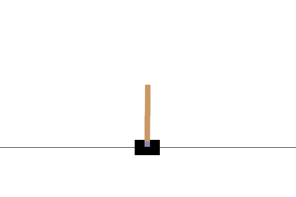
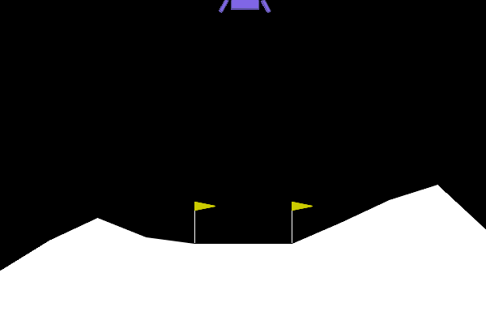
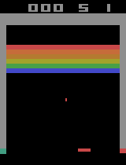

# MuZero General

[](requirements.txt)
[](LICENSE)

An educational and commented implementation of [MuZero](https://arxiv.org/abs/1911.08265), based on DeepMind's 2019 paper and [original pseudocode](https://arxiv.org/src/1911.08265v2/anc/pseudocode.py), built with PyTorch and Ray.

MuZero builds on [AlphaZero](https://arxiv.org/abs/1712.01815) by learning the dynamics used for planning from experience. Its network represents observations as a latent state, predicts how actions change that state, and estimates rewards, values and policies. Monte Carlo tree search (MCTS) uses these predictions to choose actions.

For an introduction, watch the [MuZero explanatory video](https://youtu.be/We20YSAJZSE) or read [How MuZero works](https://github.com/werner-duvaud/muzero-general/wiki/How-MuZero-works) and the [project wiki](https://github.com/werner-duvaud/muzero-general/wiki/MuZero-Documentation).

The implementation supports fully connected and residual networks, parallel self-play, prioritized replay, reanalysis, and single-player or two-player turn-based games with discrete actions.

To adapt it to a new environment, add a [game file](games) containing its configuration and `Game` adapter. See [CartPole](games/cartpole.py) for an example and [Add an environment](#add-an-environment) for the interface.

## Trained examples

| [CartPole](games/cartpole.py) | [Lunar Lander](games/lunarlander.py) | [Breakout](games/breakout.py) |
| :---: | :---: | :---: |
|  |  |  |
| [Learning curve](checkpoints/cartpole/training.png) · [Checkpoint](checkpoints/cartpole/model.checkpoint) | [Learning curve](checkpoints/lunarlander/training.png) · [Checkpoint](checkpoints/lunarlander/model.checkpoint) | [Learning curve](checkpoints/breakout/training.png) · [Checkpoint](checkpoints/breakout/model.checkpoint) |

## Quick start

### Install

Use Python 3.12 or later. The included checkpoints were trained on Linux with Python 3.12.

```bash
git clone https://github.com/werner-duvaud/muzero-general.git
cd muzero-general
python3 -m venv .venv
source .venv/bin/activate
python -m pip install -r requirements.txt
```

See the official [PyTorch installation guide](https://docs.pytorch.org/get-started/locally/) for GPU setup and [Gymnasium Box2D instructions](https://gymnasium.farama.org/environments/box2d/) for Lunar Lander build dependencies. MCTS tree visualization also needs the system [Graphviz executable](https://graphviz.readthedocs.io/en/stable/manual.html#installation), in addition to its Python package.

### Train

Choose an environment:

```bash
python muzero.py cartpole
python muzero.py lunarlander
python muzero.py breakout
```

Each command starts a fresh model using that game's default config, runs the configured training budget, then evaluates the selected checkpoint. The defaults use CPU training for CartPole and Lunar Lander, and a GPU for Breakout when CUDA is available. Use `--cpu` to force CPU execution.

From Python:

```python
from muzero import MuZero

agent = MuZero("cartpole")
agent.train()
```

### Evaluate a checkpoint

```bash
python muzero.py cartpole --evaluate
python muzero.py lunarlander --evaluate
python muzero.py breakout --evaluate
```

These commands load `checkpoints/<env>/model.checkpoint` and evaluate it on CPU, without training or rendering. The default is 100 episodes. Checkpoints contain their saved configuration; no JSON sidecar is needed.

### Monitor and render

Run TensorBoard in another terminal:

```bash
tensorboard --logdir ./results
```

For interactive rendering, human play, model diagnostics or hyperparameter search, open the menu:

```bash
python muzero.py
```

Run `python muzero.py --help` for all command-line options.

## Configuration and saved runs

Each [game file](games) contains a complete, commented `MuZeroConfig`. All games share the same parameter names; values are tuned per environment. Edit the Python config to change the default recipe. [config.py](config.py) provides shared validation and temperature-schedule helpers.

You can also override fields for one run:

```bash
python muzero.py cartpole --config '{"num_workers": 4}' --output results/cartpole/example
```

`--config` accepts a JSON object or a JSON file. `--seed` changes the training seed; evaluation seeds are configured separately.

By default, runs are saved under `results/<env>/<timestamp>/`:

| File | Contents |
| --- | --- |
| `model.checkpoint` | Latest saved training state, including weights and optimizer state |
| `model-best.checkpoint` | Best validation checkpoint, when validation is enabled |
| `replay_buffer.pkl` | Collected games for resuming training |
| `config.json`, `run.json` | Effective configuration and runtime/source metadata |
| `validation.json`, `evaluation.json` | Validation history and final evaluation results |

TensorBoard event files are saved in the same directory. With `checkpoint_selection="best"`, the final evaluation uses the best validation checkpoint, which may precede the last gradient update.

Replay snapshots can be many gigabytes for image-based environments.

To evaluate your own run or resume interrupted training, replace `RUN` with its directory name:

```bash
python muzero.py cartpole --evaluate --checkpoint results/cartpole/RUN/model-best.checkpoint

python muzero.py cartpole --checkpoint results/cartpole/RUN/model.checkpoint --replay-buffer results/cartpole/RUN/replay_buffer.pkl
```

Resume with both the checkpoint and replay buffer to retain collected experience. To train beyond the saved budget, increase `training_steps` through `--config`.

## Other environments

Additional adapters are available for:

- [MiniGrid](games/gridworld.py) (`gridworld`) and [a simple grid world](games/simple_grid.py) (`simple_grid`).
- [Tic-tac-toe](games/tictactoe.py), [Connect4](games/connect4.py) and [Gomoku](games/gomoku.py).
- [Twenty-One](games/twentyone.py) (`twentyone`), a simplified card game.
- [OpenSpiel](games/spiel.py) (`spiel`), configured for tic-tac-toe by default. The adapter supports deterministic games with one player or two alternating players and 1D–3D observation tensors. Chance-based games such as backgammon and simultaneous-action games are unsupported.
- [An Atari template](games/atari.py) (`atari`), configured for Breakout by default. Use `breakout` for the tuned recipe and packaged checkpoint shown above.

Only CartPole, Lunar Lander and Breakout currently include packaged checkpoints.

## Add an environment

1. Copy [games/cartpole.py](games/cartpole.py) to `games/my_game.py`, keeping the common config fields.
2. Set the observation shape, action/player lists, network and training parameters. Observations must have shape `(channels, height, width)`; reshape a vector of length `n` to `(1, 1, n)`.
3. Implement `Game` using [AbstractGame](games/abstract_game.py): initialization, `reset()`, `step(action)`, `legal_actions()` and `render()`. `step()` returns `(observation, reward, done)`. Implement `to_play()` for multiplayer games and `close()` to release resources.
4. Run `python muzero.py my_game`.

Actions and players use consecutive IDs starting at zero. Wrap Gymnasium's `terminated` and `truncated` flags into `done`. Trajectory indexing and training-target alignment are documented in [game_history.py](game_history.py).

## Code guide

| File | Role |
| --- | --- |
| [muzero.py](muzero.py) | CLI, worker orchestration, training and checkpoint loading |
| [self_play.py](self_play.py) | MCTS, action selection and self-play |
| [models.py](models.py) | Fully connected and residual networks |
| [trainer.py](trainer.py) | Losses, recurrent unrolling and optimizer updates |
| [replay_buffer.py](replay_buffer.py) | Replay sampling, eviction and reanalysis |
| [game_history.py](game_history.py) | Trajectories, observation stacks and training targets |
| [evaluation.py](evaluation.py) | Validation, checkpoint selection and evaluation reports |
| [random_bootstrap.py](random_bootstrap.py) | Random-episode collection and replay initialization |
| [diagnose_model.py](diagnose_model.py) | Compare learned dynamics with real environment transitions |

Format code with [Ruff](https://docs.astral.sh/ruff/): `ruff format --target-version py312 .`

## Further reading

- [MuZero paper](https://arxiv.org/abs/1911.08265) and [original pseudocode](https://arxiv.org/src/1911.08265v2/anc/pseudocode.py).
- [Project wiki](https://github.com/werner-duvaud/muzero-general/wiki/MuZero-Documentation) and [explanatory video](https://youtu.be/We20YSAJZSE).
- [Network diagram](docs/muzero-network-werner-duvaud.png).
- [EfficientZero](https://arxiv.org/abs/2111.00210) and [Sampled MuZero](https://arxiv.org/abs/2104.06303).

## Authors and citation

Werner Duvaud, Aurèle Hainaut, Paul Lenoir, and [contributors](https://github.com/werner-duvaud/muzero-general/graphs/contributors). Released under the [MIT license](LICENSE).

```bibtex
@misc{muzero-general,
  author       = {Werner Duvaud, Aurèle Hainaut},
  title        = {MuZero General: Open Reimplementation of MuZero},
  year         = {2019},
  publisher    = {GitHub},
  url          = {https://github.com/werner-duvaud/muzero-general},
}
```
