# Main Orchestrator Module

## Overview

The **main_orchestrator** module serves as the central coordination hub for the MuZero reinforcement learning system. It orchestrates all major components including neural networks, self-play workers, training processes, replay buffer management, and shared storage. The module provides the primary interface for training, testing, and managing MuZero agents across various game environments.

**Core Components:**
- `knowledge.muzero.MuZero` - Main orchestration class managing the entire MuZero training pipeline
- `knowledge.muzero.CPUActor` - Ray remote actor for initializing model weights on CPU

---

## Table of Contents

1. [Architecture Overview](#architecture-overview)
2. [Core Components](#core-components)
3. [System Integration](#system-integration)
4. [Training Pipeline](#training-pipeline)
5. [Worker Management](#worker-management)
6. [Model Operations](#model-operations)
7. [Hyperparameter Search](#hyperparameter-search)
8. [Data Flow](#data-flow)
9. [Usage Examples](#usage-examples)

---

## Architecture Overview

The main_orchestrator module implements a distributed architecture using Ray for parallel processing. It coordinates multiple worker types that operate concurrently to enable efficient training of MuZero agents.

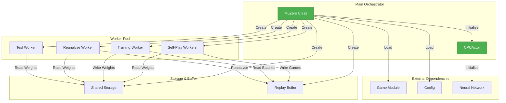

### Key Architectural Principles

1. **Distributed Processing**: Leverages Ray for parallel execution across multiple CPUs/GPUs
2. **Asynchronous Workers**: Self-play, training, and reanalysis run concurrently
3. **Centralized Coordination**: MuZero class manages all worker lifecycles
4. **Flexible Resource Management**: Dynamic GPU allocation based on configuration
5. **Modular Design**: Clean separation between orchestration and worker logic

---

## Core Components

### MuZero Class

The `MuZero` class is the primary orchestrator that manages the entire training and testing pipeline.

#### Initialization

```python
class MuZero:
    def __init__(self, game_name, config=None, split_resources_in=1):
        """
        Main class to manage MuZero.
        
        Args:
            game_name (str): Name of the game module in "./games" directory
            config (dict, MuZeroConfig, optional): Override default game config
            split_resources_in (int, optional): Split GPU usage for concurrent instances
        """
```

**Initialization Process:**

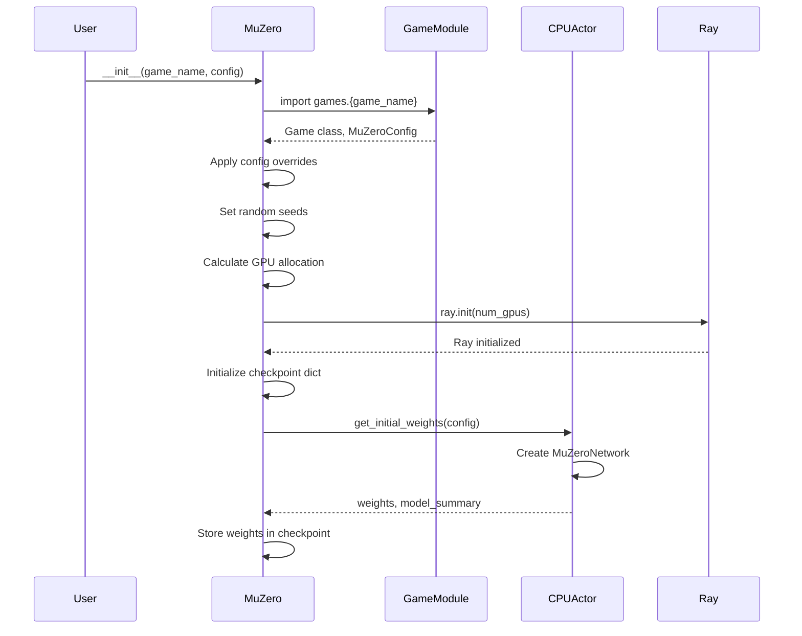

#### Key Attributes

| Attribute | Type | Description |
|-----------|------|-------------|
| `Game` | class | Game environment class loaded from module |
| `config` | MuZeroConfig | Configuration object with all hyperparameters |
| `checkpoint` | dict | Contains model weights, optimizer state, and metrics |
| `replay_buffer` | dict | Stores game histories for training |
| `num_gpus` | float | Number of GPUs allocated to this instance |
| `self_play_workers` | list | Ray actors for self-play game generation |
| `training_worker` | Trainer | Ray actor for neural network training |
| `reanalyse_worker` | Reanalyse | Ray actor for game reanalysis |
| `test_worker` | SelfPlay | Ray actor for testing performance |
| `shared_storage_worker` | SharedStorage | Ray actor for weight sharing |
| `replay_buffer_worker` | ReplayBuffer | Ray actor for buffer management |

#### Checkpoint Structure

The checkpoint dictionary maintains the complete training state:

```python
checkpoint = {
    "weights": None,                    # Neural network weights
    "optimizer_state": None,            # Optimizer state for resuming training
    "total_reward": 0,                  # Average total reward
    "muzero_reward": 0,                 # MuZero player reward
    "opponent_reward": 0,               # Opponent player reward
    "episode_length": 0,                # Average episode length
    "mean_value": 0,                    # Mean predicted value
    "training_step": 0,                 # Current training iteration
    "lr": 0,                            # Current learning rate
    "total_loss": 0,                    # Combined loss
    "value_loss": 0,                    # Value prediction loss
    "reward_loss": 0,                   # Reward prediction loss
    "policy_loss": 0,                   # Policy prediction loss
    "num_played_games": 0,              # Total games played
    "num_played_steps": 0,              # Total steps taken
    "num_reanalysed_games": 0,          # Games reanalysed
    "terminate": False,                 # Termination flag
}
```

### CPUActor Class

A Ray remote actor that forces model initialization on CPU, ensuring weights can be retrieved on CPU even when GPUs are available.

```python
@ray.remote(num_cpus=0, num_gpus=0)
class CPUActor:
    def get_initial_weights(self, config):
        """
        Initialize neural network and return weights.
        
        Returns:
            tuple: (weights, model_summary_string)
        """
        model = models.MuZeroNetwork(config)
        weights = model.get_weights()
        summary = str(model).replace("\n", " \n\n")
        return weights, summary
```

**Purpose**: Prevents GPU memory allocation issues when initializing multiple MuZero instances by ensuring initial weights are always on CPU.

---

## System Integration

The main_orchestrator integrates with all other modules in the MuZero system:

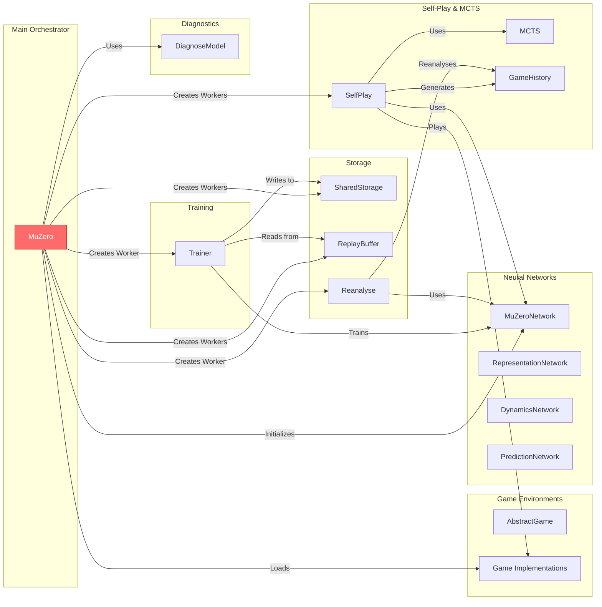

### Module Dependencies

| Module | Components Used | Purpose |
|--------|----------------|---------|
| [neural_networks](neural_networks.md) | MuZeroNetwork, RepresentationNetwork, DynamicsNetwork, PredictionNetwork | Model initialization and inference |
| [self_play_mcts](self_play_mcts.md) | SelfPlay, MCTS, GameHistory | Generate training data through self-play |
| [trainer](trainer.md) | Trainer | Train neural networks on replay buffer data |
| [replay_buffer](replay_buffer.md) | ReplayBuffer, Reanalyse | Store and sample game histories |
| [shared_storage](shared_storage.md) | SharedStorage | Share model weights across workers |
| [game_environments](game_environments.md) | AbstractGame, Game implementations | Provide game logic and rules |
| [diagnostics](diagnostics.md) | DiagnoseModel | Model debugging and analysis |

---

## Training Pipeline

The training pipeline orchestrates multiple concurrent processes to efficiently train MuZero agents.

### Training Workflow

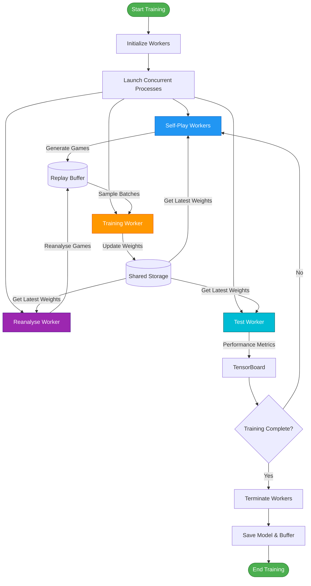

### Training Method

```python
def train(self, log_in_tensorboard=True):
    """
    Spawn ray workers and launch the training.
    
    Args:
        log_in_tensorboard (bool): Start testing worker and log performance
    """
```

**Training Process Steps:**

1. **Setup Phase**
   - Create results directory if needed
   - Calculate GPU allocation per worker
   - Initialize checkpoint and replay buffer

2. **Worker Initialization**
   - Create training worker (Trainer)
   - Create shared storage worker (SharedStorage)
   - Create replay buffer worker (ReplayBuffer)
   - Create reanalyse worker (Reanalyse) if enabled
   - Create self-play workers (SelfPlay × num_workers)

3. **Launch Phase**
   - Start continuous self-play on all self-play workers
   - Start continuous weight updates on training worker
   - Start reanalysis if enabled
   - Start logging loop if TensorBoard enabled

4. **Monitoring Phase**
   - Test worker evaluates performance periodically
   - Metrics logged to TensorBoard
   - Training continues until target steps reached

### GPU Resource Management

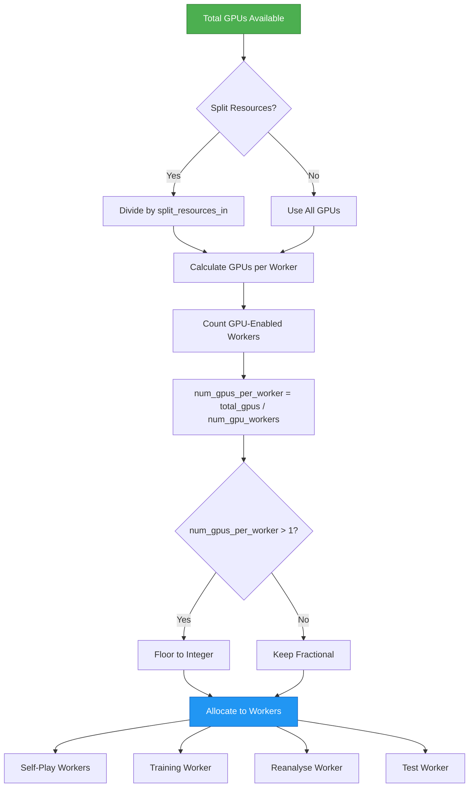

**GPU Allocation Logic:**

```python
# Calculate total GPUs
total_gpus = config.max_num_gpus if config.max_num_gpus else torch.cuda.device_count()
num_gpus = total_gpus / split_resources_in

# Calculate workers needing GPUs
num_gpu_workers = (
    config.train_on_gpu +
    config.num_workers * config.selfplay_on_gpu +
    log_in_tensorboard * config.selfplay_on_gpu +
    config.use_last_model_value * config.reanalyse_on_gpu
)

# Allocate GPUs per worker
num_gpus_per_worker = num_gpus / num_gpu_workers
if num_gpus_per_worker > 1:
    num_gpus_per_worker = math.floor(num_gpus_per_worker)
```

### Logging Loop

The logging loop monitors training progress and writes metrics to TensorBoard:

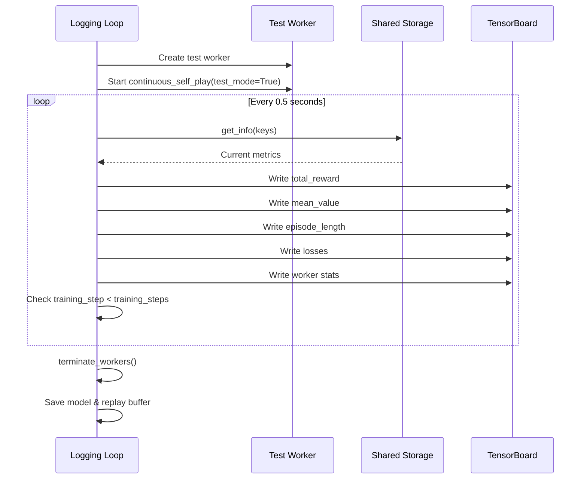

**Logged Metrics:**

| Category | Metrics |
|----------|---------|
| **Rewards** | Total reward, MuZero reward, Opponent reward, Mean value, Episode length |
| **Workers** | Self-played games, Training steps, Self-played steps, Reanalysed games, Training ratio |
| **Training** | Learning rate |
| **Losses** | Total weighted loss, Value loss, Reward loss, Policy loss |

---

## Worker Management

The orchestrator manages multiple types of workers, each with specific responsibilities.

### Worker Types and Responsibilities

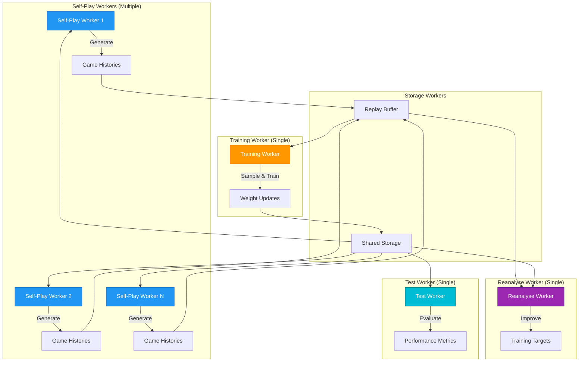

### Worker Initialization Pattern

```python
# Training Worker
self.training_worker = trainer.Trainer.options(
    num_cpus=0,
    num_gpus=num_gpus_per_worker if config.train_on_gpu else 0,
).remote(checkpoint, config)

# Shared Storage Worker
self.shared_storage_worker = shared_storage.SharedStorage.remote(
    checkpoint, config
)

# Replay Buffer Worker
self.replay_buffer_worker = replay_buffer.ReplayBuffer.remote(
    checkpoint, replay_buffer, config
)

# Reanalyse Worker (conditional)
if config.use_last_model_value:
    self.reanalyse_worker = replay_buffer.Reanalyse.options(
        num_cpus=0,
        num_gpus=num_gpus_per_worker if config.reanalyse_on_gpu else 0,
    ).remote(checkpoint, config)

# Self-Play Workers (multiple)
self.self_play_workers = [
    self_play.SelfPlay.options(
        num_cpus=0,
        num_gpus=num_gpus_per_worker if config.selfplay_on_gpu else 0,
    ).remote(checkpoint, Game, config, config.seed + seed)
    for seed in range(config.num_workers)
]
```

### Worker Launch Pattern

```python
# Launch self-play workers
[
    self_play_worker.continuous_self_play.remote(
        shared_storage_worker, replay_buffer_worker
    )
    for self_play_worker in self.self_play_workers
]

# Launch training worker
self.training_worker.continuous_update_weights.remote(
    replay_buffer_worker, shared_storage_worker
)

# Launch reanalyse worker (if enabled)
if config.use_last_model_value:
    self.reanalyse_worker.reanalyse.remote(
        replay_buffer_worker, shared_storage_worker
    )
```

### Worker Termination

```python
def terminate_workers(self):
    """
    Softly terminate running tasks and garbage collect workers.
    """
    # Signal termination
    if self.shared_storage_worker:
        self.shared_storage_worker.set_info.remote("terminate", True)
        self.checkpoint = ray.get(
            self.shared_storage_worker.get_checkpoint.remote()
        )
    
    # Retrieve replay buffer
    if self.replay_buffer_worker:
        self.replay_buffer = ray.get(
            self.replay_buffer_worker.get_buffer.remote()
        )
    
    # Clear worker references (triggers garbage collection)
    self.self_play_workers = None
    self.test_worker = None
    self.training_worker = None
    self.reanalyse_worker = None
    self.replay_buffer_worker = None
    self.shared_storage_worker = None
```

**Termination Process:**

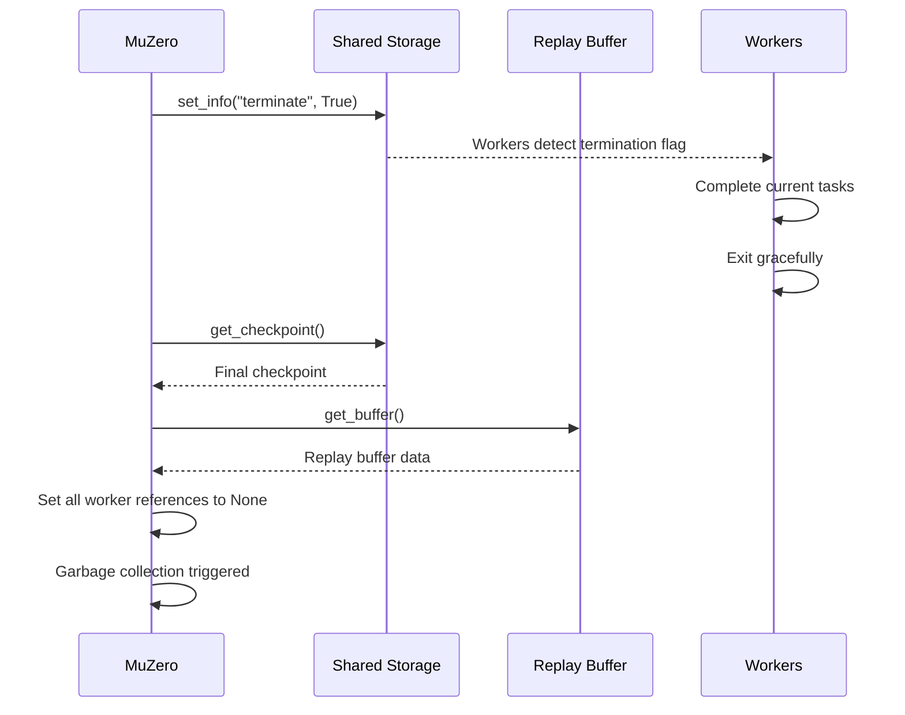

---

## Model Operations

The orchestrator provides several methods for model management and evaluation.

### Testing

```python
def test(self, render=True, opponent=None, muzero_player=None, 
         num_tests=1, num_gpus=0):
    """
    Test the model in a dedicated thread.
    
    Args:
        render (bool): Display environment
        opponent (str): "self", "human", or "random"
        muzero_player (int): Player number for MuZero
        num_tests (int): Number of games to average
        num_gpus (int): Number of GPUs to use
        
    Returns:
        float: Average reward across test games
    """
```

**Testing Workflow:**

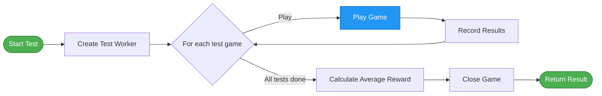

**Opponent Types:**

| Opponent | Description |
|----------|-------------|
| `"self"` | MuZero plays against itself |
| `"human"` | Human player via keyboard/mouse input |
| `"random"` | Random action selection |
| `None` | Uses opponent from config |

### Model Loading

```python
def load_model(self, checkpoint_path=None, replay_buffer_path=None):
    """
    Load a model and/or saved replay buffer.
    
    Args:
        checkpoint_path (str): Path to model.checkpoint or model.weights
        replay_buffer_path (str): Path to replay_buffer.pkl
    """
```

**Loading Process:**

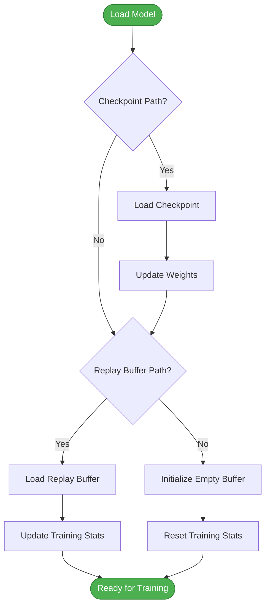

**Loaded Data:**

From checkpoint:
- Neural network weights
- Optimizer state
- Training metrics
- Training step counter

From replay buffer:
- Game histories
- Number of played games
- Number of played steps
- Number of reanalysed games

### Model Diagnosis

```python
def diagnose_model(self, horizon):
    """
    Play a game with learned model then compare with real environment.
    
    Args:
        horizon (int): Number of timesteps to collect information
    """
```

This method uses the [diagnostics](diagnostics.md) module to compare model predictions with actual environment dynamics. See the diagnostics documentation for detailed information.

---

## Hyperparameter Search

The orchestrator includes functionality for automated hyperparameter optimization using Nevergrad.

### Hyperparameter Search Function

```python
def hyperparameter_search(game_name, parametrization, budget, 
                         parallel_experiments, num_tests):
    """
    Search for hyperparameters by launching parallel experiments.
    
    Args:
        game_name (str): Name of game module
        parametrization: Nevergrad parametrization
        budget (int): Total number of experiments
        parallel_experiments (int): Number of parallel experiments
        num_tests (int): Number of games to average per evaluation
    
    Returns:
        dict: Best hyperparameters found
    """
```

### Search Workflow

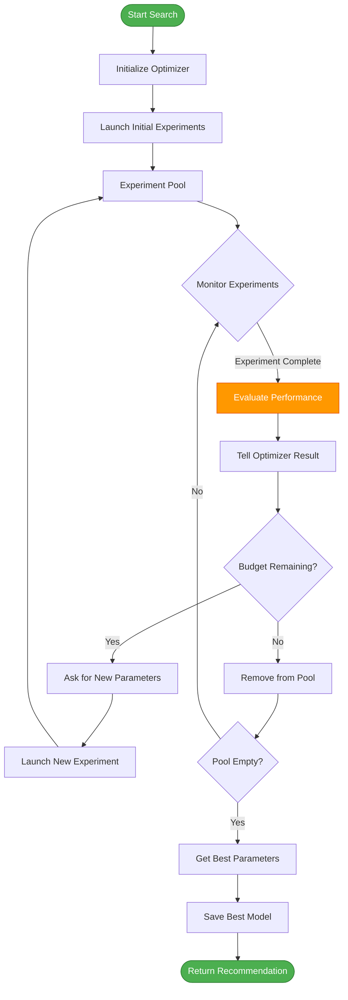

### Search Process Details

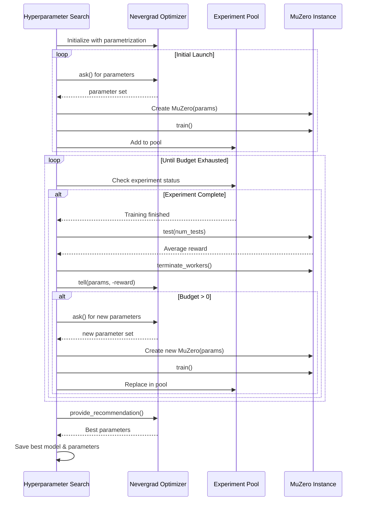

### Example Usage

```python
# Define parameter search space
import nevergrad

lr_init = nevergrad.p.Log(lower=0.0001, upper=0.1)
discount = nevergrad.p.Log(lower=0.95, upper=0.9999)
parametrization = nevergrad.p.Dict(
    lr_init=lr_init,
    discount=discount
)

# Run search
best_params = hyperparameter_search(
    game_name="cartpole",
    parametrization=parametrization,
    budget=20,
    parallel_experiments=2,
    num_tests=20
)

# Use best parameters
muzero = MuZero("cartpole", best_params)
muzero.train()
```

---

## Data Flow

Understanding data flow is crucial for comprehending how the orchestrator coordinates all components.

### Complete Training Data Flow

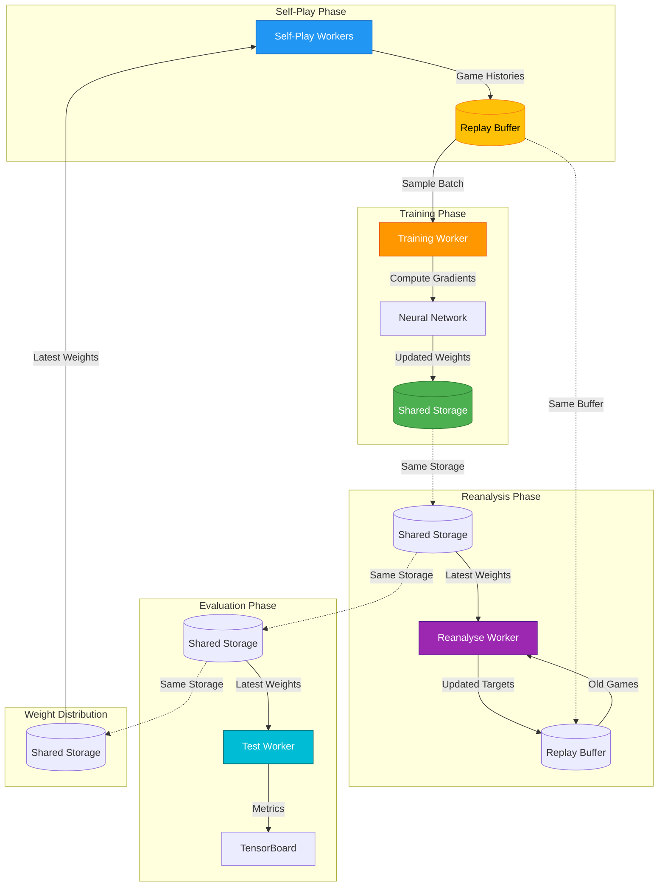

### Checkpoint Data Flow

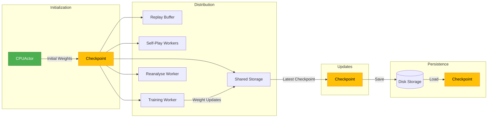

### Information Flow During Training Step

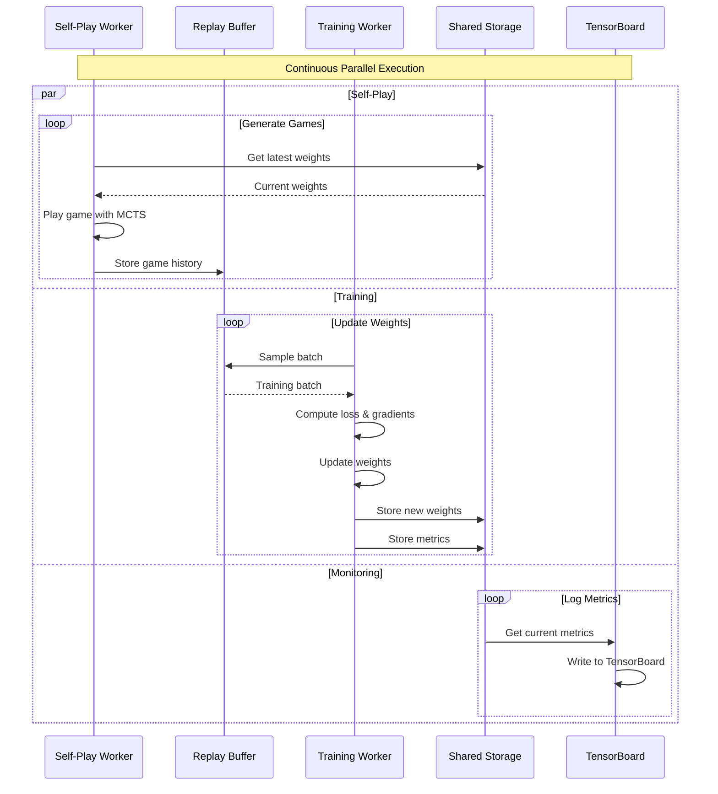

---

## Usage Examples

### Basic Training

```python
# Simple training with default configuration
muzero = MuZero("cartpole")
muzero.train()
```

### Training with Custom Configuration

```python
# Override specific configuration parameters
config = {
    "lr_init": 0.01,
    "discount": 0.99,
    "num_workers": 4,
    "training_steps": 100000,
    "batch_size": 128
}

muzero = MuZero("cartpole", config)
muzero.train()
```

### Training with Loaded Model

```python
# Initialize MuZero
muzero = MuZero("cartpole")

# Load pretrained model and replay buffer
muzero.load_model(
    checkpoint_path="results/cartpole/model.checkpoint",
    replay_buffer_path="results/cartpole/replay_buffer.pkl"
)

# Continue training
muzero.train()
```

### Testing a Trained Model

```python
# Load model
muzero = MuZero("cartpole")
muzero.load_model(checkpoint_path="results/cartpole/model.checkpoint")

# Test with rendering
result = muzero.test(
    render=True,
    opponent="self",
    num_tests=10
)
print(f"Average reward: {result}")
```

### Playing Against MuZero

```python
# Load trained model
muzero = MuZero("connect4")
muzero.load_model(checkpoint_path="results/connect4/model.checkpoint")

# Play as human against MuZero
muzero.test(
    render=True,
    opponent="human",
    muzero_player=0,
    num_tests=1
)
```

### Model Diagnosis

```python
# Load model
muzero = MuZero("cartpole")
muzero.load_model(checkpoint_path="results/cartpole/model.checkpoint")

# Diagnose model predictions vs reality
muzero.diagnose_model(horizon=30)
```

### Hyperparameter Optimization

```python
import nevergrad

# Define search space
lr_init = nevergrad.p.Log(lower=0.0001, upper=0.1)
discount = nevergrad.p.Log(lower=0.95, upper=0.9999)
batch_size = nevergrad.p.Choice([64, 128, 256, 512])

parametrization = nevergrad.p.Dict(
    lr_init=lr_init,
    discount=discount,
    batch_size=batch_size
)

# Run hyperparameter search
best_params = hyperparameter_search(
    game_name="cartpole",
    parametrization=parametrization,
    budget=50,
    parallel_experiments=5,
    num_tests=20
)

# Train with best parameters
muzero = MuZero("cartpole", best_params)
muzero.train()
```

### Multiple Concurrent Instances

```python
# Split GPU resources between 2 MuZero instances
muzero1 = MuZero("cartpole", split_resources_in=2)
muzero2 = MuZero("breakout", split_resources_in=2)

# Train both concurrently
muzero1.train(log_in_tensorboard=True)
muzero2.train(log_in_tensorboard=True)
```

### Command Line Usage

```bash
# Train with default config
python muzero.py cartpole

# Train with custom config (JSON)
python muzero.py cartpole '{"lr_init": 0.01, "num_workers": 8}'

# Interactive mode
python muzero.py
```

### Programmatic Workflow

```python
# Complete training workflow
def train_and_evaluate(game_name, config=None):
    # Initialize
    muzero = MuZero(game_name, config)
    
    # Train
    print(f"Training {game_name}...")
    muzero.train(log_in_tensorboard=True)
    
    # Evaluate
    print(f"Evaluating {game_name}...")
    result = muzero.test(render=False, num_tests=100)
    
    # Diagnose
    print(f"Diagnosing {game_name}...")
    muzero.diagnose_model(horizon=50)
    
    return result

# Run workflow
result = train_and_evaluate("cartpole", {"training_steps": 50000})
print(f"Final average reward: {result}")
```

---

## Configuration Management

The orchestrator handles configuration in a flexible manner:

### Configuration Loading Priority

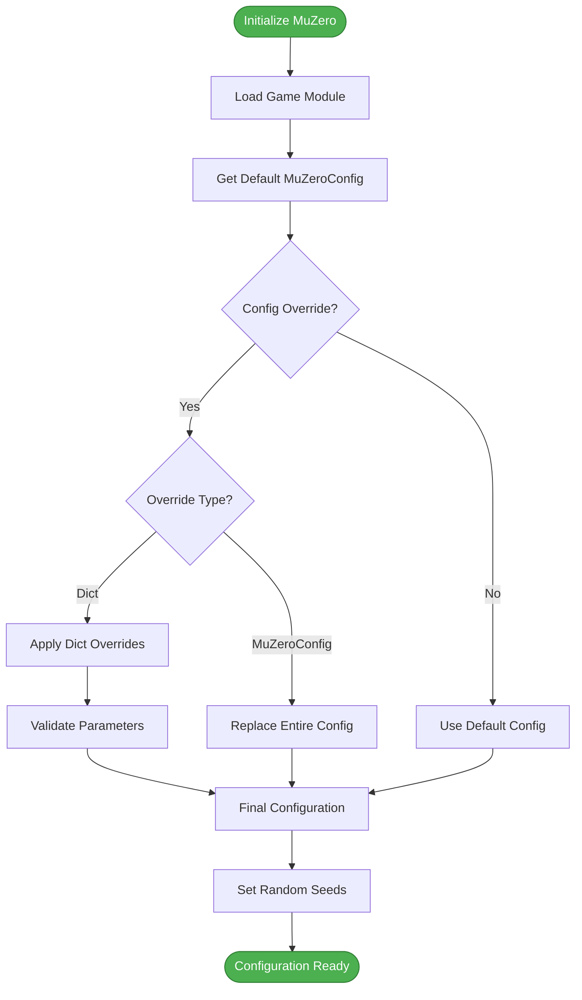

### Configuration Validation

```python
# Override with dictionary
if type(config) is dict:
    for param, value in config.items():
        if hasattr(self.config, param):
            setattr(self.config, param, value)
        else:
            raise AttributeError(
                f"{game_name} config has no attribute '{param}'. "
                "Check config file for complete list of parameters."
            )
```

### Key Configuration Parameters

| Parameter | Type | Description |
|-----------|------|-------------|
| `seed` | int | Random seed for reproducibility |
| `max_num_gpus` | int | Maximum GPUs to use |
| `selfplay_on_gpu` | bool | Run self-play on GPU |
| `train_on_gpu` | bool | Run training on GPU |
| `reanalyse_on_gpu` | bool | Run reanalysis on GPU |
| `num_workers` | int | Number of self-play workers |
| `training_steps` | int | Total training iterations |
| `use_last_model_value` | bool | Enable reanalysis |
| `save_model` | bool | Save model checkpoints |
| `results_path` | Path | Directory for results |

---

## Error Handling and Edge Cases

### GPU Configuration Validation

```python
if self.config.max_num_gpus == 0 and (
    self.config.selfplay_on_gpu
    or self.config.train_on_gpu
    or self.config.reanalyse_on_gpu
):
    raise ValueError(
        "Inconsistent MuZeroConfig: max_num_gpus = 0 but GPU requested"
    )
```

### Module Loading Error Handling

```python
try:
    game_module = importlib.import_module("games." + game_name)
    self.Game = game_module.Game
    self.config = game_module.MuZeroConfig()
except ModuleNotFoundError as err:
    print(
        f'{game_name} is not a supported game name, '
        'try "cartpole" or refer to documentation'
    )
    raise err
```

### Graceful Shutdown

```python
try:
    while info["training_step"] < self.config.training_steps:
        # Training loop
        ...
except KeyboardInterrupt:
    pass  # Allow graceful interruption

self.terminate_workers()  # Always cleanup
```

---

## Performance Considerations

### Resource Optimization

1. **GPU Memory Management**
   - CPUActor ensures initial weights on CPU
   - Fractional GPU allocation for multiple workers
   - Configurable GPU usage per worker type

2. **Parallel Processing**
   - Multiple self-play workers for data generation
   - Asynchronous training and self-play
   - Ray handles distributed execution

3. **Data Efficiency**
   - Replay buffer stores game histories
   - Reanalysis improves training targets
   - Batch sampling for training

### Scalability

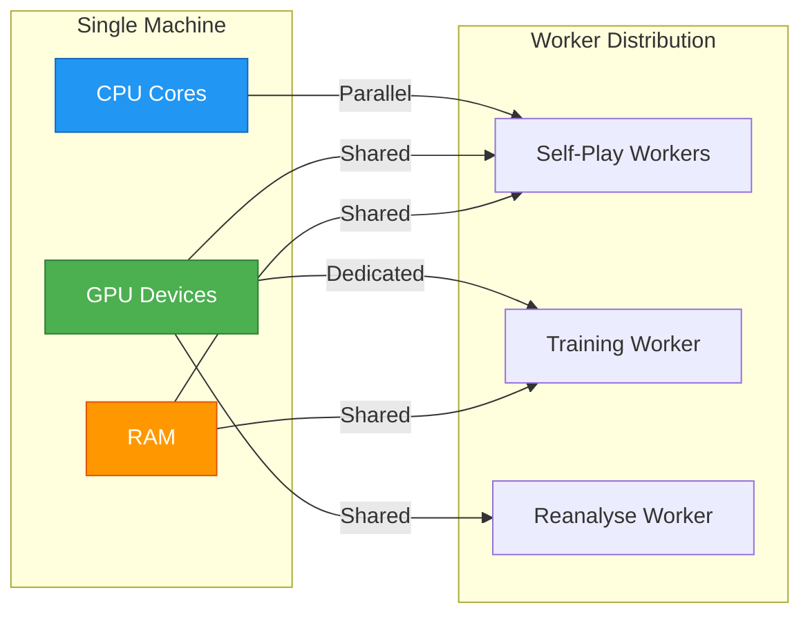

**Scaling Recommendations:**

- **More Self-Play Workers**: Increase data generation rate
- **Larger Batch Size**: Better GPU utilization during training
- **More GPUs**: Distribute workers across devices
- **Larger Replay Buffer**: More diverse training data

---

## Best Practices

### Training Workflow

1. **Start Small**: Begin with default configuration
2. **Monitor Progress**: Use TensorBoard for real-time metrics
3. **Save Frequently**: Enable `save_model` in configuration
4. **Test Regularly**: Evaluate performance during training
5. **Tune Gradually**: Adjust hyperparameters incrementally

### Resource Management

1. **GPU Allocation**: Match GPU count to worker needs
2. **Worker Count**: Balance data generation and training speed
3. **Batch Size**: Adjust based on available GPU memory
4. **Replay Buffer**: Size according to available RAM

### Debugging

1. **Use Diagnosis**: Run `diagnose_model()` to check predictions
2. **Check Logs**: Monitor TensorBoard for anomalies
3. **Test Frequently**: Validate model performance regularly
4. **Save Checkpoints**: Enable recovery from failures

### Production Deployment

1. **Load Pretrained**: Use `load_model()` for inference
2. **Disable Logging**: Set `log_in_tensorboard=False`
3. **Single Worker**: Use one self-play worker for testing
4. **CPU Inference**: Set `selfplay_on_gpu=False` if needed

---

## Related Modules

- **[neural_networks](neural_networks.md)**: Model architecture and inference
- **[self_play_mcts](self_play_mcts.md)**: Game playing and tree search
- **[trainer](trainer.md)**: Neural network training logic
- **[replay_buffer](replay_buffer.md)**: Experience storage and sampling
- **[shared_storage](shared_storage.md)**: Weight synchronization
- **[game_environments](game_environments.md)**: Game implementations
- **[diagnostics](diagnostics.md)**: Model analysis and debugging

---

## Summary

The **main_orchestrator** module is the central coordination hub of the MuZero system. It:

1. **Initializes** all components and workers
2. **Coordinates** parallel training, self-play, and reanalysis
3. **Manages** GPU resources and worker lifecycles
4. **Monitors** training progress and logs metrics
5. **Provides** interfaces for training, testing, and diagnosis
6. **Supports** hyperparameter optimization
7. **Handles** model persistence and loading

The orchestrator abstracts away the complexity of distributed training, allowing users to train sophisticated reinforcement learning agents with simple API calls. Its modular design enables easy extension and customization while maintaining robust error handling and resource management.

