# Neural Networks Module

## Overview

The **neural_networks** module implements the core neural network architectures for the MuZero algorithm. It provides two main network implementations: a fully connected network for simple environments and a residual network (ResNet) for complex visual environments. These networks form the foundation of MuZero's learned model, enabling the algorithm to predict future states, rewards, and optimal policies without explicit knowledge of the environment dynamics.

The module implements the three key functions described in the MuZero paper:
- **Representation function** (h): Encodes observations into a latent state
- **Dynamics function** (g): Predicts next latent state and reward given current state and action
- **Prediction function** (f): Predicts policy and value from a latent state

---

## Architecture Overview

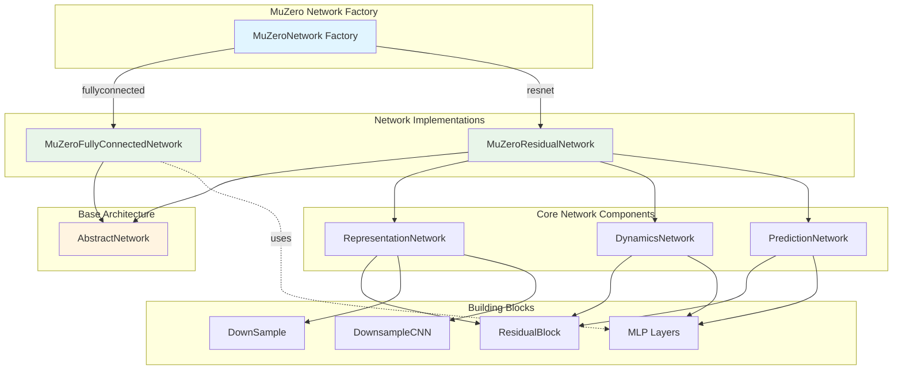

---

## Component Relationships

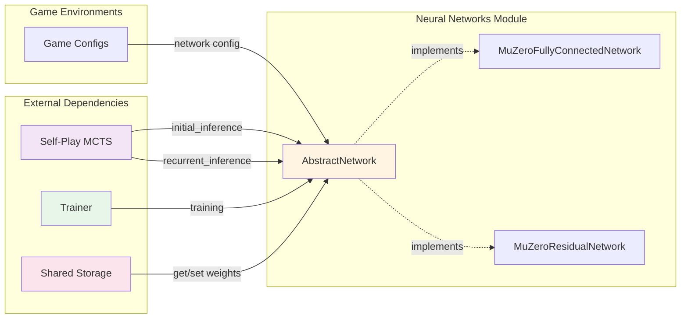

---

## Core Components

### 1. AbstractNetwork

**Purpose**: Base abstract class defining the interface for all MuZero network implementations.

**Key Responsibilities**:
- Define the contract for initial and recurrent inference
- Provide weight management (get/set weights)
- Enable CPU/GPU weight transfer for distributed training

**Key Methods**:
```python
def initial_inference(observation) -> (value, reward, policy_logits, encoded_state)
def recurrent_inference(encoded_state, action) -> (value, reward, policy_logits, next_encoded_state)
def get_weights() -> dict
def set_weights(weights: dict) -> None
```

**Integration Points**:
- Used by [self_play_mcts](self_play_mcts.md) for tree search
- Used by [trainer](trainer.md) for network optimization
- Used by [shared_storage](shared_storage.md) for weight synchronization

---

### 2. MuZeroNetwork (Factory)

**Purpose**: Factory class that instantiates the appropriate network architecture based on configuration.

**Network Selection Logic**:
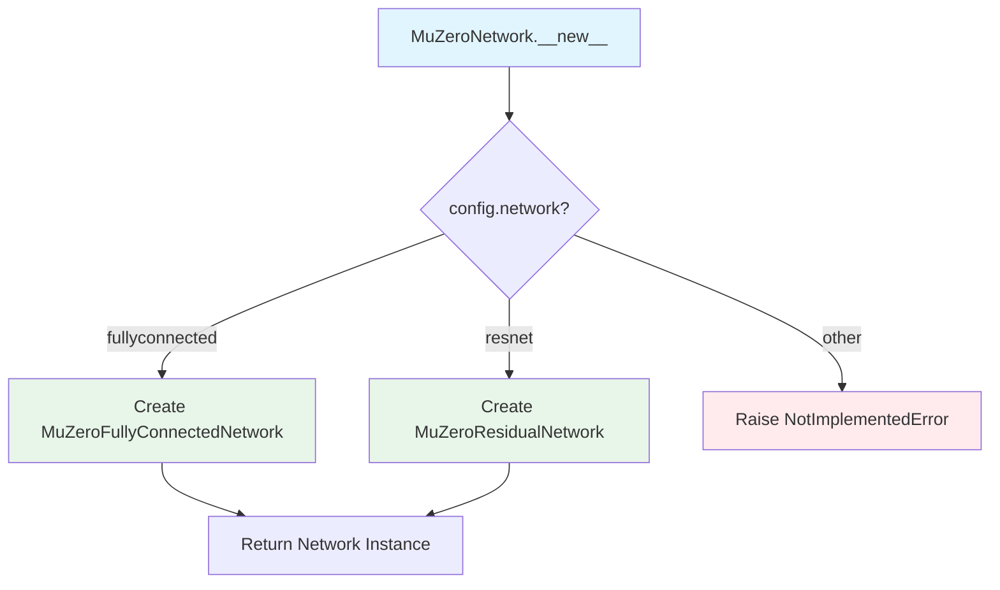

**Usage**:
```python
network = MuZeroNetwork(config)  # Returns appropriate implementation
```

---

### 3. MuZeroFullyConnectedNetwork

**Purpose**: Fully connected neural network implementation for environments with simple, low-dimensional observations.

**Architecture**:
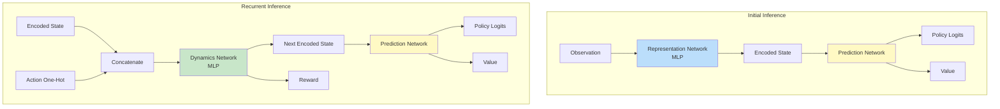

**Network Components**:
- **Representation Network**: MLP that flattens and encodes observations
- **Dynamics Network**: 
  - Encoded state network: MLP predicting next state
  - Reward network: MLP predicting reward distribution
- **Prediction Network**:
  - Policy network: MLP predicting action probabilities
  - Value network: MLP predicting value distribution

**Key Features**:
- State normalization: Scales encoded states to [0, 1] range
- Action encoding: One-hot encoding concatenated with state
- Support-based predictions: Uses categorical distributions for value/reward

**Best Used For**:
- CartPole, LunarLander, simple grid worlds
- Low-dimensional state spaces
- Fast prototyping and debugging

---

### 4. MuZeroResidualNetwork

**Purpose**: Convolutional residual network implementation for environments with high-dimensional visual observations.

**Architecture**:
```mermaid
graph TB
    subgraph "Representation Network"
        OBS[Observation<br/>Stacked Frames] --> DS{Downsample?}
        DS -->|Yes| DOWN[DownSample/DownsampleCNN]
        DS -->|No| CONV[Conv3x3 + BatchNorm]
        DOWN --> RES1[Residual Blocks]
        CONV --> RES1
        RES1 --> ES[Encoded State<br/>Normalized]
    end
    
    subgraph "Dynamics Network"
        ES2[Encoded State] --> CAT[Concatenate]
        APLANE[Action Plane] --> CAT
        CAT --> CONV2[Conv3x3 + BatchNorm]
        CONV2 --> RES2[Residual Blocks]
        RES2 --> NES[Next Encoded State]
        RES2 --> REWCONV[Conv1x1 Reward]
        REWCONV --> REWMLP[MLP]
        REWMLP --> REW[Reward Distribution]
    end
    
    subgraph "Prediction Network"
        ES3[Encoded State] --> RES3[Residual Blocks]
        RES3 --> VALCONV[Conv1x1 Value]
        RES3 --> POLCONV[Conv1x1 Policy]
        VALCONV --> VALMLP[MLP]
        POLCONV --> POLMLP[MLP]
        VALMLP --> VAL[Value Distribution]
        POLMLP --> POL[Policy Logits]
    end
    
    style DS fill:#e1f5ff
    style RES1 fill:#bbdefb
    style RES2 fill:#c8e6c9
    style RES3 fill:#fff9c4
```

**Network Components**:

#### RepresentationNetwork
- Optional downsampling (ResNet-style or CNN-style)
- Convolutional layer with batch normalization
- Stack of residual blocks
- State normalization to [0, 1]

#### DynamicsNetwork
- Action plane concatenation (normalized action value)
- Convolutional processing with residual blocks
- Separate heads for state and reward prediction
- 1x1 convolutions for dimensionality reduction

#### PredictionNetwork
- Shared residual block processing
- Separate 1x1 convolutional heads for value and policy
- MLP layers for final predictions

**Key Features**:
- **Residual connections**: Enable deep networks without vanishing gradients
- **Downsampling**: Reduces computational cost for large observations
- **Action planes**: Spatial action encoding for convolutional processing
- **Multi-head architecture**: Efficient shared feature extraction

**Best Used For**:
- Atari games, visual environments
- High-dimensional observations (images)
- Complex spatial reasoning tasks

---

### 5. Building Blocks

#### ResidualBlock

**Purpose**: Standard residual block with skip connections for deep network training.

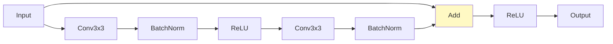

**Architecture**:
- Two 3x3 convolutional layers
- Batch normalization after each convolution
- Skip connection adding input to output
- ReLU activations

---

#### DownSample

**Purpose**: ResNet-style downsampling for reducing spatial dimensions while increasing channels.

**Architecture**:
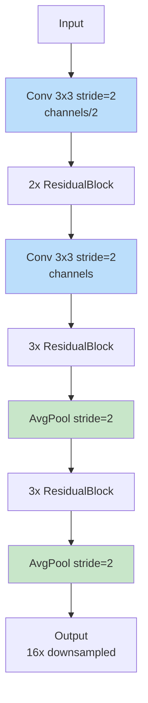

**Downsampling Strategy**:
1. Conv stride=2 → 2x residual blocks
2. Conv stride=2 → 3x residual blocks
3. AvgPool stride=2 → 3x residual blocks
4. AvgPool stride=2
5. **Total reduction**: 16x in each spatial dimension

---

#### DownsampleCNN

**Purpose**: Alternative CNN-based downsampling with adaptive pooling.

**Architecture**:
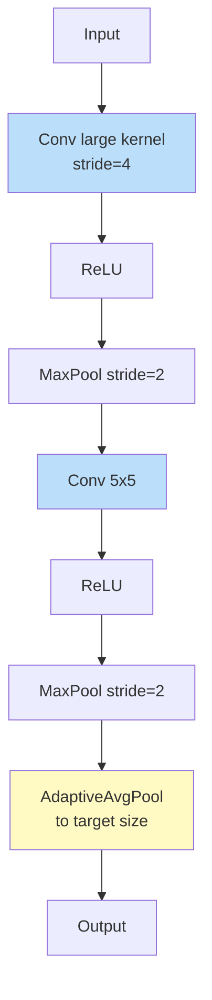

**Key Features**:
- Aggressive initial downsampling (stride=4)
- Max pooling for feature selection
- Adaptive pooling to exact target dimensions

---

## Data Flow

### Initial Inference Flow

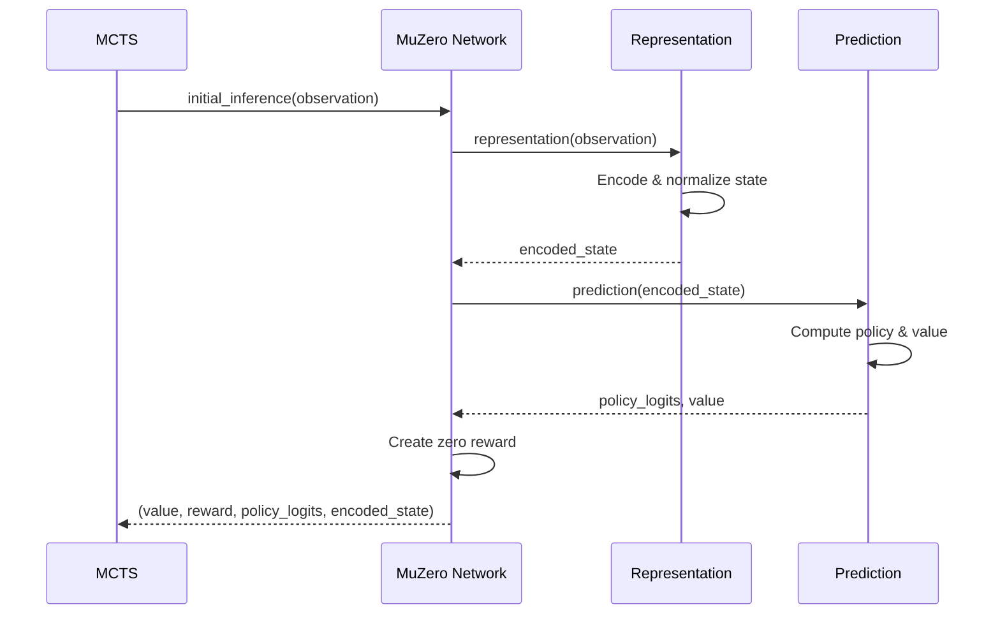

**Process**:
1. MCTS provides raw observation
2. Representation network encodes to latent state
3. State is normalized to [0, 1] range
4. Prediction network computes policy and value
5. Zero reward returned (no previous action)
6. All outputs returned for tree expansion

---

### Recurrent Inference Flow

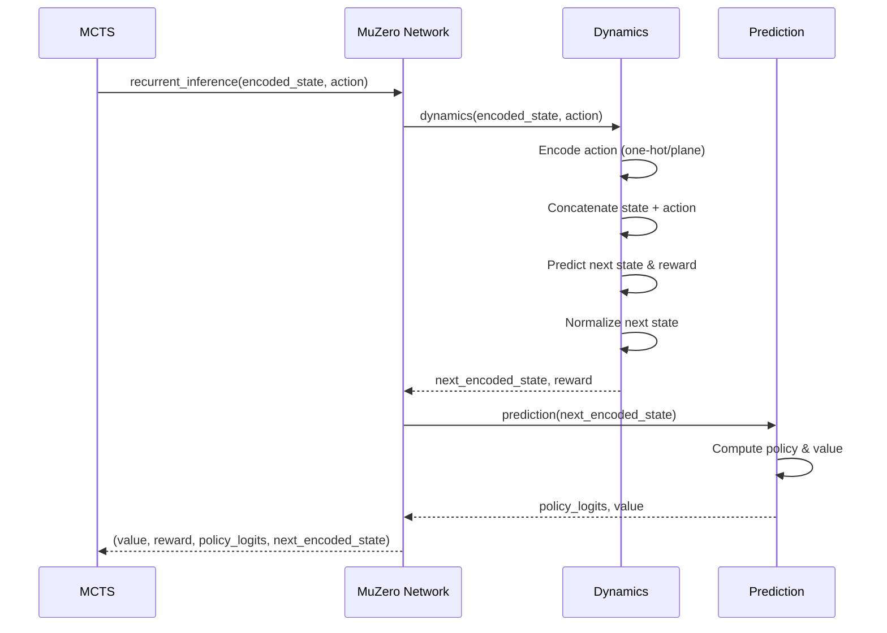

**Process**:
1. MCTS provides current latent state and action
2. Action encoded (one-hot for FC, plane for ResNet)
3. Dynamics network predicts next state and reward
4. Next state normalized to [0, 1] range
5. Prediction network computes policy and value
6. All outputs returned for tree simulation

---

## Value and Reward Encoding

### Support-Based Representation

MuZero uses categorical distributions for value and reward predictions instead of scalar regression, improving learning stability.

```mermaid
graph TB
    subgraph "Scalar to Support Encoding"
        S1[Scalar Value x] --> T1[Transform: sign * sqrt abs + ε*x]
        T1 --> C1[Clamp to support range]
        C1 --> F1[Floor to integer]
        F1 --> P1[Compute probability]
        P1 --> L1[Create logits distribution]
    end
    
    subgraph "Support to Scalar Decoding"
        L2[Logits] --> SM[Softmax]
        SM --> SP[Support * Probabilities]
        SP --> SUM[Sum weighted values]
        SUM --> IT[Inverse transform]
        IT --> S2[Scalar Value]
    end
    
    style T1 fill:#bbdefb
    style IT fill:#c8e6c9
```

**Encoding Process** (`scalar_to_support`):
1. **Transform**: Apply h(x) = sign(x) * (√(|x| + 1) - 1) + εx
   - Reduces scale of large values
   - Maintains sign information
2. **Clamp**: Limit to [-support_size, support_size]
3. **Discretize**: Distribute probability between floor and ceiling
4. **Output**: Categorical distribution over 2*support_size + 1 bins

**Decoding Process** (`support_to_scalar`):
1. **Softmax**: Convert logits to probabilities
2. **Weighted sum**: Multiply support values by probabilities
3. **Inverse transform**: Apply h⁻¹(x) = sign(x) * ((√(1 + 4ε(|x| + 1 + ε)) - 1) / 2ε)² - 1)
4. **Output**: Scalar value

**Benefits**:
- More stable gradients than regression
- Better handles multi-modal distributions
- Improved learning for sparse rewards

---

## Weight Management

### Weight Transfer Process

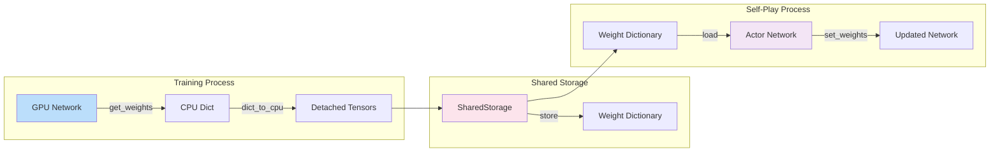

**Key Functions**:

#### `get_weights()`
- Retrieves current network state_dict
- Converts all tensors to CPU
- Recursively handles nested dictionaries
- Returns detached, CPU-resident weights

#### `set_weights(weights)`
- Loads weights into network
- Uses PyTorch's load_state_dict
- Automatically handles device placement
- Enables distributed training synchronization

#### `dict_to_cpu(dictionary)`
- Recursively processes weight dictionaries
- Moves torch.Tensor objects to CPU
- Preserves non-tensor values
- Handles nested dictionary structures

**Usage in Distributed Training**:
1. Trainer updates network on GPU
2. Periodically calls `get_weights()` to CPU
3. Stores weights in [shared_storage](shared_storage.md)
4. Self-play actors call `set_weights()` to update
5. Ensures all actors use latest network

---

## Network Configuration

### Configuration Parameters

```mermaid
graph TB
    subgraph "Common Parameters"
        OS[observation_shape]
        SO[stacked_observations]
        AS[action_space_size]
        SS[support_size]
    end
    
    subgraph "Fully Connected Config"
        ES[encoding_size]
        FCR[fc_reward_layers]
        FCV[fc_value_layers]
        FCP[fc_policy_layers]
        FCREP[fc_representation_layers]
        FCD[fc_dynamics_layers]
    end
    
    subgraph "ResNet Config"
        BL[blocks]
        CH[channels]
        RCR[reduced_channels_reward]
        RCV[reduced_channels_value]
        RCP[reduced_channels_policy]
        RFCR[resnet_fc_reward_layers]
        RFCV[resnet_fc_value_layers]
        RFCP[resnet_fc_policy_layers]
        DS[downsample]
    end
    
    OS --> ES
    OS --> CH
    AS --> FCP
    AS --> RFCP
    
    style OS fill:#e1f5ff
    style ES fill:#e8f5e9
    style CH fill:#e8f5e9
```

**Fully Connected Parameters**:
- `encoding_size`: Dimension of latent state (e.g., 32, 64)
- `fc_*_layers`: List of hidden layer sizes for each network
- Example: `fc_value_layers=[256, 256]` → 2 hidden layers of 256 units

**ResNet Parameters**:
- `blocks`: Number of residual blocks per network (e.g., 1-16)
- `channels`: Number of convolutional channels (e.g., 64, 128, 256)
- `reduced_channels_*`: Channels for 1x1 conv heads (e.g., 2, 4)
- `resnet_fc_*_layers`: MLP layers after convolutions
- `downsample`: "resnet", "CNN", or False

**Support Size**:
- Defines range of categorical distribution: [-support_size, support_size]
- Total bins: 2 * support_size + 1
- Typical values: 10-300 depending on reward scale

---

## Integration with Other Modules

### Self-Play Integration

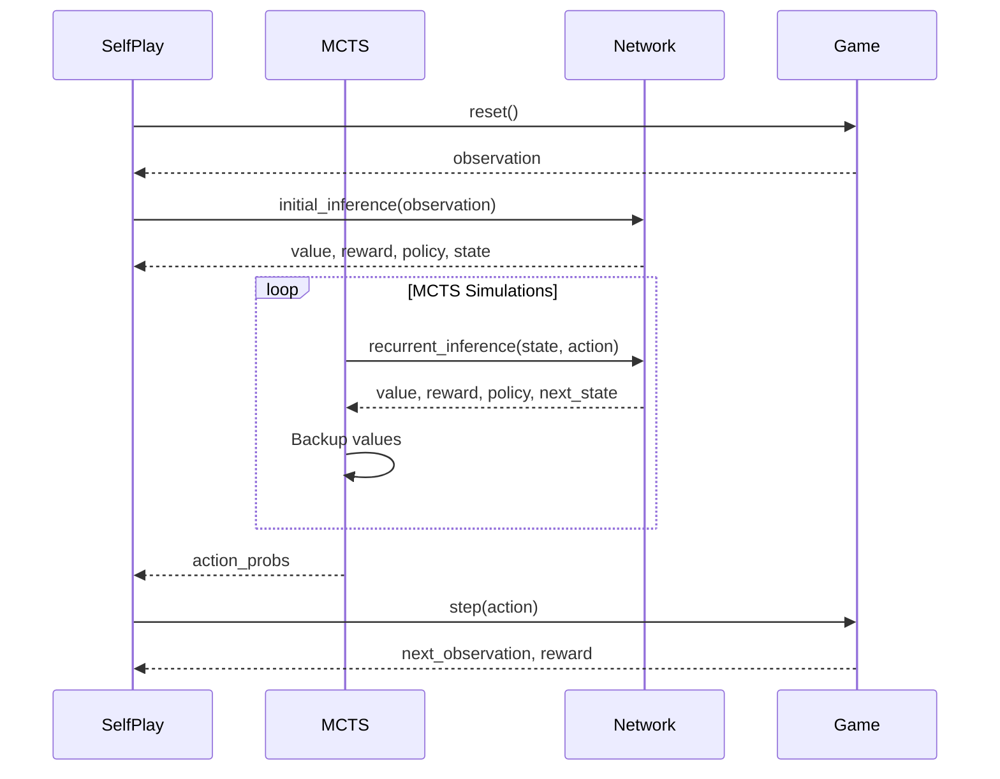

**Network Role**:
- Provides initial state encoding and predictions
- Simulates environment dynamics during tree search
- Enables planning without environment interaction
- See [self_play_mcts](self_play_mcts.md) for details

---

### Training Integration

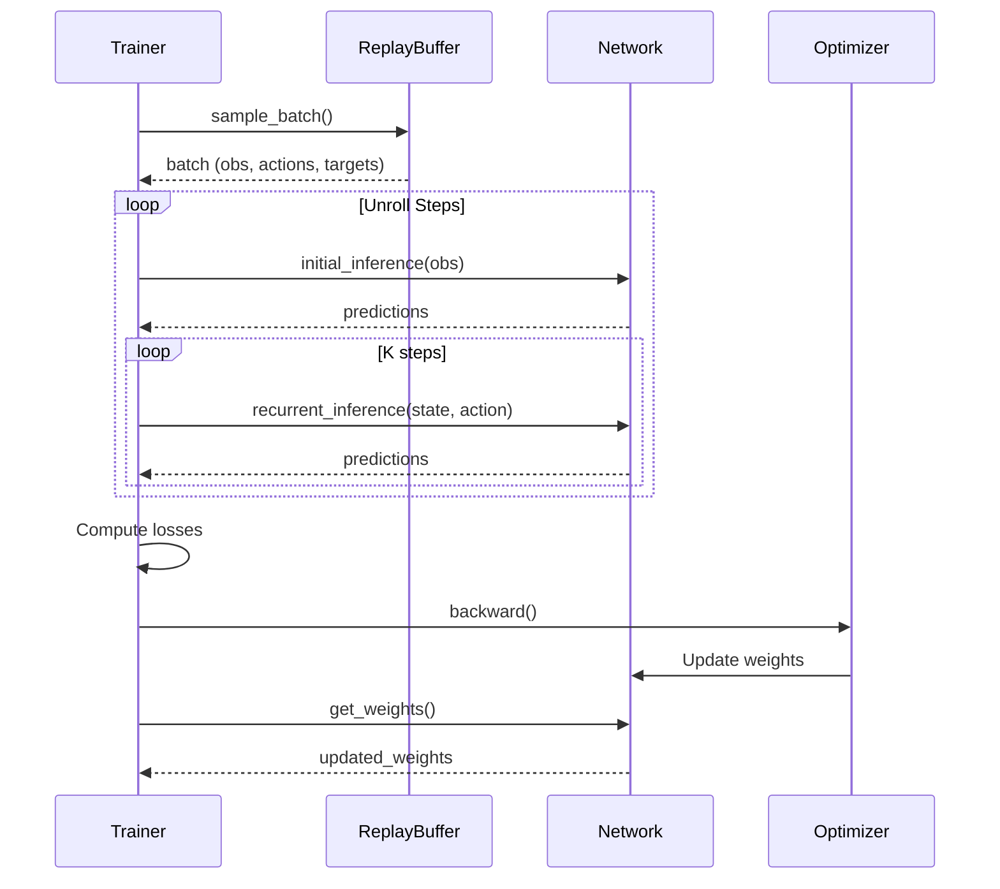

**Training Process**:
1. Sample batch from [replay_buffer](replay_buffer.md)
2. Perform initial inference on observations
3. Unroll K steps using recurrent inference
4. Compute losses (value, reward, policy)
5. Backpropagate and update weights
6. Synchronize with [shared_storage](shared_storage.md)
7. See [trainer](trainer.md) for details

---

### Shared Storage Integration

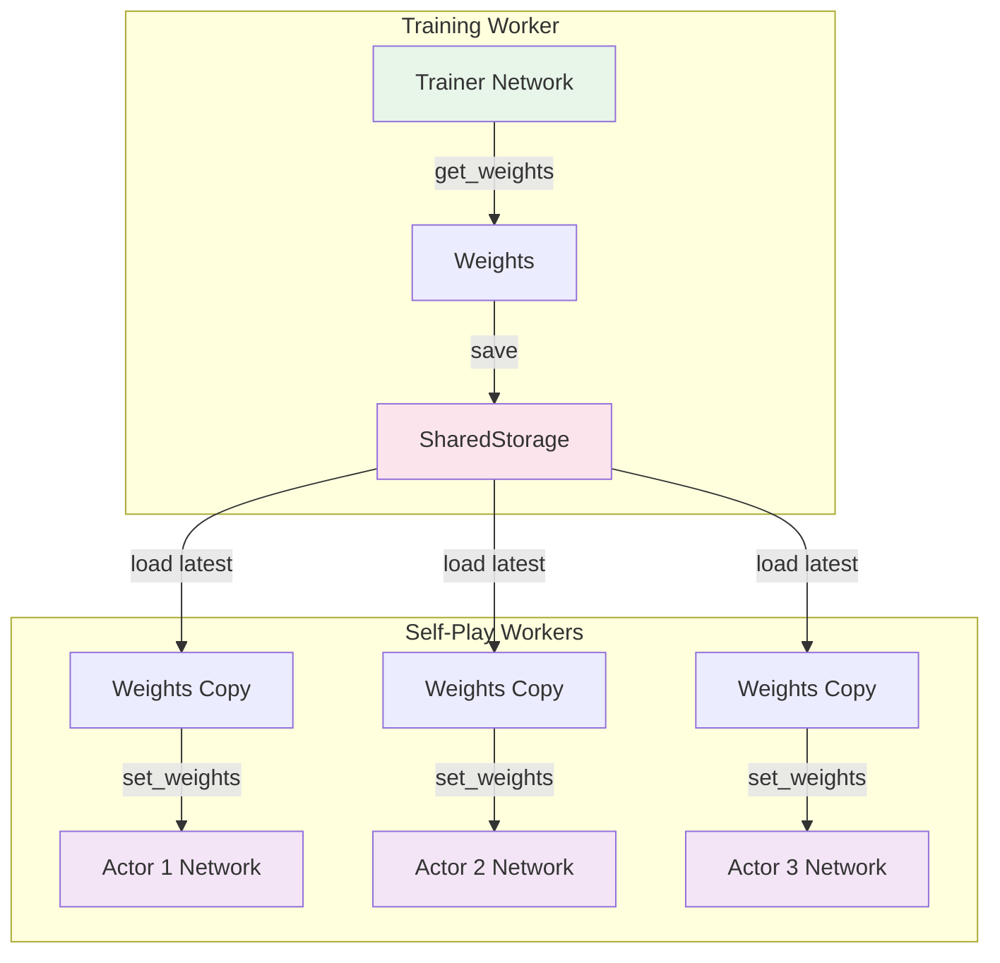

**Synchronization**:
- Trainer periodically saves weights to shared storage
- Self-play actors load latest weights before games
- Enables asynchronous distributed training
- See [shared_storage](shared_storage.md) for details

---

## Implementation Details

### State Normalization

**Purpose**: Normalize encoded states to [0, 1] range for stable learning.

**Fully Connected Implementation**:
```python
# Compute min/max across feature dimension
min_encoded_state = encoded_state.min(1, keepdim=True)[0]
max_encoded_state = encoded_state.max(1, keepdim=True)[0]

# Compute scale with numerical stability
scale = max_encoded_state - min_encoded_state
scale[scale < 1e-5] += 1e-5  # Avoid division by zero

# Normalize
normalized = (encoded_state - min_encoded_state) / scale
```

**ResNet Implementation**:
```python
# Flatten spatial dimensions for min/max computation
flat = encoded_state.view(
    -1, channels, height * width
)
min_state = flat.min(2, keepdim=True)[0].unsqueeze(-1)
max_state = flat.max(2, keepdim=True)[0].unsqueeze(-1)

# Normalize per channel
scale = max_state - min_state
scale[scale < 1e-5] += 1e-5
normalized = (encoded_state - min_state) / scale
```

**Benefits**:
- Prevents exploding/vanishing activations
- Improves gradient flow
- Stabilizes training across different games

---

### Action Encoding

#### Fully Connected Networks

**One-Hot Encoding**:
```python
# Create zero tensor
action_one_hot = torch.zeros((batch_size, action_space_size))

# Set selected action to 1.0
action_one_hot.scatter_(1, action.long(), 1.0)

# Concatenate with state
x = torch.cat((encoded_state, action_one_hot), dim=1)
```

**Properties**:
- Discrete action representation
- Dimension: action_space_size
- Concatenated along feature dimension

---

#### Residual Networks

**Action Plane Encoding**:
```python
# Create spatial plane
action_plane = torch.ones((batch_size, 1, height, width))

# Fill with normalized action value
action_plane = action[:, :, None, None] * action_plane / action_space_size

# Concatenate with state
x = torch.cat((encoded_state, action_plane), dim=1)
```

**Properties**:
- Spatial action representation
- Normalized to [0, 1] range
- Preserves spatial structure for convolutions
- Dimension: 1 channel added to state

---

### DataParallel Wrapping

**Purpose**: Enable multi-GPU training for faster convergence.

**Implementation**:
```python
self.representation_network = torch.nn.DataParallel(
    RepresentationNetwork(...)
)
self.dynamics_network = torch.nn.DataParallel(
    DynamicsNetwork(...)
)
self.prediction_network = torch.nn.DataParallel(
    PredictionNetwork(...)
)
```

**Benefits**:
- Automatic batch splitting across GPUs
- Parallel forward passes
- Gradient synchronization
- Transparent to calling code

**Considerations**:
- Adds overhead for small batches
- Requires sufficient batch size
- May not be optimal for all hardware

---

## Performance Considerations

### Memory Optimization

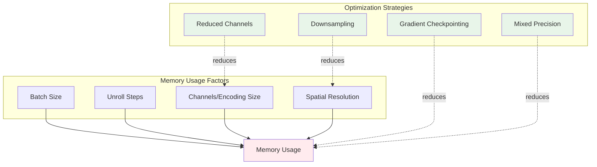

**Memory Bottlenecks**:
1. **Unrolled states**: K steps × batch_size × state_size
2. **Gradient storage**: All intermediate activations
3. **Multi-GPU replication**: Model copied to each GPU

**Optimization Techniques**:
1. **Downsampling**: Reduce spatial dimensions by 16x
2. **Reduced channels**: Use 1x1 convs before MLPs
3. **Gradient checkpointing**: Recompute activations during backward
4. **Mixed precision**: Use FP16 for forward/backward, FP32 for updates

---

### Computational Efficiency

**Fully Connected Networks**:
- **Pros**: Fast for small observations, simple implementation
- **Cons**: Doesn't scale to images, loses spatial structure
- **Complexity**: O(input_size × hidden_size)

**Residual Networks**:
- **Pros**: Efficient for images, preserves spatial structure
- **Cons**: More complex, requires tuning
- **Complexity**: O(channels² × height × width × kernel_size²)

**Inference Speed Comparison** (approximate):
- Fully Connected (CartPole): ~0.1ms per inference
- ResNet (Atari, no downsample): ~5-10ms per inference
- ResNet (Atari, with downsample): ~2-5ms per inference

---

## Usage Examples

### Creating a Network

```python
from knowledge.models import MuZeroNetwork

# Fully connected network for CartPole
config.network = "fullyconnected"
config.observation_shape = (1, 4, 1)  # 4 features
config.stacked_observations = 0
config.action_space = [0, 1]  # 2 actions
config.encoding_size = 32
config.fc_reward_layers = [16]
config.fc_value_layers = [16]
config.fc_policy_layers = [16]
config.fc_representation_layers = [16]
config.fc_dynamics_layers = [16]
config.support_size = 10

network = MuZeroNetwork(config)
```

```python
# ResNet for Atari
config.network = "resnet"
config.observation_shape = (3, 96, 96)  # RGB image
config.stacked_observations = 4  # 4 frame stack
config.action_space = list(range(18))  # Atari actions
config.blocks = 6  # Residual blocks per network
config.channels = 128  # Convolutional channels
config.reduced_channels_reward = 2
config.reduced_channels_value = 2
config.reduced_channels_policy = 4
config.resnet_fc_reward_layers = [64]
config.resnet_fc_value_layers = [64]
config.resnet_fc_policy_layers = [64]
config.support_size = 300
config.downsample = "resnet"

network = MuZeroNetwork(config)
```

---

### Performing Inference

```python
import torch

# Initial inference
observation = torch.randn(32, 3, 96, 96)  # Batch of 32 images
value, reward, policy_logits, encoded_state = network.initial_inference(observation)

# value: (32, 601) - categorical distribution over support
# reward: (32, 601) - always zero for initial inference
# policy_logits: (32, 18) - action logits
# encoded_state: (32, 128, 6, 6) - latent state

# Recurrent inference
action = torch.tensor([[5], [10], ...])  # Batch of actions
value, reward, policy_logits, next_state = network.recurrent_inference(
    encoded_state, action
)

# reward: (32, 601) - predicted reward distribution
# next_state: (32, 128, 6, 6) - predicted next latent state
```

---

### Converting Between Scalar and Support

```python
from knowledge.models import scalar_to_support, support_to_scalar

# Encode scalar rewards to categorical distribution
rewards = torch.tensor([[1.5], [0.0], [-2.3]])
support_size = 10
reward_logits = scalar_to_support(rewards, support_size)
# reward_logits: (3, 1, 21) - categorical distribution

# Decode categorical distribution to scalar
predicted_logits = network.dynamics(state, action)[1]
predicted_rewards = support_to_scalar(predicted_logits, support_size)
# predicted_rewards: (batch_size, 1) - scalar values
```

---

### Weight Management

```python
# Save weights (e.g., in trainer)
weights = network.get_weights()
shared_storage.set_info("weights", weights)

# Load weights (e.g., in self-play actor)
latest_weights = shared_storage.get_info("weights")
network.set_weights(latest_weights)

# Move network to GPU
network = network.to("cuda")

# Weights are automatically on correct device after set_weights
```

---

## Design Patterns

### Factory Pattern

**MuZeroNetwork** uses the factory pattern to instantiate the appropriate network based on configuration:

```python
class MuZeroNetwork:
    def __new__(cls, config):
        if config.network == "fullyconnected":
            return MuZeroFullyConnectedNetwork(...)
        elif config.network == "resnet":
            return MuZeroResidualNetwork(...)
```

**Benefits**:
- Single entry point for network creation
- Configuration-driven architecture selection
- Easy to add new network types
- Consistent interface across implementations

---

### Template Method Pattern

**AbstractNetwork** defines the interface that all implementations must follow:

```python
class AbstractNetwork(ABC, torch.nn.Module):
    @abstractmethod
    def initial_inference(self, observation):
        pass
    
    @abstractmethod
    def recurrent_inference(self, encoded_state, action):
        pass
```

**Benefits**:
- Enforces consistent API
- Enables polymorphism
- Facilitates testing and mocking
- Clear contract for implementations

---

### Composition Pattern

Networks are composed of smaller, reusable components:

```python
class MuZeroResidualNetwork(AbstractNetwork):
    def __init__(self, ...):
        self.representation_network = RepresentationNetwork(...)
        self.dynamics_network = DynamicsNetwork(...)
        self.prediction_network = PredictionNetwork(...)
```

**Benefits**:
- Modular design
- Reusable components
- Easier testing
- Clear separation of concerns

---

## Testing and Validation

### Network Output Validation

```python
def validate_network_outputs(network, observation, action):
    """Validate network output shapes and ranges."""
    
    # Initial inference
    value, reward, policy, state = network.initial_inference(observation)
    
    assert value.shape == (batch_size, full_support_size)
    assert reward.shape == (batch_size, full_support_size)
    assert policy.shape == (batch_size, action_space_size)
    assert state.shape[0] == batch_size
    
    # Check reward is zero (log probability at center)
    assert torch.allclose(
        reward.argmax(dim=1),
        torch.tensor([full_support_size // 2] * batch_size)
    )
    
    # Recurrent inference
    value, reward, policy, next_state = network.recurrent_inference(state, action)
    
    assert value.shape == (batch_size, full_support_size)
    assert reward.shape == (batch_size, full_support_size)
    assert policy.shape == (batch_size, action_space_size)
    assert next_state.shape == state.shape
    
    # Check state normalization
    assert state.min() >= 0.0 and state.max() <= 1.0
    assert next_state.min() >= 0.0 and next_state.max() <= 1.0
```

---

### Gradient Flow Testing

```python
def test_gradient_flow(network, observation, action):
    """Ensure gradients flow through all network components."""
    
    # Initial inference
    value, reward, policy, state = network.initial_inference(observation)
    loss = value.sum() + policy.sum()
    loss.backward()
    
    # Check all parameters have gradients
    for name, param in network.named_parameters():
        assert param.grad is not None, f"No gradient for {name}"
        assert not torch.isnan(param.grad).any(), f"NaN gradient in {name}"
    
    network.zero_grad()
    
    # Recurrent inference
    state = state.detach().requires_grad_(True)
    value, reward, policy, next_state = network.recurrent_inference(state, action)
    loss = value.sum() + reward.sum() + policy.sum()
    loss.backward()
    
    # Check gradients flow to input state
    assert state.grad is not None
    assert not torch.isnan(state.grad).any()
```

---

## Common Issues and Solutions

### Issue 1: NaN Values in Training

**Symptoms**:
- Loss becomes NaN
- Network outputs contain NaN
- Training crashes

**Causes**:
- Division by zero in normalization
- Exploding gradients
- Invalid support encoding

**Solutions**:
```python
# Add epsilon to scale computation
scale_encoded_state[scale_encoded_state < 1e-5] += 1e-5

# Clip gradients
torch.nn.utils.clip_grad_norm_(network.parameters(), max_norm=5.0)

# Use gradient checkpointing for deep networks
# Validate support_size matches reward scale
```

---

### Issue 2: Poor Performance on Visual Tasks

**Symptoms**:
- Slow learning on Atari
- Network doesn't capture spatial patterns
- High memory usage

**Causes**:
- Using fully connected network for images
- No downsampling for large observations
- Insufficient network capacity

**Solutions**:
```python
# Use ResNet architecture
config.network = "resnet"

# Enable downsampling
config.downsample = "resnet"  # or "CNN"

# Increase capacity
config.blocks = 6  # More residual blocks
config.channels = 128  # More channels
```

---

### Issue 3: Slow Inference Speed

**Symptoms**:
- Self-play is bottlenecked
- Low games per second
- High GPU utilization

**Causes**:
- Network too large
- No downsampling
- Inefficient batch sizes

**Solutions**:
```python
# Enable downsampling
config.downsample = "resnet"

# Reduce network size
config.blocks = 3  # Fewer blocks
config.channels = 64  # Fewer channels

# Optimize batch size for GPU
# Use mixed precision training
```

---

### Issue 4: Memory Overflow

**Symptoms**:
- CUDA out of memory errors
- Training crashes during unroll
- Cannot increase batch size

**Causes**:
- Large unroll steps
- High-resolution observations
- Too many channels

**Solutions**:
```python
# Reduce batch size
config.batch_size = 64  # Instead of 128

# Reduce unroll steps
config.num_unroll_steps = 5  # Instead of 10

# Enable downsampling
config.downsample = "resnet"

# Use gradient checkpointing
# Use mixed precision training
```

---

## Best Practices

### Network Architecture Selection

1. **Start Simple**: Begin with fully connected for debugging
2. **Match Environment**: Use ResNet for visual, FC for low-dim
3. **Tune Capacity**: Increase blocks/channels if underfitting
4. **Enable Downsampling**: Always use for large observations (>64x64)

### Training Stability

1. **Normalize States**: Always normalize encoded states to [0, 1]
2. **Clip Gradients**: Use gradient clipping (max_norm=5-10)
3. **Validate Outputs**: Check for NaN/Inf regularly
4. **Monitor Norms**: Track gradient and weight norms

### Performance Optimization

1. **Profile First**: Identify actual bottlenecks before optimizing
2. **Batch Efficiently**: Use batch sizes that fully utilize GPU
3. **Downsample Wisely**: Balance speed vs. information loss
4. **Mixed Precision**: Use FP16 for large networks

### Code Quality

1. **Type Hints**: Add type annotations for clarity
2. **Documentation**: Document non-obvious design choices
3. **Testing**: Validate shapes, ranges, and gradients
4. **Modularity**: Keep components small and reusable

---

## Future Enhancements

### Potential Improvements

1. **Transformer Networks**: Replace ResNet with Vision Transformers
2. **Efficient Architectures**: MobileNet, EfficientNet variants
3. **Attention Mechanisms**: Add attention to prediction network
4. **Auxiliary Tasks**: Self-supervised learning objectives
5. **Adaptive Capacity**: Dynamic network sizing based on task

### Research Directions

1. **Learned Downsampling**: Trainable downsampling modules
2. **Sparse Networks**: Pruning and quantization
3. **Meta-Learning**: Fast adaptation to new games
4. **Hierarchical Representations**: Multi-scale latent states
5. **Uncertainty Estimation**: Bayesian neural networks

---

## References

### Related Modules
- [self_play_mcts](self_play_mcts.md) - Uses networks for tree search
- [trainer](trainer.md) - Trains network parameters
- [shared_storage](shared_storage.md) - Manages network weights
- [replay_buffer](replay_buffer.md) - Provides training data
- [game_environments](game_environments.md) - Defines observation spaces

### External Resources
- [MuZero Paper](https://arxiv.org/abs/1911.08265) - Original algorithm
- [MuZero Appendix](https://arxiv.org/src/1911.08265v2/anc/pseudocode.py) - Network architecture details
- [ResNet Paper](https://arxiv.org/abs/1512.03385) - Residual networks
- [Categorical DQN](https://arxiv.org/abs/1707.06887) - Support-based value prediction

---

## Appendix

### Network Size Calculations

**Fully Connected Network**:
```
Parameters = representation + dynamics + prediction

representation = input_size × hidden_sizes × encoding_size
dynamics_state = (encoding_size + action_size) × hidden_sizes × encoding_size
dynamics_reward = encoding_size × hidden_sizes × support_size
prediction_policy = encoding_size × hidden_sizes × action_size
prediction_value = encoding_size × hidden_sizes × support_size

Total ≈ O(input_size × encoding_size + encoding_size²)
```

**Residual Network**:
```
Parameters = representation + dynamics + prediction

representation = channels × (3×3×channels) × blocks
dynamics = (channels+1) × (3×3×channels) × blocks + reward_head
prediction = channels × (3×3×channels) × blocks + value_head + policy_head

Total ≈ O(channels² × blocks × 9)
```

### Typical Configurations

**CartPole (Fully Connected)**:
```python
observation_shape = (1, 4, 1)
encoding_size = 32
fc_*_layers = [16]
support_size = 10
Parameters ≈ 10K
```

**Atari (ResNet)**:
```python
observation_shape = (3, 96, 96)
channels = 128
blocks = 6
downsample = "resnet"
support_size = 300
Parameters ≈ 5M
```

**Go (ResNet)**:
```python
observation_shape = (17, 19, 19)
channels = 256
blocks = 16
downsample = False
support_size = 300
Parameters ≈ 50M
```

---

*This documentation provides a comprehensive overview of the neural_networks module. For implementation details, refer to the source code. For usage in the context of the full MuZero algorithm, see [main_orchestrator](main_orchestrator.md).*
