# Replay Buffer Module

## Overview

The **replay_buffer** module is a critical component of the MuZero reinforcement learning system that manages experience storage and batch generation for training. It implements two key distributed actors using Ray: **ReplayBuffer** for storing and sampling game experiences, and **Reanalyse** for updating stored experiences with fresh model predictions. This module enables efficient experience replay with support for Prioritized Experience Replay (PER) and implements the reanalysis mechanism described in the MuZero paper.

### Key Responsibilities

- **Experience Storage**: Maintains a buffer of completed game histories with configurable size limits
- **Batch Generation**: Samples and prepares training batches from stored experiences
- **Prioritized Sampling**: Implements PER to focus training on more valuable experiences
- **Experience Reanalysis**: Updates stored experiences with fresh model predictions for improved value estimates
- **Distributed Operation**: Runs as independent Ray actors for concurrent operation with training and self-play

### Module Position in System Architecture

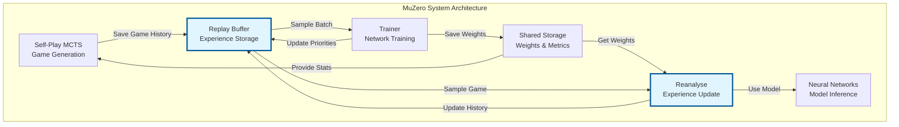

---

## Core Components

### 1. ReplayBuffer

A Ray remote actor that manages the storage of game histories and generates training batches.

#### Architecture

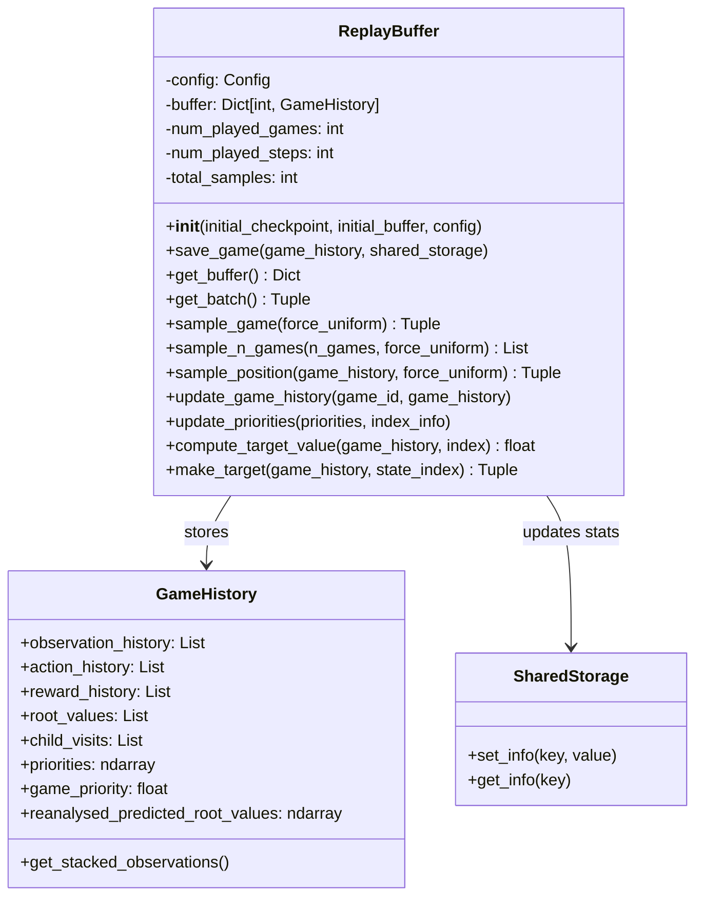

#### Key Features

**Experience Storage Management**
- Maintains a dictionary buffer mapping game IDs to GameHistory objects
- Implements FIFO eviction when buffer reaches capacity
- Tracks global statistics (games played, steps taken, total samples)
- Supports initialization from checkpoints for training resumption

**Prioritized Experience Replay (PER)**
- Assigns priorities based on TD-error magnitude: `priority = |value - target|^α`
- Maintains both position-level and game-level priorities
- Samples games and positions according to priority distribution
- Computes importance sampling weights to correct for bias

**Batch Generation Pipeline**
1. Sample N games from buffer (prioritized or uniform)
2. For each game, sample a position (prioritized or uniform)
3. Generate targets for unroll steps from that position
4. Stack observations with action history
5. Compute importance sampling weights
6. Return structured batch for training

#### Data Flow

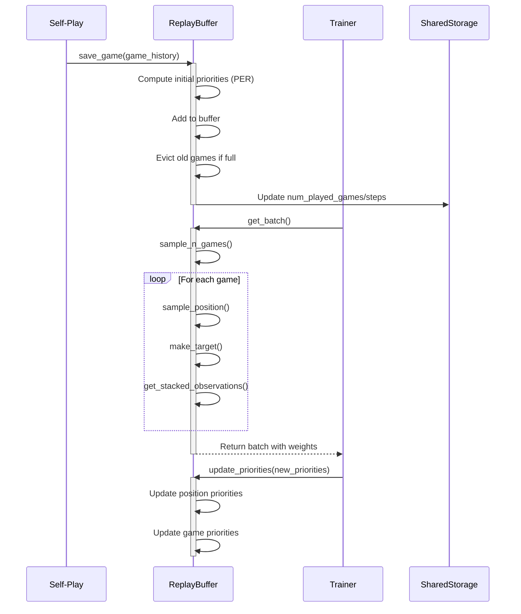

#### Methods Deep Dive

**save_game(game_history, shared_storage)**
- Computes initial priorities for PER if enabled
- Adds game to buffer with auto-incrementing game ID
- Removes oldest game if buffer exceeds `replay_buffer_size`
- Updates global statistics in shared storage

**get_batch()**
Returns a tuple of `(index_batch, data_batch)` where:
- `index_batch`: List of `[game_id, position]` for priority updates
- `data_batch`: Tuple of:
  - `observation_batch`: Stacked observations with action history
  - `action_batch`: Actions taken for unroll steps
  - `value_batch`: Target values for each step
  - `reward_batch`: Observed rewards
  - `policy_batch`: MCTS policy distributions
  - `weight_batch`: Importance sampling weights (PER only)
  - `gradient_scale_batch`: Gradient scaling factors

**sample_game(force_uniform=False)**
- Samples a game from buffer
- Uses priority-based sampling if PER enabled and not forced uniform
- Returns `(game_id, game_history, game_probability)`

**sample_position(game_history, force_uniform=False)**
- Samples a position within a game
- Uses position priorities if PER enabled
- Returns `(position_index, position_probability)`

**compute_target_value(game_history, index)**
Implements n-step bootstrapped value target:
```
V_target = Σ(γ^i * r_{t+i}) + γ^n * V(s_{t+n})
```
- Sums discounted rewards for `td_steps`
- Adds discounted bootstrap value from search tree
- Handles player perspective in two-player games
- Returns 0 for terminal states

**make_target(game_history, state_index)**
- Generates targets for `num_unroll_steps + 1` positions
- For positions within game: uses actual values, rewards, policies, actions
- For terminal position: uses 0 value, actual reward, uniform policy
- For absorbing states: uses 0 value/reward, uniform policy, random action

**update_priorities(priorities, index_info)**
- Updates position priorities from training TD-errors
- Recomputes game priority as max of position priorities
- Handles cases where games were evicted during training

---

### 2. Reanalyse

A Ray remote actor that continuously updates stored game histories with fresh model predictions.

#### Architecture

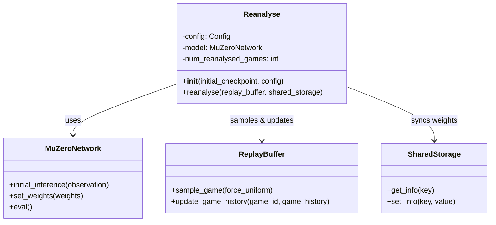

#### Purpose and Benefits

The reanalysis mechanism addresses a key challenge in off-policy learning: stored experiences contain value estimates from older, less accurate models. By re-evaluating positions with the current model, reanalysis provides:

1. **Fresher Value Estimates**: More accurate n-step bootstrap values
2. **Stable Learning**: Reduces bias from outdated predictions
3. **Improved Sample Efficiency**: Extracts more value from stored experiences
4. **Better Credit Assignment**: More accurate value targets for training

#### Reanalysis Process

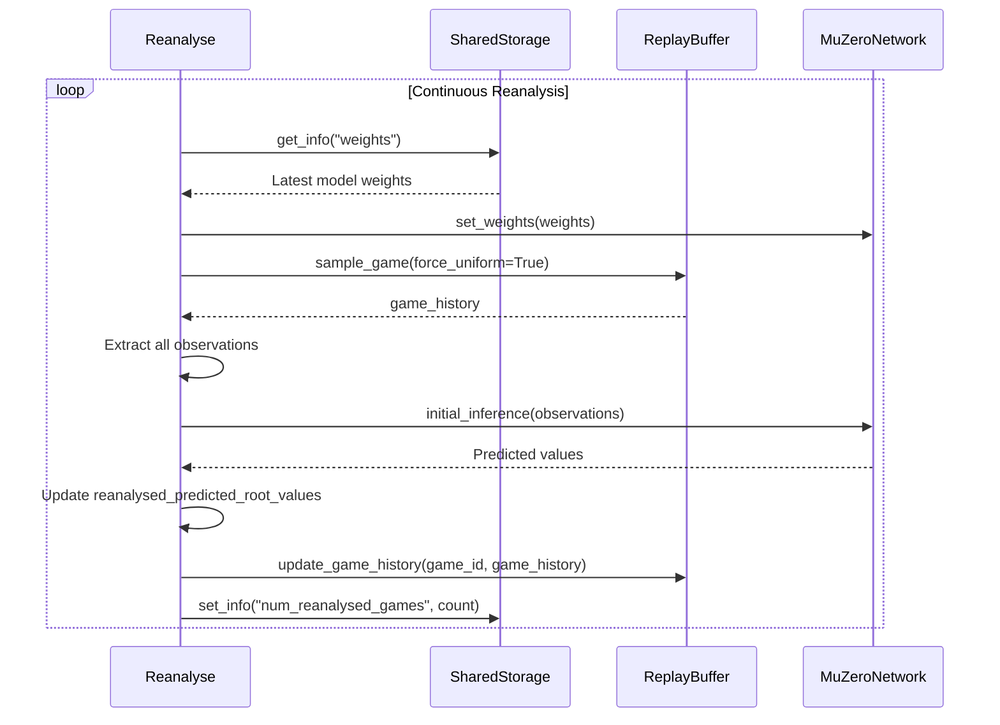

#### Key Features

**Continuous Operation**
- Runs in infinite loop until training completes
- Waits for at least one game to be played before starting
- Checks termination flag from shared storage

**Model Synchronization**
- Loads latest weights from shared storage each iteration
- Runs on GPU if `reanalyse_on_gpu` is enabled
- Uses model in evaluation mode (no gradient computation)

**Uniform Sampling**
- Always samples games uniformly (not by priority)
- Ensures all experiences eventually get reanalyzed
- Prevents bias toward high-priority games

**Batch Inference**
- Processes all positions in a game simultaneously
- Converts observations to stacked format
- Stores predictions in `reanalysed_predicted_root_values`

#### Configuration Options

Key configuration parameters affecting reanalysis:

- `use_last_model_value`: Enable/disable reanalysis mechanism
- `reanalyse_on_gpu`: Run reanalysis on GPU for faster inference
- `stacked_observations`: Number of past observations to stack
- `support_size`: Size of value support for categorical distribution

---

## Integration with Other Modules

### Relationship with Self-Play MCTS

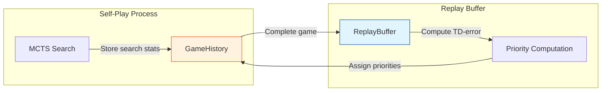

**Data Flow**: Self-play generates complete GameHistory objects containing:
- Observation sequences
- Action sequences  
- Reward sequences
- MCTS policy distributions (child_visits)
- Root value estimates

See [self_play_mcts.md](self_play_mcts.md) for details on game history generation.

### Relationship with Trainer

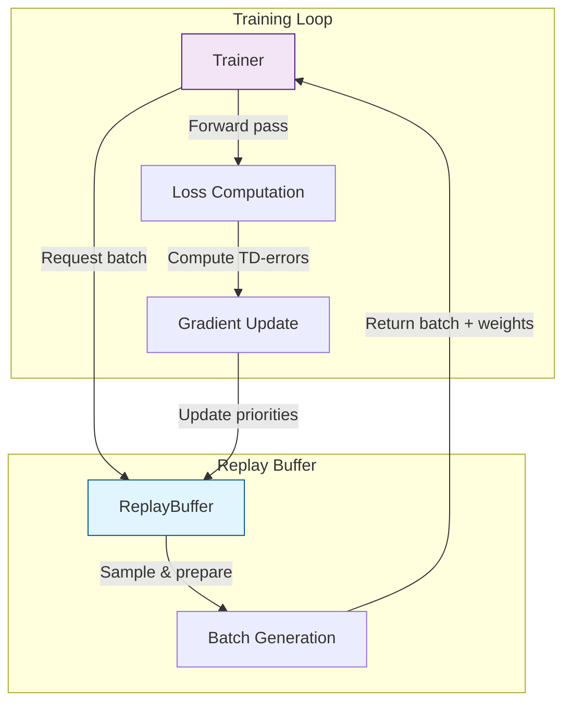

**Bidirectional Communication**:
- Trainer requests batches for training
- Replay buffer provides weighted samples
- Trainer returns TD-errors for priority updates

See [trainer.md](trainer.md) for training loop details.

### Relationship with Shared Storage

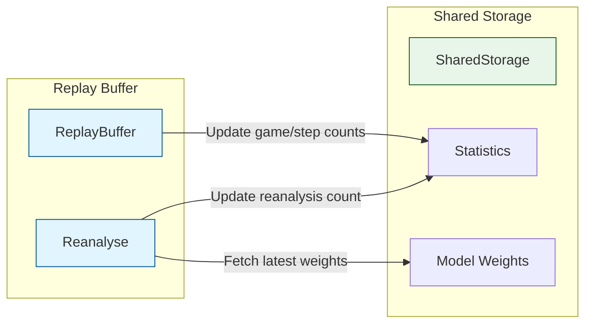

**Coordination**: Shared storage acts as central coordination point for:
- Training progress tracking
- Model weight distribution
- Termination signaling

See [shared_storage.md](shared_storage.md) for coordination mechanisms.

### Relationship with Neural Networks

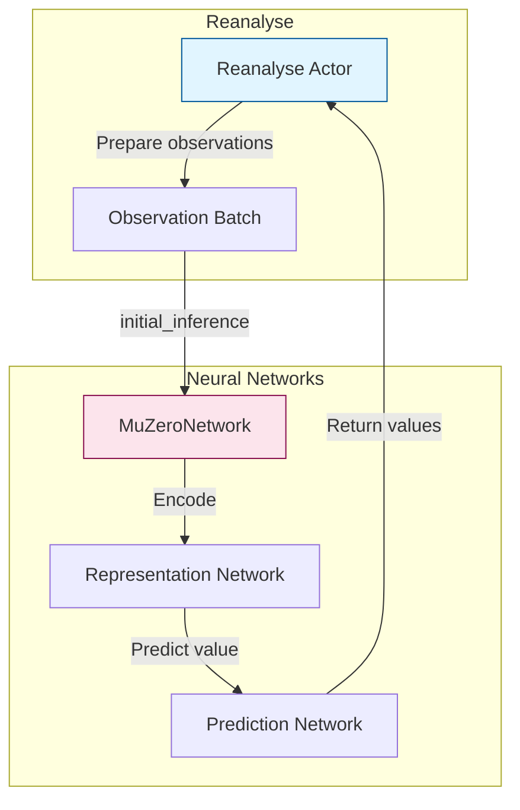

**Model Usage**: Reanalyse uses the representation and prediction networks to generate fresh value estimates without performing MCTS search.

See [neural_networks.md](neural_networks.md) for network architecture details.

---

## Key Algorithms

### Prioritized Experience Replay (PER)

The module implements PER as described in "Prioritized Experience Replay" (Schaul et al., 2015) with adaptations for MuZero.

#### Priority Computation

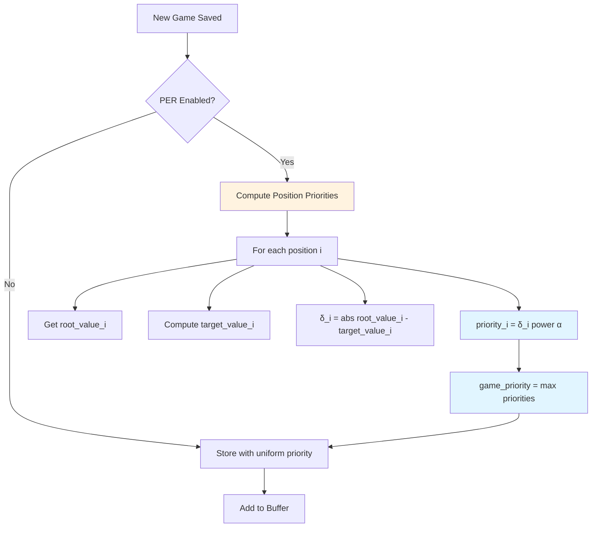

**Priority Formula**:
```
position_priority = |TD_error|^α
game_priority = max(position_priorities)
```

Where:
- `TD_error = root_value - target_value`
- `α` (PER_alpha): Controls prioritization strength (typically 0.5-1.0)

#### Sampling with Priorities

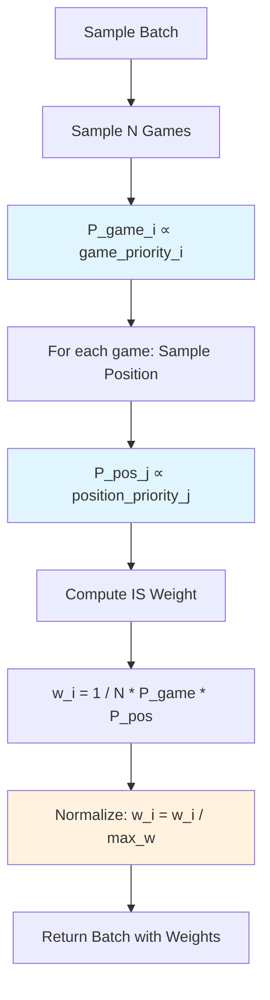

**Importance Sampling Weight**:
```
w = (1 / (N * P_game * P_position))
normalized_w = w / max(weights)
```

This corrects for bias introduced by non-uniform sampling.

#### Priority Updates

After training, priorities are updated based on fresh TD-errors:

```python
# During training
td_errors = |predicted_values - target_values|
new_priorities = td_errors ** α

# Update in replay buffer
replay_buffer.update_priorities(new_priorities, index_info)
```

### Target Value Computation

The n-step bootstrapped return combines observed rewards with model predictions.

#### Algorithm

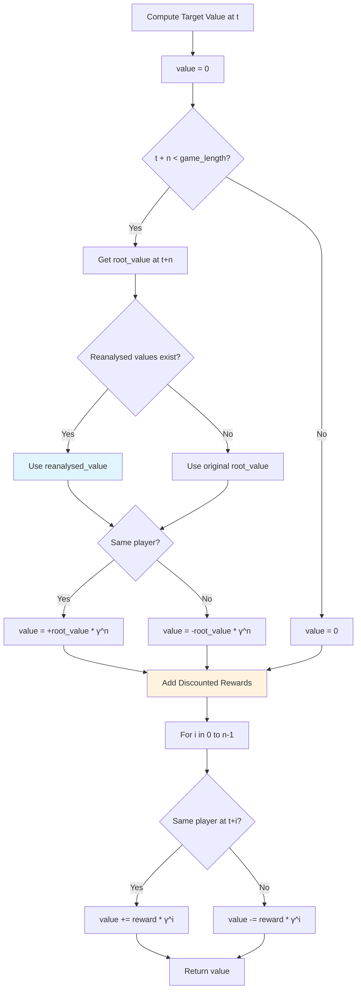

#### Mathematical Formulation

For single-player games:
```
V_target(s_t) = Σ_{i=0}^{n-1} γ^i * r_{t+i+1} + γ^n * V(s_{t+n})
```

For two-player games (player perspective):
```
V_target(s_t) = Σ_{i=0}^{n-1} γ^i * sign(player_t, player_{t+i}) * r_{t+i+1} 
                + γ^n * sign(player_t, player_{t+n}) * V(s_{t+n})

where sign(p1, p2) = +1 if p1 == p2, else -1
```

#### Reanalysis Integration

When reanalysis is enabled:
```python
if game_history.reanalysed_predicted_root_values is not None:
    root_values = game_history.reanalysed_predicted_root_values
else:
    root_values = game_history.root_values
```

This ensures the most recent value estimates are used for bootstrapping.

### Batch Generation Process

Complete pipeline for generating a training batch:

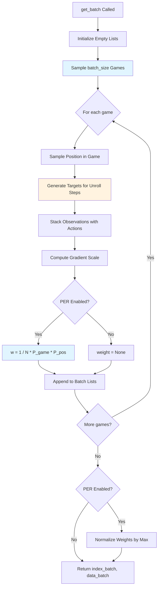

#### Gradient Scale Computation

The gradient scale determines how many valid unroll steps exist:

```python
gradient_scale = min(
    num_unroll_steps,
    len(game_history.action_history) - game_pos
)
```

This is used during training to mask out invalid positions beyond game termination.

---

## Configuration Parameters

### Replay Buffer Configuration

| Parameter | Type | Description | Typical Value |
|-----------|------|-------------|---------------|
| `replay_buffer_size` | int | Maximum number of games to store | 1000-10000 |
| `batch_size` | int | Number of samples per training batch | 128-1024 |
| `num_unroll_steps` | int | Number of future steps to unroll | 5-10 |
| `td_steps` | int | Number of steps for n-step return | 5-50 |
| `discount` | float | Discount factor γ | 0.95-0.999 |
| `stacked_observations` | int | Number of past observations to stack | 1-8 |
| `action_space` | list | List of valid actions | Game-specific |
| `seed` | int | Random seed for reproducibility | Any int |

### Prioritized Experience Replay Configuration

| Parameter | Type | Description | Typical Value |
|-----------|------|-------------|---------------|
| `PER` | bool | Enable prioritized experience replay | True/False |
| `PER_alpha` | float | Priority exponent (α) | 0.5-1.0 |

Higher α values increase prioritization strength:
- α = 0: Uniform sampling
- α = 1: Full prioritization

### Reanalysis Configuration

| Parameter | Type | Description | Typical Value |
|-----------|------|-------------|---------------|
| `use_last_model_value` | bool | Enable reanalysis mechanism | True |
| `reanalyse_on_gpu` | bool | Run reanalysis on GPU | True |
| `training_steps` | int | Total training steps (for termination) | 100000-1000000 |

---

## Performance Considerations

### Memory Management

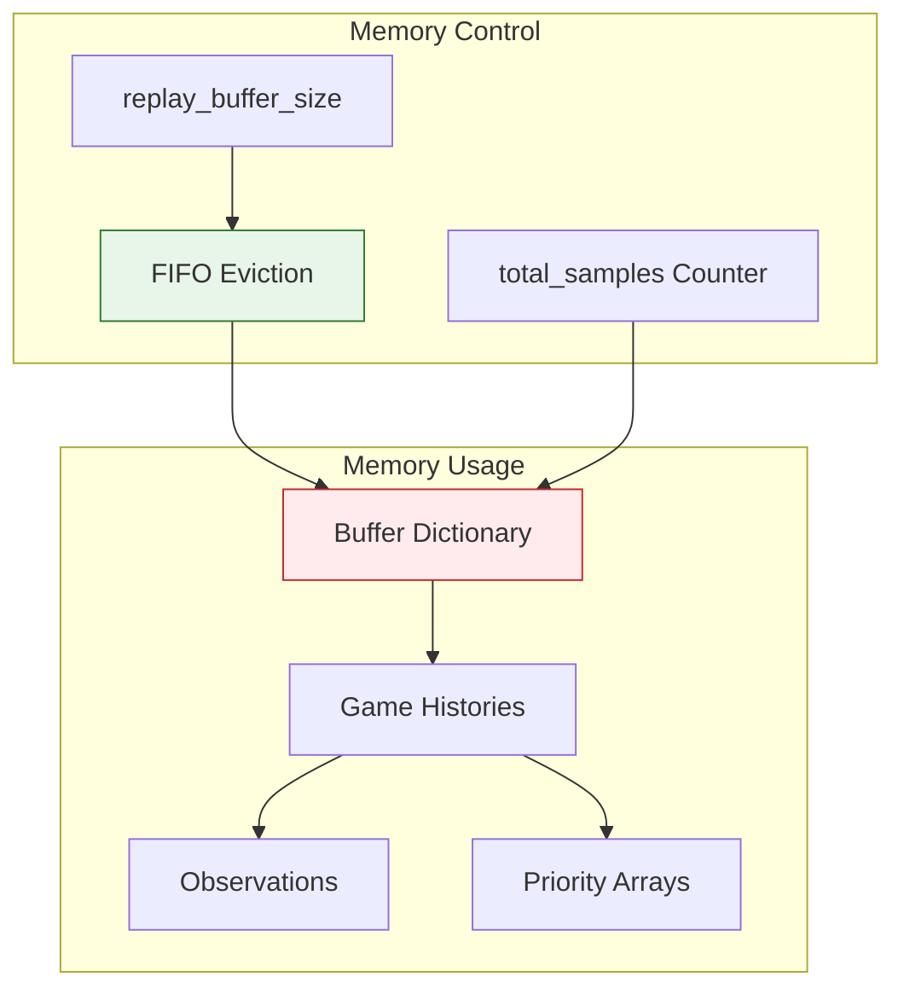

**Memory Footprint**:
```
Total Memory ≈ replay_buffer_size × avg_game_length × observation_size
```

**Optimization Strategies**:
1. **Limit Buffer Size**: Set `replay_buffer_size` based on available RAM
2. **FIFO Eviction**: Automatically removes oldest games
3. **Lazy Loading**: Consider disk-based storage for very large buffers
4. **Compression**: Store observations in compressed format

### Computational Efficiency

#### Batch Generation Performance

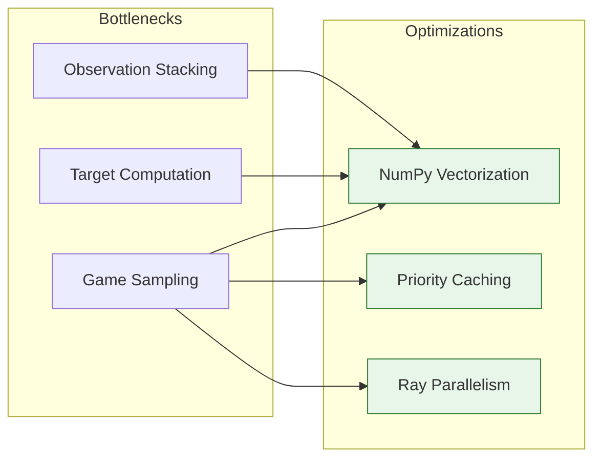

**Performance Tips**:
1. **Vectorized Operations**: Use NumPy for array operations
2. **Priority Caching**: Cache game priorities for faster sampling
3. **Batch Processing**: Process multiple samples simultaneously
4. **Ray Distribution**: Leverage Ray's distributed computing

#### Reanalysis Performance

**GPU Acceleration**:
- Set `reanalyse_on_gpu=True` for 5-10x speedup
- Batch all positions in a game for efficient inference
- Use mixed precision if supported

**Throughput Optimization**:
```python
# Reanalysis rate should match or exceed game generation rate
reanalysis_rate ≈ game_generation_rate

# Monitor with:
num_reanalysed_games / num_played_games
```

### Distributed Coordination

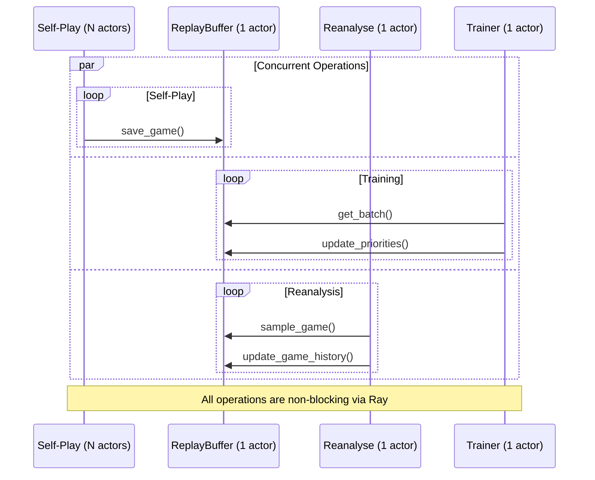

**Concurrency Benefits**:
- Self-play, training, and reanalysis run in parallel
- Ray handles synchronization automatically
- No GIL limitations due to separate processes

**Potential Bottlenecks**:
- Replay buffer can become a bottleneck if accessed too frequently
- Consider multiple replay buffer actors for extreme scale
- Monitor Ray dashboard for actor utilization

---

## Usage Examples

### Basic Initialization

```python
import ray
from replay_buffer import ReplayBuffer, Reanalyse

# Initialize Ray
ray.init()

# Create replay buffer
initial_checkpoint = {
    "num_played_games": 0,
    "num_played_steps": 0,
    "num_reanalysed_games": 0,
    "weights": model.get_weights()
}
initial_buffer = {}

replay_buffer = ReplayBuffer.remote(
    initial_checkpoint,
    initial_buffer,
    config
)

# Create reanalyse actor
reanalyse = Reanalyse.remote(initial_checkpoint, config)
```

### Saving Game Histories

```python
# After self-play game completes
game_history = GameHistory()
# ... populate game_history during self-play ...

# Save to replay buffer
ray.get(replay_buffer.save_game.remote(game_history, shared_storage))
```

### Sampling Training Batches

```python
# In training loop
index_batch, data_batch = ray.get(replay_buffer.get_batch.remote())

(
    observation_batch,
    action_batch,
    value_batch,
    reward_batch,
    policy_batch,
    weight_batch,
    gradient_scale_batch
) = data_batch

# Use batch for training
loss = train_step(
    model,
    observation_batch,
    action_batch,
    value_batch,
    reward_batch,
    policy_batch,
    weight_batch
)
```

### Updating Priorities

```python
# After computing TD-errors during training
td_errors = compute_td_errors(predictions, targets)
priorities = td_errors ** config.PER_alpha

# Update priorities in replay buffer
replay_buffer.update_priorities.remote(priorities, index_batch)
```

### Running Reanalysis

```python
# Start reanalysis in background
reanalyse_task = reanalyse.reanalyse.remote(replay_buffer, shared_storage)

# Reanalysis runs continuously until training completes
# No need to wait for completion
```

### Monitoring Statistics

```python
# Get buffer statistics
buffer = ray.get(replay_buffer.get_buffer.remote())
print(f"Buffer size: {len(buffer)} games")
print(f"Total samples: {sum(len(g.root_values) for g in buffer.values())}")

# Get reanalysis progress
num_reanalysed = ray.get(shared_storage.get_info.remote("num_reanalysed_games"))
num_played = ray.get(shared_storage.get_info.remote("num_played_games"))
print(f"Reanalysis coverage: {num_reanalysed / num_played * 100:.1f}%")
```

---

## Error Handling and Edge Cases

### Buffer Eviction During Training

**Problem**: A game may be evicted from the buffer between sampling and priority update.

**Solution**: Check if game still exists before updating:
```python
def update_priorities(self, priorities, index_info):
    for i in range(len(index_info)):
        game_id, game_pos = index_info[i]
        
        # Check if game still in buffer
        if next(iter(self.buffer)) <= game_id:
            # Safe to update
            self.buffer[game_id].priorities[game_pos:...] = priorities[i, :]
```

### Absorbing States Beyond Game End

**Problem**: Unroll steps may extend beyond game termination.

**Solution**: Treat post-terminal states as absorbing states:
```python
if current_index > len(game_history.root_values):
    # Absorbing state
    target_values.append(0)
    target_rewards.append(0)
    target_policies.append(uniform_policy)
    actions.append(random_action)
```

### Reanalysis Synchronization

**Problem**: Reanalysis may use stale weights if not synchronized properly.

**Solution**: Fetch latest weights at start of each reanalysis iteration:
```python
def reanalyse(self, replay_buffer, shared_storage):
    while not terminated:
        # Always use latest weights
        self.model.set_weights(
            ray.get(shared_storage.get_info.remote("weights"))
        )
        # ... perform reanalysis ...
```

### Priority Initialization

**Problem**: New games need initial priorities before training.

**Solution**: Compute priorities based on initial TD-error:
```python
priorities = []
for i, root_value in enumerate(game_history.root_values):
    target_value = self.compute_target_value(game_history, i)
    priority = (abs(root_value - target_value) ** self.config.PER_alpha)
    priorities.append(priority)
```

### Empty Buffer Handling

**Problem**: Training may start before any games are played.

**Solution**: Wait for minimum buffer size:
```python
# In trainer
while ray.get(replay_buffer.get_buffer.remote()) < min_buffer_size:
    time.sleep(1)
```

---

## Testing and Validation

### Unit Tests

```python
def test_replay_buffer_capacity():
    """Test FIFO eviction when buffer is full"""
    config.replay_buffer_size = 10
    replay_buffer = ReplayBuffer(checkpoint, {}, config)
    
    # Add 15 games
    for i in range(15):
        game_history = create_dummy_game()
        replay_buffer.save_game(game_history)
    
    buffer = replay_buffer.get_buffer()
    assert len(buffer) == 10
    assert min(buffer.keys()) == 5  # First 5 games evicted

def test_priority_sampling():
    """Test that high-priority games are sampled more often"""
    replay_buffer = create_buffer_with_priorities()
    
    sample_counts = defaultdict(int)
    for _ in range(1000):
        game_id, _, _ = replay_buffer.sample_game()
        sample_counts[game_id] += 1
    
    # High priority game should be sampled more
    assert sample_counts[high_priority_game_id] > sample_counts[low_priority_game_id]

def test_target_value_computation():
    """Test n-step return calculation"""
    game_history = create_test_game()
    replay_buffer = ReplayBuffer(checkpoint, {}, config)
    
    target = replay_buffer.compute_target_value(game_history, index=0)
    
    # Manually compute expected value
    expected = sum(
        config.discount**i * game_history.reward_history[i+1]
        for i in range(config.td_steps)
    ) + config.discount**config.td_steps * game_history.root_values[config.td_steps]
    
    assert abs(target - expected) < 1e-5
```

### Integration Tests

```python
def test_full_pipeline():
    """Test complete replay buffer pipeline"""
    # Initialize components
    replay_buffer = ReplayBuffer.remote(checkpoint, {}, config)
    shared_storage = SharedStorage.remote(checkpoint, config)
    
    # Generate and save games
    for _ in range(10):
        game_history = play_game()
        ray.get(replay_buffer.save_game.remote(game_history, shared_storage))
    
    # Sample batch
    index_batch, data_batch = ray.get(replay_buffer.get_batch.remote())
    
    # Verify batch structure
    assert len(index_batch) == config.batch_size
    assert len(data_batch) == 7  # 7 components
    
    # Verify shapes
    obs_batch, action_batch, value_batch, _, _, _, _ = data_batch
    assert len(obs_batch) == config.batch_size
    assert len(action_batch[0]) == config.num_unroll_steps + 1

def test_reanalysis_updates():
    """Test that reanalysis updates game histories"""
    replay_buffer = ReplayBuffer.remote(checkpoint, {}, config)
    reanalyse = Reanalyse.remote(checkpoint, config)
    shared_storage = SharedStorage.remote(checkpoint, config)
    
    # Add game
    game_history = play_game()
    ray.get(replay_buffer.save_game.remote(game_history, shared_storage))
    
    # Run one reanalysis iteration
    original_values = game_history.root_values.copy()
    
    # Trigger reanalysis (run one iteration manually)
    game_id, game_history, _ = ray.get(
        replay_buffer.sample_game.remote(force_uniform=True)
    )
    # ... perform reanalysis ...
    ray.get(replay_buffer.update_game_history.remote(game_id, game_history))
    
    # Verify reanalysed values exist
    updated_game = ray.get(replay_buffer.get_buffer.remote())[game_id]
    assert updated_game.reanalysed_predicted_root_values is not None
```

### Performance Benchmarks

```python
def benchmark_batch_generation():
    """Measure batch generation throughput"""
    replay_buffer = create_full_buffer()
    
    start_time = time.time()
    num_batches = 100
    
    for _ in range(num_batches):
        ray.get(replay_buffer.get_batch.remote())
    
    elapsed = time.time() - start_time
    throughput = num_batches / elapsed
    
    print(f"Batch generation: {throughput:.2f} batches/sec")
    assert throughput > 10  # Should generate at least 10 batches/sec

def benchmark_reanalysis():
    """Measure reanalysis throughput"""
    reanalyse = Reanalyse.remote(checkpoint, config)
    replay_buffer = create_full_buffer()
    shared_storage = SharedStorage.remote(checkpoint, config)
    
    start_time = time.time()
    num_games = 50
    
    for _ in range(num_games):
        game_id, game_history, _ = ray.get(
            replay_buffer.sample_game.remote(force_uniform=True)
        )
        # ... perform reanalysis ...
    
    elapsed = time.time() - start_time
    throughput = num_games / elapsed
    
    print(f"Reanalysis: {throughput:.2f} games/sec")
```

---

## Troubleshooting Guide

### Common Issues

#### Issue: Out of Memory Errors

**Symptoms**:
- Process killed by OS
- Ray actor crashes
- Slow performance due to swapping

**Solutions**:
1. Reduce `replay_buffer_size`
2. Reduce `stacked_observations`
3. Use smaller observation representations
4. Enable disk-based storage for large buffers

```python
# Monitor memory usage
import psutil
process = psutil.Process()
memory_gb = process.memory_info().rss / 1e9
print(f"Replay buffer memory: {memory_gb:.2f} GB")
```

#### Issue: Slow Batch Generation

**Symptoms**:
- Training waits for batches
- Low GPU utilization
- High replay buffer CPU usage

**Solutions**:
1. Reduce `batch_size`
2. Optimize `compute_target_value` with vectorization
3. Cache frequently accessed data
4. Use multiple replay buffer actors

```python
# Profile batch generation
import cProfile
cProfile.run('replay_buffer.get_batch()', sort='cumtime')
```

#### Issue: Reanalysis Falling Behind

**Symptoms**:
- `num_reanalysed_games << num_played_games`
- Reanalysis actor at 100% CPU/GPU
- Stale value estimates

**Solutions**:
1. Enable `reanalyse_on_gpu=True`
2. Reduce model size for faster inference
3. Run multiple reanalysis actors
4. Increase reanalysis batch size

```python
# Monitor reanalysis coverage
coverage = num_reanalysed_games / num_played_games
if coverage < 0.5:
    print("WARNING: Reanalysis falling behind!")
```

#### Issue: Priority Sampling Bias

**Symptoms**:
- Same games sampled repeatedly
- Poor exploration of buffer
- Training instability

**Solutions**:
1. Reduce `PER_alpha` for less aggressive prioritization
2. Add minimum priority threshold
3. Periodically sample uniformly
4. Implement priority decay

```python
# Add minimum priority
priority = max(min_priority, abs(td_error) ** alpha)

# Mix uniform and prioritized sampling
if random.random() < 0.1:
    game_id, game_history, _ = replay_buffer.sample_game(force_uniform=True)
```

### Debugging Tips

**Enable Verbose Logging**:
```python
import logging
logging.basicConfig(level=logging.DEBUG)

# Add logging to replay buffer
print(f"Buffer size: {len(self.buffer)}")
print(f"Total samples: {self.total_samples}")
print(f"Priority range: [{min(priorities)}, {max(priorities)}]")
```

**Visualize Priority Distribution**:
```python
import matplotlib.pyplot as plt

priorities = [game.game_priority for game in buffer.values()]
plt.hist(priorities, bins=50)
plt.xlabel("Game Priority")
plt.ylabel("Count")
plt.title("Priority Distribution")
plt.show()
```

**Monitor Ray Dashboard**:
- Open Ray dashboard at `http://localhost:8265`
- Check actor resource utilization
- Monitor task execution times
- Identify bottlenecks

---

## Best Practices

### Configuration Tuning

1. **Buffer Size**: Start with 1000 games, increase if memory allows
2. **Batch Size**: Balance between sample diversity and training speed
3. **Unroll Steps**: Longer unrolls improve credit assignment but increase computation
4. **TD Steps**: Match to game episode length (5-10 for short games, 20-50 for long games)
5. **PER Alpha**: Start with 0.6, increase for more prioritization

### Memory Optimization

1. **Use Efficient Data Types**: Store observations as uint8 instead of float32
2. **Compress Observations**: Use image compression for visual observations
3. **Lazy Loading**: Load observations from disk when needed
4. **Periodic Cleanup**: Remove unnecessary data from game histories

### Performance Optimization

1. **Vectorize Operations**: Use NumPy/PyTorch for batch operations
2. **GPU Acceleration**: Enable GPU for reanalysis
3. **Parallel Sampling**: Sample multiple games concurrently
4. **Cache Priorities**: Avoid recomputing priorities unnecessarily

### Monitoring and Maintenance

1. **Track Key Metrics**:
   - Buffer utilization
   - Reanalysis coverage
   - Priority distribution
   - Batch generation time

2. **Regular Checkpointing**:
   ```python
   # Save buffer periodically
   if training_step % 1000 == 0:
       buffer = ray.get(replay_buffer.get_buffer.remote())
       torch.save(buffer, f"buffer_step_{training_step}.pkl")
   ```

3. **Validate Data Quality**:
   ```python
   # Check for NaN values
   assert not numpy.isnan(observation_batch).any()
   assert not numpy.isnan(value_batch).any()
   ```

---

## Future Enhancements

### Potential Improvements

1. **Distributed Replay Buffer**: Shard buffer across multiple actors for scalability
2. **Disk-Based Storage**: Support for buffers larger than RAM
3. **Advanced Prioritization**: Implement diversity-based sampling
4. **Compression**: Reduce memory footprint with observation compression
5. **Incremental Reanalysis**: Only reanalyze positions with large value changes
6. **Multi-Step Reanalysis**: Use recurrent inference for efficiency

### Research Directions

1. **Adaptive Prioritization**: Learn optimal priority function
2. **Curriculum Replay**: Sample based on learning progress
3. **Hindsight Experience Replay**: Generate synthetic experiences
4. **Episodic Memory**: Retrieve similar past experiences

---

## References

### Papers

1. **MuZero**: Schrittwieser et al., "Mastering Atari, Go, Chess and Shogi by Planning with a Learned Model", Nature 2020
2. **Prioritized Experience Replay**: Schaul et al., "Prioritized Experience Replay", ICLR 2016
3. **Distributed PER**: Horgan et al., "Distributed Prioritized Experience Replay", ICLR 2018
4. **Reanalyze**: Schrittwieser et al., "Online and Offline Reinforcement Learning by Planning with a Learned Model", NeurIPS 2021

### Related Documentation

- [self_play_mcts.md](self_play_mcts.md) - Game history generation and MCTS
- [trainer.md](trainer.md) - Training loop and loss computation
- [neural_networks.md](neural_networks.md) - Model architecture and inference
- [shared_storage.md](shared_storage.md) - Coordination and weight management
- [main_orchestrator.md](main_orchestrator.md) - Overall system orchestration

### External Resources

- [Ray Documentation](https://docs.ray.io/) - Distributed computing framework
- [MuZero Pseudocode](https://arxiv.org/abs/1911.08265) - Algorithm details
- [OpenSpiel](https://github.com/deepmind/open_spiel) - Game environments

---

## Appendix

### Complete Configuration Example

```python
class ReplayBufferConfig:
    # Buffer settings
    replay_buffer_size = 5000
    batch_size = 256
    num_unroll_steps = 5
    td_steps = 10
    discount = 0.997
    
    # Observation settings
    stacked_observations = 4
    observation_shape = (3, 96, 96)
    action_space = list(range(18))
    
    # PER settings
    PER = True
    PER_alpha = 0.6
    
    # Reanalysis settings
    use_last_model_value = True
    reanalyse_on_gpu = True
    
    # Training settings
    training_steps = 100000
    seed = 42
```

### Glossary

- **Experience Replay**: Technique of storing and reusing past experiences for training
- **Prioritized Experience Replay (PER)**: Sampling experiences based on their learning value
- **TD-Error**: Temporal difference error, difference between predicted and target values
- **Importance Sampling**: Correction for bias introduced by non-uniform sampling
- **Reanalysis**: Re-evaluating past positions with updated model
- **Bootstrap Value**: Value estimate used to compute n-step returns
- **Absorbing State**: Terminal state with no further transitions
- **Gradient Scale**: Factor controlling gradient magnitude for different positions

---

**Document Version**: 1.0  
**Last Updated**: 2024  
**Maintainer**: MuZero Development Team

