# Self-Play MCTS Module

## Overview

The **self_play_mcts** module is the core decision-making and data generation engine of the MuZero algorithm. It implements Monte Carlo Tree Search (MCTS) combined with neural network guidance to play games and generate high-quality training data. This module operates in dedicated threads/processes to continuously generate self-play games while the neural networks are being trained, creating a feedback loop that drives the learning process.

The module consists of five key components:
- **SelfPlay**: Orchestrates game playing using MCTS and manages the self-play loop
- **MCTS**: Implements the Monte Carlo Tree Search algorithm for action selection
- **Node**: Represents individual nodes in the search tree
- **GameHistory**: Stores game trajectories for training
- **MinMaxStats**: Normalizes values during tree search

This module bridges the gap between the [neural networks](neural_networks.md) that learn environment dynamics and the [replay buffer](replay_buffer.md) that stores training data, while interacting with [game environments](game_environments.md) to generate experience.

---

## Architecture Overview

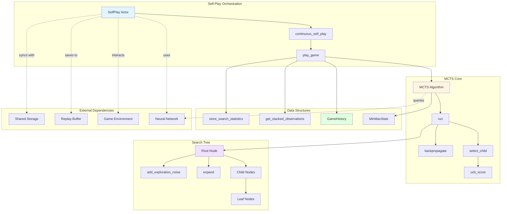

---

## Component Interaction Flow

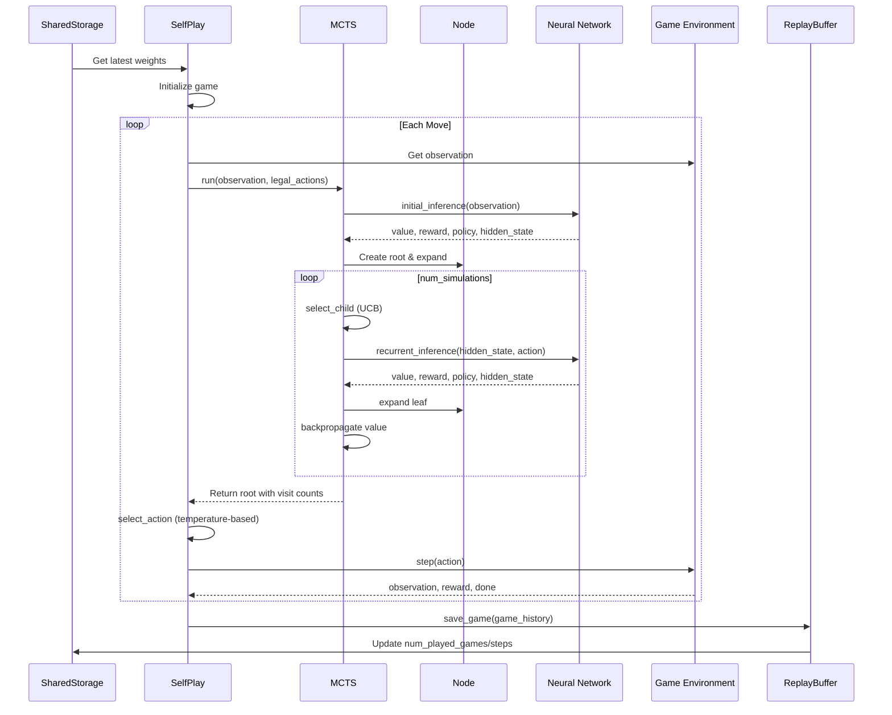

---

## Core Components

### 1. SelfPlay Class

The `SelfPlay` class is a Ray remote actor that runs in dedicated threads to continuously generate self-play games.

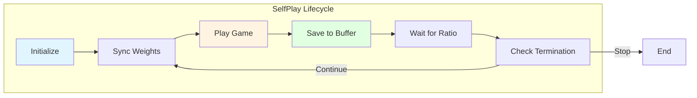

#### Key Responsibilities

1. **Game Orchestration**: Manages the complete lifecycle of self-play games
2. **Weight Synchronization**: Periodically updates neural network weights from shared storage
3. **Action Selection**: Uses MCTS to select actions during gameplay
4. **Data Generation**: Creates training data in the form of game histories
5. **Ratio Management**: Controls the balance between self-play and training

#### Key Methods

**`continuous_self_play(shared_storage, replay_buffer, test_mode=False)`**
- Main loop that continuously generates games
- Syncs weights from shared storage before each game
- Manages self-play/training ratio to prevent buffer overflow
- Supports both training mode (exploration) and test mode (exploitation)

**`play_game(temperature, temperature_threshold, render, opponent, muzero_player)`**
- Plays a complete game using MCTS for action selection
- Returns a `GameHistory` object containing the full trajectory
- Supports different opponent types: self, human, expert, random
- Handles observation stacking and legal action filtering

**`select_action(node, temperature)`**
- Selects actions based on visit count distribution
- Temperature controls exploration vs exploitation:
  - `temperature = 0`: Greedy (argmax)
  - `temperature = ∞`: Uniform random
  - `0 < temperature < ∞`: Softmax with temperature

#### Configuration Parameters

- `selfplay_on_gpu`: Whether to run self-play on GPU
- `visit_softmax_temperature_fn`: Function that returns temperature based on training steps
- `temperature_threshold`: Number of moves before switching to greedy selection
- `max_moves`: Maximum moves per game
- `self_play_delay`: Artificial delay between games
- `ratio`: Target ratio of training steps to played steps

---

### 2. MCTS Class

The `MCTS` class implements the core Monte Carlo Tree Search algorithm, which is the heart of MuZero's planning capability.

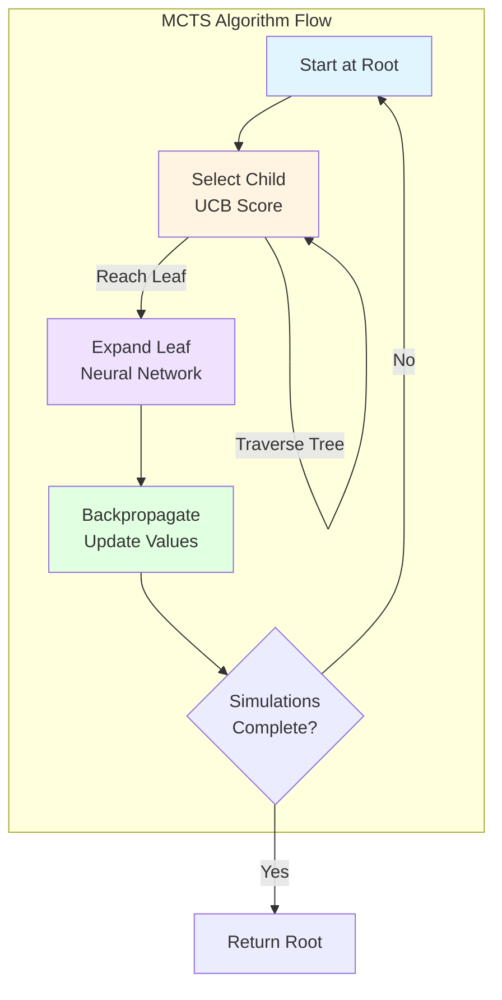

#### Algorithm Overview

The MCTS algorithm performs the following steps for each simulation:

1. **Selection**: Starting from root, recursively select children with highest UCB score until reaching a leaf
2. **Expansion**: Use neural network's recurrent inference to expand the leaf node
3. **Backpropagation**: Propagate the value back up the tree, updating statistics

#### Key Methods

**`run(model, observation, legal_actions, to_play, add_exploration_noise, override_root_with=None)`**
- Main entry point for MCTS
- Creates root node using representation function
- Runs `num_simulations` iterations of selection-expansion-backpropagation
- Returns root node with visit statistics and extra info

**`select_child(node, min_max_stats)`**
- Selects child with highest UCB score
- Breaks ties randomly
- Uses normalized values for stable training

**`ucb_score(parent, child, min_max_stats)`**
- Computes Upper Confidence Bound score for a child node
- Balances exploitation (value) and exploration (prior)
- Formula: `UCB = prior_score + value_score`
  - `prior_score = pb_c * sqrt(parent_visits) / (child_visits + 1) * prior`
  - `value_score = normalize(reward + discount * value)`

**`backpropagate(search_path, value, to_play, min_max_stats)`**
- Propagates values up the search tree
- Handles single-player and two-player games differently
- Updates min-max statistics for normalization

#### UCB Formula Details

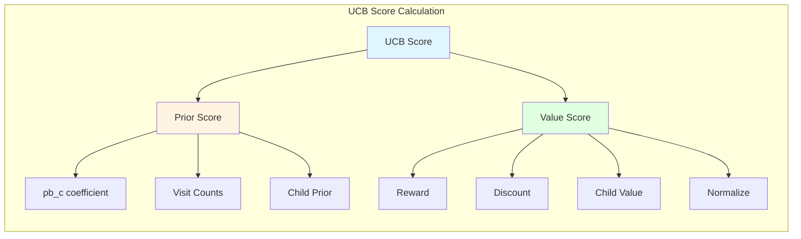

The UCB score balances:
- **Exploration**: Nodes with high prior probability and low visit counts
- **Exploitation**: Nodes with high estimated values

---

### 3. Node Class

The `Node` class represents individual nodes in the MCTS search tree.

#### Node Structure

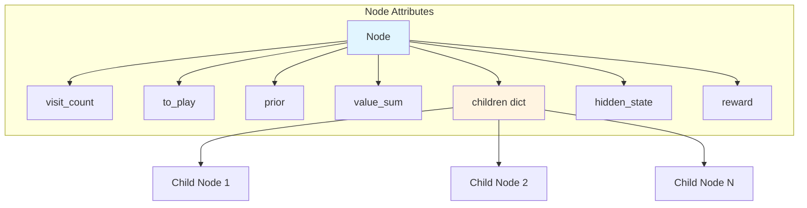

#### Key Attributes

- `visit_count`: Number of times this node has been visited during simulations
- `to_play`: Which player's turn it is at this node
- `prior`: Prior probability from the policy network
- `value_sum`: Cumulative value from all visits
- `children`: Dictionary mapping actions to child nodes
- `hidden_state`: Latent state representation from the neural network
- `reward`: Immediate reward for reaching this node

#### Key Methods

**`expanded()`**
- Returns whether the node has been expanded (has children)

**`value()`**
- Returns mean value: `value_sum / visit_count`
- Returns 0 if never visited

**`expand(actions, to_play, reward, policy_logits, hidden_state)`**
- Expands the node by creating child nodes for each legal action
- Assigns prior probabilities from the policy network
- Stores hidden state for future recurrent inference

**`add_exploration_noise(dirichlet_alpha, exploration_fraction)`**
- Adds Dirichlet noise to root node priors to encourage exploration
- Formula: `prior = (1 - frac) * prior + frac * noise`
- Only applied to the root node at the start of each search

---

### 4. GameHistory Class

The `GameHistory` class stores complete game trajectories for training.

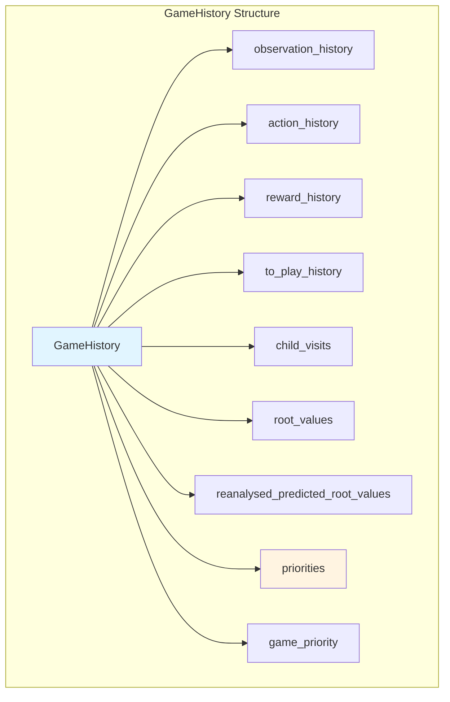

#### Key Attributes

**Core Trajectory Data:**
- `observation_history`: List of observations at each timestep
- `action_history`: List of actions taken
- `reward_history`: List of rewards received
- `to_play_history`: List of which player's turn at each step

**MCTS Statistics:**
- `child_visits`: Visit count distributions (used as policy targets)
- `root_values`: Root node values from MCTS (used as value targets)

**Training Enhancements:**
- `reanalysed_predicted_root_values`: Updated values from reanalysis (see [replay_buffer](replay_buffer.md))
- `priorities`: Per-position priorities for Prioritized Experience Replay (PER)
- `game_priority`: Maximum priority in the game (for game-level sampling)

#### Key Methods

**`store_search_statistics(root, action_space)`**
- Converts MCTS visit counts into a policy distribution
- Stores root value for training targets
- Called after each MCTS search

**`get_stacked_observations(index, num_stacked_observations, action_space_size)`**
- Creates stacked observation by concatenating:
  - Current observation
  - Previous `num_stacked_observations` observations
  - Previous actions (normalized)
- Handles edge cases at the start of the game with zero-padding
- Provides temporal context to the neural network

#### Observation Stacking

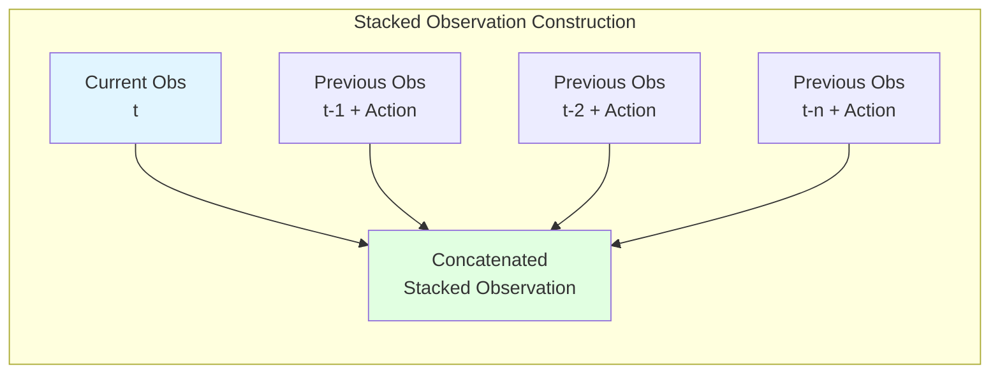

---

### 5. MinMaxStats Class

The `MinMaxStats` class tracks minimum and maximum values encountered during tree search for normalization.

#### Purpose

Normalizing values to [0, 1] range provides:
- **Stable Training**: Prevents value scale from affecting UCB scores
- **Consistent Exploration**: Ensures exploration bonus is appropriately scaled
- **Cross-Game Compatibility**: Works across games with different reward scales

#### Key Methods

**`update(value)`**
- Updates minimum and maximum values seen

**`normalize(value)`**
- Normalizes value to [0, 1] range
- Formula: `(value - min) / (max - min)`
- Returns unnormalized value if min == max (no data yet)

#### Normalization Flow

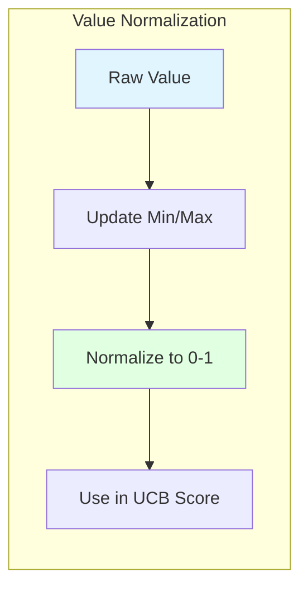

---

## Data Flow

### Self-Play Data Generation Pipeline

```mermaid
graph TB
    subgraph "Data Generation Flow"
        START[Start Game]
        RESET[Reset Environment]
        
        LOOP_START[Game Loop]
        GET_OBS[Get Observation]
        STACK[Stack Observations]
        MCTS_RUN[Run MCTS]
        SELECT[Select Action]
        STEP[Environment Step]
        STORE[Store Statistics]
        
        CHECK{Game<br/>Done?}
        
        SAVE[Save GameHistory]
        BUFFER[Replay Buffer]
    end
    
    START --> RESET
    RESET --> LOOP_START
    LOOP_START --> GET_OBS
    GET_OBS --> STACK
    STACK --> MCTS_RUN
    MCTS_RUN --> SELECT
    SELECT --> STEP
    STEP --> STORE
    STORE --> CHECK
    
    CHECK -->|No| LOOP_START
    CHECK -->|Yes| SAVE
    SAVE --> BUFFER
    
    style START fill:#e1f5ff
    style MCTS_RUN fill:#fff4e1
    style SAVE fill:#e1ffe1
```

### MCTS Simulation Flow

```mermaid
graph TB
    subgraph "Single MCTS Simulation"
        ROOT[Root Node]
        
        SELECT1[Select Child<br/>Max UCB]
        SELECT2[Select Child<br/>Max UCB]
        LEAF[Reach Leaf Node]
        
        INFERENCE[Recurrent Inference<br/>Neural Network]
        EXPAND[Expand Leaf<br/>Create Children]
        
        BACKUP1[Backpropagate<br/>Update Parent]
        BACKUP2[Backpropagate<br/>Update Grandparent]
        BACKUP3[Backpropagate<br/>Update Root]
    end
    
    ROOT --> SELECT1
    SELECT1 --> SELECT2
    SELECT2 --> LEAF
    
    LEAF --> INFERENCE
    INFERENCE --> EXPAND
    
    EXPAND --> BACKUP1
    BACKUP1 --> BACKUP2
    BACKUP2 --> BACKUP3
    
    style ROOT fill:#e1f5ff
    style INFERENCE fill:#f0e1ff
    style EXPAND fill:#fff4e1
    style BACKUP3 fill:#e1ffe1
```

---

## Integration with Other Modules

### Neural Network Integration

The self-play module heavily relies on the [neural networks](neural_networks.md) module:

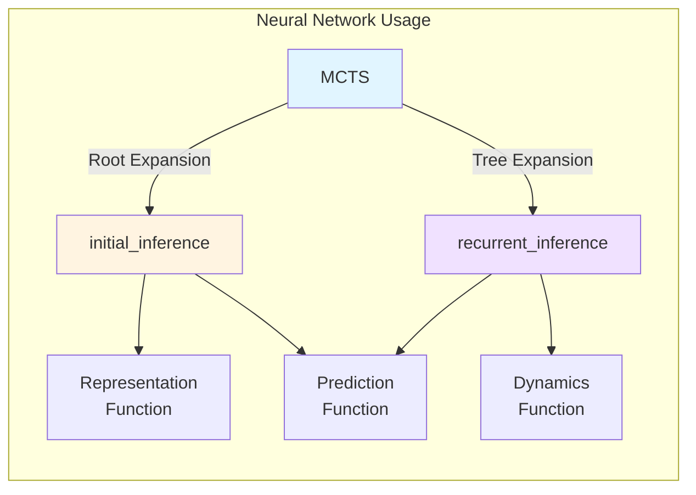

**Initial Inference** (Root Node):
- Input: Stacked observations
- Output: Hidden state, value, reward, policy
- Uses: Representation + Prediction networks

**Recurrent Inference** (Tree Expansion):
- Input: Parent hidden state, action
- Output: Next hidden state, value, reward, policy
- Uses: Dynamics + Prediction networks

### Replay Buffer Integration

Game histories are saved to the [replay buffer](replay_buffer.md) for training:

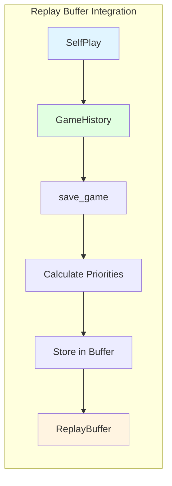

**Data Saved:**
- Complete observation, action, reward sequences
- MCTS visit count distributions (policy targets)
- Root values (value targets)
- Player turn information
- Priorities for PER (if enabled)

### Shared Storage Integration

The self-play module synchronizes with [shared storage](shared_storage.md):

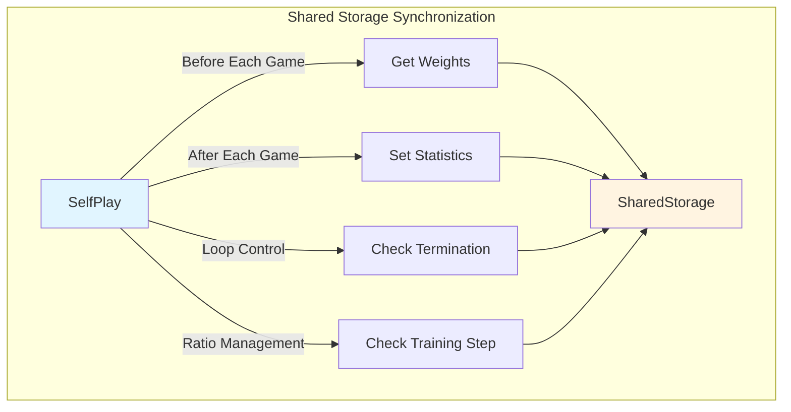

**Information Retrieved:**
- Neural network weights
- Current training step
- Termination signal

**Information Provided:**
- Episode length
- Total reward
- Mean MCTS value
- Player-specific rewards (multiplayer)

### Game Environment Integration

The self-play module interacts with [game environments](game_environments.md):

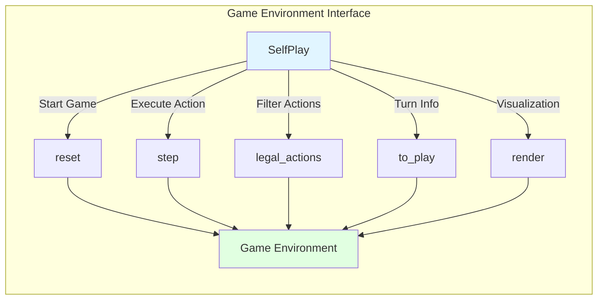

---

## Key Algorithms

### Temperature-Based Action Selection

Temperature controls the exploration-exploitation tradeoff:

```python
def select_action(node, temperature):
    visit_counts = [child.visit_count for child in node.children.values()]
    actions = list(node.children.keys())
    
    if temperature == 0:
        # Greedy: Select most visited action
        action = actions[argmax(visit_counts)]
    elif temperature == float("inf"):
        # Uniform random
        action = random.choice(actions)
    else:
        # Softmax with temperature
        distribution = visit_counts ** (1 / temperature)
        distribution = distribution / sum(distribution)
        action = random.choice(actions, p=distribution)
    
    return action
```

**Temperature Schedule:**
- Early training: High temperature (exploration)
- Late training: Low temperature (exploitation)
- First N moves: Use temperature
- After N moves: Greedy selection (temperature = 0)

### UCB Score Calculation

The UCB score balances exploration and exploitation:

```python
def ucb_score(parent, child, min_max_stats):
    # Exploration component
    pb_c = log((parent.visit_count + pb_c_base + 1) / pb_c_base) + pb_c_init
    pb_c *= sqrt(parent.visit_count) / (child.visit_count + 1)
    prior_score = pb_c * child.prior
    
    # Exploitation component
    if child.visit_count > 0:
        value = child.reward + discount * child.value()
        value_score = min_max_stats.normalize(value)
    else:
        value_score = 0
    
    return prior_score + value_score
```

**Components:**
- `pb_c`: Exploration coefficient (increases with parent visits)
- `prior_score`: Encourages trying actions with high policy probability
- `value_score`: Encourages revisiting actions with high estimated value

### Backpropagation

Values are propagated up the tree differently for single-player and two-player games:

**Single-Player:**
```python
for node in reversed(search_path):
    node.value_sum += value
    node.visit_count += 1
    value = node.reward + discount * value
```

**Two-Player (Zero-Sum):**
```python
for node in reversed(search_path):
    node.value_sum += value if node.to_play == to_play else -value
    node.visit_count += 1
    value = (-node.reward if node.to_play == to_play else node.reward) + discount * value
```

The two-player version accounts for alternating perspectives.

---

## Configuration Parameters

### MCTS Parameters

| Parameter | Description | Typical Value |
|-----------|-------------|---------------|
| `num_simulations` | Number of MCTS simulations per move | 50-800 |
| `pb_c_base` | Base constant for UCB exploration | 19652 |
| `pb_c_init` | Initial constant for UCB exploration | 1.25 |
| `root_dirichlet_alpha` | Dirichlet noise alpha for root | 0.25-0.3 |
| `root_exploration_fraction` | Fraction of noise to add to root | 0.25 |
| `discount` | Discount factor for future rewards | 0.95-0.997 |

### Self-Play Parameters

| Parameter | Description | Typical Value |
|-----------|-------------|---------------|
| `selfplay_on_gpu` | Run self-play on GPU | False |
| `max_moves` | Maximum moves per game | 500-1000 |
| `temperature_threshold` | Moves before greedy selection | 10-30 |
| `self_play_delay` | Delay between games (seconds) | 0 |
| `ratio` | Training steps / played steps ratio | None or 0.1-1.0 |
| `stacked_observations` | Number of observations to stack | 1-32 |

### Temperature Function

```python
def visit_softmax_temperature_fn(trained_steps):
    """
    Returns temperature based on training progress.
    Typically decreases from 1.0 to 0.5 or 0.
    """
    if trained_steps < 0.5 * training_steps:
        return 1.0
    elif trained_steps < 0.75 * training_steps:
        return 0.5
    else:
        return 0.25
```

---

## Performance Considerations

### Parallelization

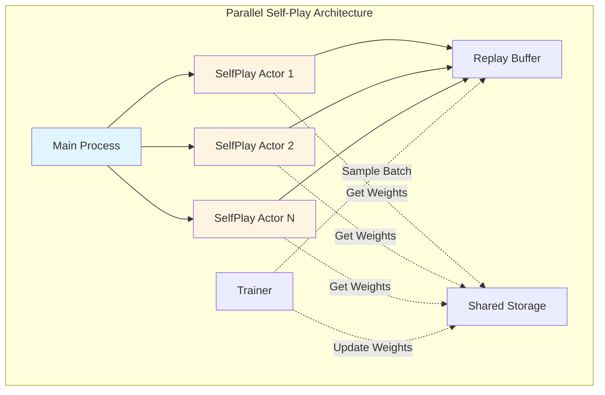

**Benefits:**
- Multiple games played simultaneously
- Continuous data generation while training
- Better hardware utilization

### GPU vs CPU Self-Play

**GPU Self-Play:**
- Pros: Faster neural network inference
- Cons: Competes with training for GPU resources
- Best for: Complex visual environments (Atari)

**CPU Self-Play:**
- Pros: Doesn't compete with training
- Cons: Slower inference
- Best for: Simple environments, many parallel actors

### Self-Play/Training Ratio

The ratio parameter controls the balance:

```python
while (training_steps / num_played_steps) < ratio:
    time.sleep(0.5)  # Wait for training to catch up
```

**Low Ratio (e.g., 0.1):**
- More self-play than training
- Larger replay buffer
- More diverse data
- Risk: Stale data

**High Ratio (e.g., 1.0):**
- More training than self-play
- Smaller replay buffer
- More on-policy data
- Risk: Overfitting

**No Ratio (None):**
- Self-play runs as fast as possible
- Maximum data generation
- Risk: Memory overflow

---

## Testing and Evaluation

### Test Mode

The `continuous_self_play` method supports a test mode:

```python
if test_mode:
    game_history = self.play_game(
        temperature=0,  # Greedy action selection
        temperature_threshold=config.temperature_threshold,
        render=False,
        opponent="self" or config.opponent,
        muzero_player=config.muzero_player,
    )
    
    # Save statistics to shared storage
    shared_storage.set_info({
        "episode_length": len(game_history.action_history) - 1,
        "total_reward": sum(game_history.reward_history),
        "mean_value": mean(game_history.root_values),
    })
```

**Test Mode Characteristics:**
- Greedy action selection (no exploration)
- Statistics saved to shared storage
- Not saved to replay buffer
- Used for evaluation during training

### Opponent Types

**Self-Play (`opponent="self"`):**
- Both players use MuZero
- Standard training mode

**Human (`opponent="human"`):**
- Human provides actions via input
- MuZero suggests moves
- For interactive evaluation

**Expert (`opponent="expert"`):**
- Uses game-specific expert agent
- For benchmarking against known strategies

**Random (`opponent="random"`):**
- Selects random legal actions
- Baseline comparison

---

## Common Patterns and Best Practices

### 1. Observation Stacking

Always stack observations to provide temporal context:

```python
stacked_observations = game_history.get_stacked_observations(
    index=-1,  # Current position
    num_stacked_observations=config.stacked_observations,
    action_space_size=len(config.action_space)
)
```

**Benefits:**
- Captures velocity and acceleration
- Handles partially observable environments
- Provides action history context

### 2. Legal Action Filtering

Always filter MCTS to legal actions:

```python
root, mcts_info = MCTS(config).run(
    model=self.model,
    observation=stacked_observations,
    legal_actions=self.game.legal_actions(),  # Critical!
    to_play=self.game.to_play(),
    add_exploration_noise=True,
)
```

**Benefits:**
- Prevents illegal moves
- Focuses search on valid actions
- Improves sample efficiency

### 3. Exploration Noise

Add Dirichlet noise only to the root node:

```python
if add_exploration_noise:
    root.add_exploration_noise(
        dirichlet_alpha=config.root_dirichlet_alpha,
        exploration_fraction=config.root_exploration_fraction,
    )
```

**Benefits:**
- Encourages exploration of different strategies
- Prevents premature convergence
- Maintains diversity in replay buffer

### 4. Value Normalization

Always normalize values in UCB calculation:

```python
value_score = min_max_stats.normalize(
    child.reward + config.discount * child.value()
)
```

**Benefits:**
- Stable across different reward scales
- Consistent exploration bonus
- Better convergence

---

## Debugging and Diagnostics

### MCTS Information

The `run` method returns extra information:

```python
root, mcts_info = MCTS(config).run(...)

print(f"Max tree depth: {mcts_info['max_tree_depth']}")
print(f"Root predicted value: {mcts_info['root_predicted_value']}")
print(f"Root value after search: {root.value()}")
```

### Visit Count Distribution

Visualize the policy learned by MCTS:

```python
visit_counts = [child.visit_count for child in root.children.values()]
actions = list(root.children.keys())

for action, count in zip(actions, visit_counts):
    print(f"Action {action}: {count} visits ({count/sum(visit_counts)*100:.1f}%)")
```

### Value Tracking

Monitor value estimates during self-play:

```python
print(f"Root value for player {game.to_play()}: {root.value():.2f}")
print(f"Mean value over game: {numpy.mean(game_history.root_values):.2f}")
```

---

## Relationship to MuZero Paper

The implementation closely follows the MuZero paper (Schrittwieser et al., 2020):

### MCTS Algorithm (Appendix B)

**Selection:**
- Uses PUCT variant of UCB
- Exploration coefficient grows with parent visits
- Values normalized to [0, 1]

**Expansion:**
- Uses learned dynamics model (not true environment)
- Expands all actions (not just legal ones in tree)
- Stores hidden state for recurrent inference

**Backpropagation:**
- Updates visit counts and value sums
- Handles two-player zero-sum games
- Maintains min-max statistics

### Self-Play (Appendix D)

**Temperature Schedule:**
- High temperature early in game (exploration)
- Greedy selection after threshold (exploitation)
- Temperature decreases with training progress

**Exploration Noise:**
- Dirichlet noise added to root prior
- Alpha = 0.3 for chess, 0.25 for Go
- Fraction = 0.25 (25% noise, 75% prior)

**Data Generation:**
- Stores visit count distribution as policy target
- Stores root value as value target
- Stacks observations for temporal context

---

## Advanced Topics

### Reanalyze Integration

Game histories can be reanalyzed with updated networks (see [replay_buffer](replay_buffer.md)):

```python
# During reanalysis
root, _ = MCTS(config).run(
    model=latest_model,
    observation=stacked_observations,
    legal_actions=legal_actions,
    to_play=to_play,
    add_exploration_noise=False,  # No noise during reanalysis
)

# Update stored values
game_history.reanalysed_predicted_root_values[index] = root.value()
```

### Prioritized Experience Replay

Game histories store priorities for PER:

```python
# Calculate priority based on TD error
priority = abs(root_value - target_value) ** alpha

# Store in game history
game_history.priorities[index] = priority
game_history.game_priority = max(game_history.priorities)
```

### Multi-Player Support

The implementation supports two-player zero-sum games:

```python
# Alternate players
if virtual_to_play + 1 < len(config.players):
    virtual_to_play = config.players[virtual_to_play + 1]
else:
    virtual_to_play = config.players[0]

# Flip values for opponent
node.value_sum += value if node.to_play == to_play else -value
```

---

## Summary

The **self_play_mcts** module is the decision-making engine of MuZero:

1. **SelfPlay** orchestrates game playing and data generation
2. **MCTS** implements planning via tree search with neural network guidance
3. **Node** represents search tree structure with visit statistics
4. **GameHistory** stores complete game trajectories for training
5. **MinMaxStats** normalizes values for stable search

The module integrates with:
- [Neural Networks](neural_networks.md) for inference
- [Replay Buffer](replay_buffer.md) for data storage
- [Shared Storage](shared_storage.md) for weight synchronization
- [Game Environments](game_environments.md) for interaction

Key features:
- Parallel self-play for efficient data generation
- Temperature-based exploration control
- UCB-based action selection
- Support for single and two-player games
- Prioritized experience replay integration

This module is critical to MuZero's success, as it generates the high-quality training data that enables the neural networks to learn effective policies and value functions without access to the true environment dynamics.
