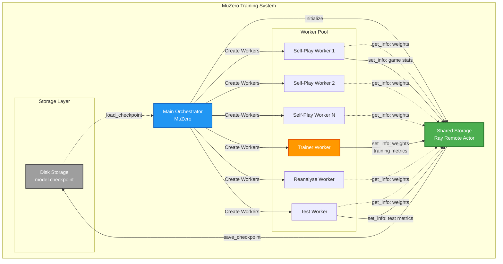
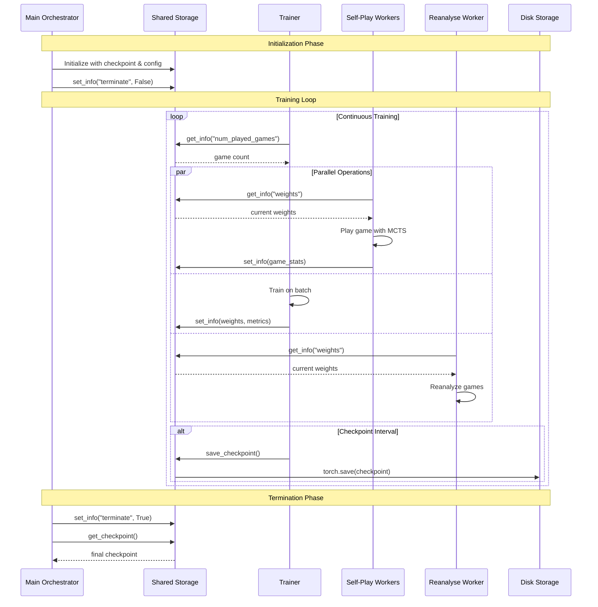
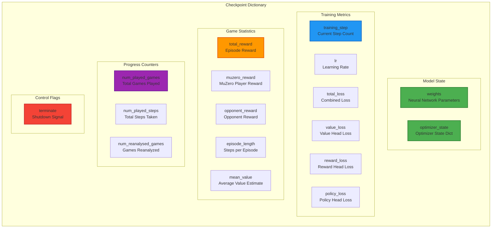
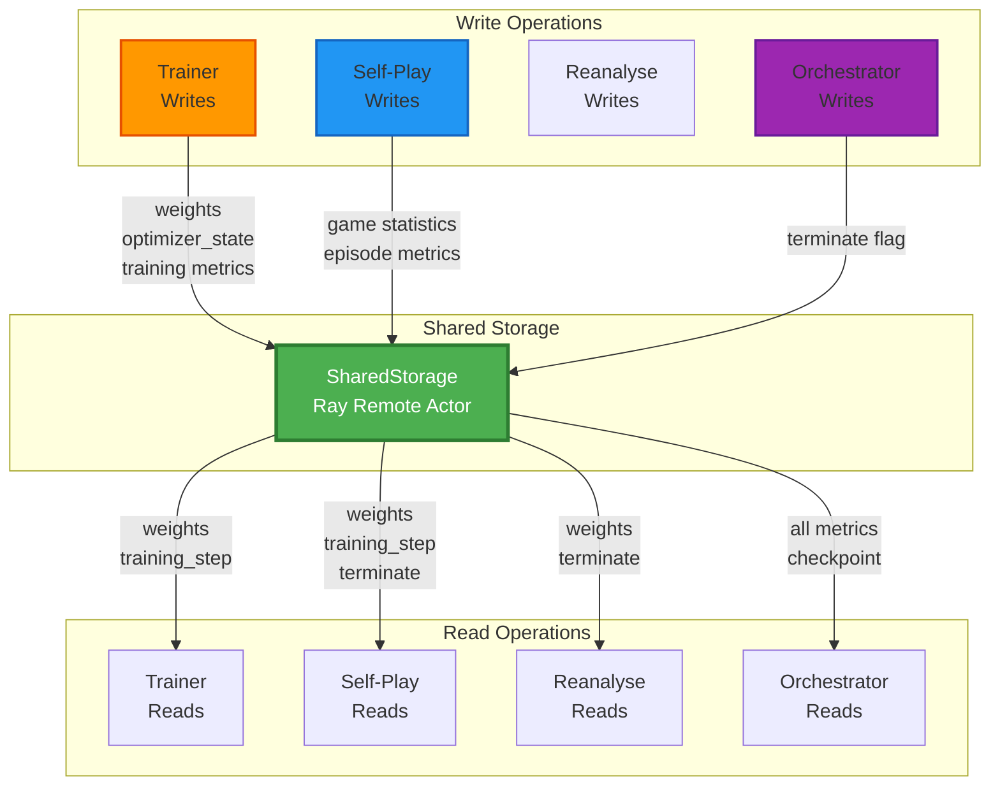
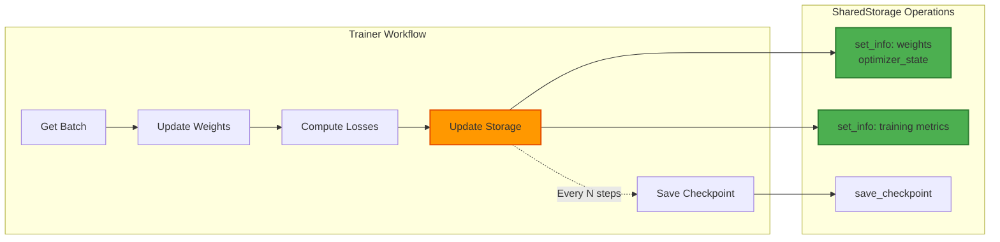
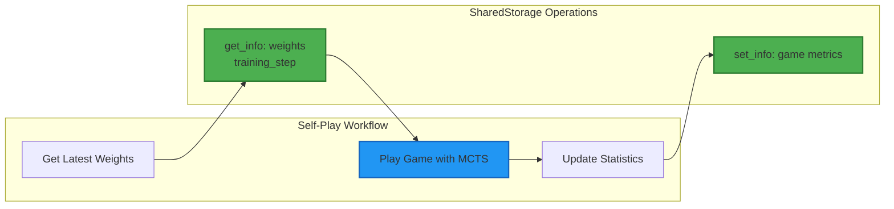
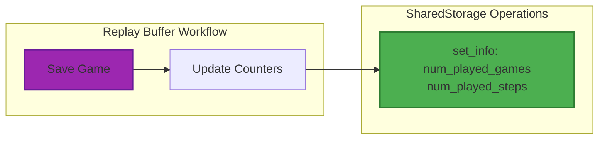
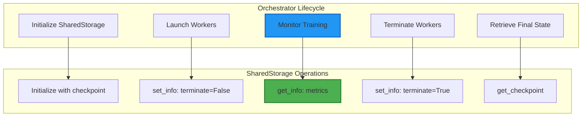
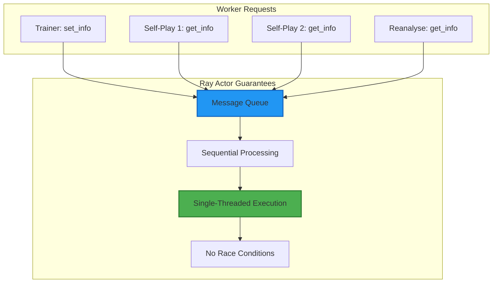
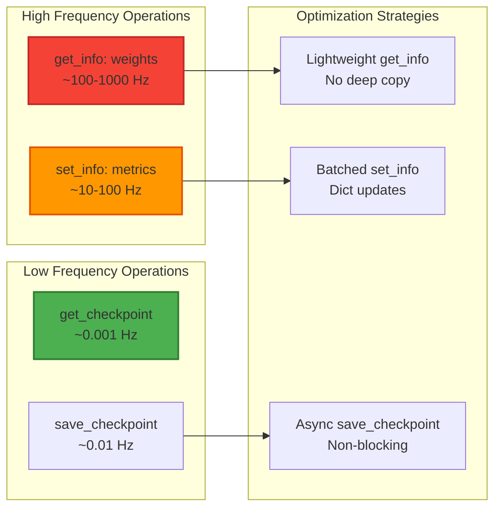

# Shared Storage Module

## Overview

The **Shared Storage** module provides a centralized, thread-safe storage mechanism for managing the MuZero neural network weights and training metadata across distributed Ray workers. It acts as the single source of truth for the current state of the training process, enabling seamless coordination between self-play workers, the trainer, and reanalysis workers.

This module implements a Ray remote actor that runs in a dedicated thread, providing atomic read/write operations for checkpoint data and ensuring consistency across all concurrent workers in the MuZero training pipeline.

## Core Components

### SharedStorage

**Location**: `knowledge.shared_storage.SharedStorage`

A Ray remote actor class that maintains and synchronizes the current training checkpoint across all distributed workers.

**Key Responsibilities**:
- Store and retrieve neural network weights
- Maintain training statistics and metadata
- Provide thread-safe checkpoint operations
- Enable checkpoint persistence to disk
- Coordinate state across distributed workers

**Initialization Parameters**:
- `checkpoint` (dict): Initial checkpoint containing weights and training metadata
- `config` (MuZeroConfig): Configuration object with training parameters

**Key Methods**:
- `save_checkpoint(path=None)`: Persist checkpoint to disk
- `get_checkpoint()`: Retrieve a deep copy of the current checkpoint
- `get_info(keys)`: Get specific checkpoint values by key(s)
- `set_info(keys, values=None)`: Update checkpoint values atomically

## Architecture

### System Integration



### Component Interaction Flow



## Data Flow

### Checkpoint Structure

The checkpoint dictionary maintained by SharedStorage contains the following key-value pairs:



### Read/Write Patterns



## Detailed Component Documentation

### SharedStorage Class

#### Class Definition

```python
@ray.remote
class SharedStorage:
    """
    Class which run in a dedicated thread to store the network weights 
    and some information.
    """
```

The `@ray.remote` decorator transforms this class into a Ray actor, enabling:
- Asynchronous method invocation via `.remote()`
- Automatic serialization/deserialization
- Thread-safe state management
- Distributed execution across cluster nodes

#### Constructor

```python
def __init__(self, checkpoint, config):
    self.config = config
    self.current_checkpoint = copy.deepcopy(checkpoint)
```

**Parameters**:
- `checkpoint` (dict): Initial checkpoint state containing:
  - `weights`: Neural network parameters
  - `optimizer_state`: Optimizer state dictionary
  - Training metrics (losses, rewards, etc.)
  - Progress counters
  - Control flags
- `config` (MuZeroConfig): Configuration object with `results_path` for saving

**Behavior**:
- Creates a deep copy of the checkpoint to prevent external mutations
- Stores configuration for checkpoint persistence

#### Methods

##### save_checkpoint()

```python
def save_checkpoint(self, path=None):
    if not path:
        path = self.config.results_path / "model.checkpoint"
    torch.save(self.current_checkpoint, path)
```

**Purpose**: Persist the current checkpoint to disk for recovery and evaluation.

**Parameters**:
- `path` (str/Path, optional): Custom save location. Defaults to `{results_path}/model.checkpoint`

**Usage Pattern**:
```python
# Called by trainer at checkpoint intervals
if self.training_step % self.config.checkpoint_interval == 0:
    shared_storage.save_checkpoint.remote()
```

**File Format**: PyTorch checkpoint file containing the entire checkpoint dictionary.

##### get_checkpoint()

```python
def get_checkpoint(self):
    return copy.deepcopy(self.current_checkpoint)
```

**Purpose**: Retrieve a complete copy of the current checkpoint state.

**Returns**: Deep copy of the checkpoint dictionary to prevent external mutations.

**Usage Pattern**:
```python
# Called by orchestrator during termination
checkpoint = ray.get(shared_storage_worker.get_checkpoint.remote())
```

**Thread Safety**: Deep copy ensures the returned data is isolated from concurrent modifications.

##### get_info()

```python
def get_info(self, keys):
    if isinstance(keys, str):
        return self.current_checkpoint[keys]
    elif isinstance(keys, list):
        return {key: self.current_checkpoint[key] for key in keys}
    else:
        raise TypeError
```

**Purpose**: Retrieve specific checkpoint values efficiently.

**Parameters**:
- `keys` (str or list): Single key or list of keys to retrieve

**Returns**:
- If `keys` is a string: The value associated with that key
- If `keys` is a list: Dictionary mapping keys to their values

**Usage Patterns**:
```python
# Single key retrieval
weights = ray.get(shared_storage.get_info.remote("weights"))

# Multiple keys retrieval
info = ray.get(shared_storage.get_info.remote([
    "total_reward", "training_step", "num_played_games"
]))
```

**Error Handling**: Raises `TypeError` if keys is neither string nor list.

##### set_info()

```python
def set_info(self, keys, values=None):
    if isinstance(keys, str) and values is not None:
        self.current_checkpoint[keys] = values
    elif isinstance(keys, dict):
        self.current_checkpoint.update(keys)
    else:
        raise TypeError
```

**Purpose**: Update checkpoint values atomically.

**Parameters**:
- `keys` (str or dict): Single key or dictionary of key-value pairs
- `values` (any, optional): Value to set when keys is a string

**Usage Patterns**:
```python
# Single key update
shared_storage.set_info.remote("terminate", True)

# Multiple keys update
shared_storage.set_info.remote({
    "weights": new_weights,
    "optimizer_state": optimizer_state,
    "training_step": step,
    "total_loss": loss
})
```

**Atomicity**: Ray ensures each method call is atomic, preventing race conditions.

## Integration with Other Modules

### Trainer Module Integration

The [Trainer](trainer.md) module is the primary writer to SharedStorage:



**Key Interactions**:
- **Weight Updates**: Trainer writes new weights after each training step
- **Metric Logging**: Training losses and learning rate are continuously updated
- **Checkpoint Saving**: Periodic persistence at configured intervals

### Self-Play Module Integration

The [Self-Play MCTS](self_play_mcts.md) module reads weights and writes game statistics:



**Key Interactions**:
- **Weight Synchronization**: Self-play workers fetch latest weights before each game
- **Progress Tracking**: Training step is checked to determine temperature and termination
- **Performance Metrics**: Episode rewards and lengths are reported for monitoring

### Replay Buffer Integration

The [Replay Buffer](replay_buffer.md) module coordinates with SharedStorage for game counting:



**Key Interactions**:
- **Game Counting**: Replay buffer updates game and step counters after saving each game
- **Progress Monitoring**: Counters are used to track training progress and ratios

### Main Orchestrator Integration

The [Main Orchestrator](main_orchestrator.md) module initializes and monitors SharedStorage:



**Key Interactions**:
- **Initialization**: Orchestrator creates SharedStorage with initial checkpoint
- **Monitoring**: Continuous polling of metrics for TensorBoard logging
- **Termination**: Graceful shutdown via terminate flag and final checkpoint retrieval

## Concurrency and Thread Safety

### Ray Actor Model

SharedStorage leverages Ray's actor model for thread safety:



**Key Properties**:
1. **Single-Threaded**: Each actor processes one method call at a time
2. **Message Queue**: Requests are queued and processed sequentially
3. **Atomicity**: Each method call is atomic with respect to other calls
4. **No Locks Needed**: Ray handles synchronization automatically

### Deep Copy Strategy

SharedStorage uses deep copying to prevent data races:

```python
# Constructor: Isolate initial state
self.current_checkpoint = copy.deepcopy(checkpoint)

# get_checkpoint: Prevent external mutations
return copy.deepcopy(self.current_checkpoint)
```

**Benefits**:
- Workers receive independent copies of data
- No shared mutable state between workers
- Prevents accidental corruption of checkpoint

**Trade-offs**:
- Memory overhead for large checkpoints
- CPU cost for copying operations
- Acceptable given infrequent checkpoint retrievals

## Performance Considerations

### Access Patterns



### Optimization Techniques

1. **Selective Deep Copying**:
   - `get_info()`: Returns references (fast, frequent)
   - `get_checkpoint()`: Returns deep copy (slow, rare)

2. **Batched Updates**:
   - Use dictionary form of `set_info()` to update multiple values atomically
   - Reduces number of remote calls

3. **Asynchronous Saves**:
   - `save_checkpoint.remote()` returns immediately
   - Disk I/O happens in background

4. **Checkpoint Intervals**:
   - Configure `checkpoint_interval` to balance safety vs. performance
   - Typical values: 10-100 training steps

## Usage Examples

### Basic Initialization

```python
import ray
from knowledge.shared_storage import SharedStorage

# Initialize Ray
ray.init()

# Create initial checkpoint
checkpoint = {
    "weights": model.get_weights(),
    "optimizer_state": None,
    "training_step": 0,
    "num_played_games": 0,
    "terminate": False,
    # ... other fields
}

# Create SharedStorage actor
shared_storage = SharedStorage.remote(checkpoint, config)
```

### Worker Weight Synchronization

```python
# In self-play worker
class SelfPlay:
    def continuous_self_play(self, shared_storage, replay_buffer):
        while not ray.get(shared_storage.get_info.remote("terminate")):
            # Get latest weights
            weights = ray.get(shared_storage.get_info.remote("weights"))
            self.model.set_weights(weights)
            
            # Play game
            game_history = self.play_game(...)
            
            # Save game to replay buffer
            replay_buffer.save_game.remote(game_history, shared_storage)
```

### Trainer Updates

```python
# In trainer worker
class Trainer:
    def continuous_update_weights(self, replay_buffer, shared_storage):
        while self.training_step < config.training_steps:
            # Train on batch
            batch = ray.get(replay_buffer.get_batch.remote())
            loss = self.update_weights(batch)
            
            # Update shared storage
            if self.training_step % config.checkpoint_interval == 0:
                shared_storage.set_info.remote({
                    "weights": self.model.get_weights(),
                    "optimizer_state": self.optimizer.state_dict(),
                })
                shared_storage.save_checkpoint.remote()
            
            shared_storage.set_info.remote({
                "training_step": self.training_step,
                "total_loss": loss,
            })
```

### Monitoring Loop

```python
# In main orchestrator
def logging_loop(self, shared_storage):
    keys = ["total_reward", "training_step", "total_loss"]
    
    while True:
        # Get current metrics
        info = ray.get(shared_storage.get_info.remote(keys))
        
        # Log to TensorBoard
        writer.add_scalar("Reward", info["total_reward"], info["training_step"])
        writer.add_scalar("Loss", info["total_loss"], info["training_step"])
        
        # Check termination
        if info["training_step"] >= config.training_steps:
            break
        
        time.sleep(0.5)
```

### Graceful Shutdown

```python
# In main orchestrator
def terminate_workers(self):
    # Signal all workers to stop
    self.shared_storage_worker.set_info.remote("terminate", True)
    
    # Retrieve final checkpoint
    self.checkpoint = ray.get(
        self.shared_storage_worker.get_checkpoint.remote()
    )
    
    # Save to disk
    if self.config.save_model:
        torch.save(self.checkpoint, "final_model.checkpoint")
```

## Configuration

SharedStorage behavior is controlled by the MuZeroConfig object:

```python
class MuZeroConfig:
    # Checkpoint saving
    results_path: Path = Path("./results")
    save_model: bool = True
    checkpoint_interval: int = 10  # Save every N training steps
    
    # Training control
    training_steps: int = 100000
    
    # Worker coordination
    ratio: float = None  # Self-play/training ratio
    training_delay: float = 0  # Artificial delay between updates
```

**Key Parameters**:
- `results_path`: Directory for saving checkpoints
- `save_model`: Enable/disable checkpoint persistence
- `checkpoint_interval`: Frequency of checkpoint saves
- `training_steps`: Total training steps before termination

## Error Handling

### Type Validation

```python
def get_info(self, keys):
    if isinstance(keys, str):
        return self.current_checkpoint[keys]
    elif isinstance(keys, list):
        return {key: self.current_checkpoint[key] for key in keys}
    else:
        raise TypeError("keys must be str or list")
```

### Missing Keys

```python
# KeyError if key doesn't exist in checkpoint
try:
    value = ray.get(shared_storage.get_info.remote("nonexistent_key"))
except KeyError as e:
    print(f"Key not found: {e}")
```

### Ray Actor Failures

```python
# Ray automatically handles actor failures with retries
# Configure retry behavior in ray.init()
ray.init(
    num_gpus=total_gpus,
    ignore_reinit_error=True,
    _system_config={
        "max_actor_restart_retries": 3,
    }
)
```

## Best Practices

### 1. Minimize Remote Calls

```python
# Bad: Multiple remote calls
reward = ray.get(shared_storage.get_info.remote("total_reward"))
step = ray.get(shared_storage.get_info.remote("training_step"))
loss = ray.get(shared_storage.get_info.remote("total_loss"))

# Good: Single remote call
info = ray.get(shared_storage.get_info.remote([
    "total_reward", "training_step", "total_loss"
]))
```

### 2. Batch Updates

```python
# Bad: Multiple set_info calls
shared_storage.set_info.remote("training_step", step)
shared_storage.set_info.remote("total_loss", loss)
shared_storage.set_info.remote("lr", lr)

# Good: Single batched update
shared_storage.set_info.remote({
    "training_step": step,
    "total_loss": loss,
    "lr": lr,
})
```

### 3. Asynchronous Operations

```python
# Fire-and-forget for non-critical updates
shared_storage.set_info.remote("num_played_games", count)

# Wait for critical operations
checkpoint = ray.get(shared_storage.get_checkpoint.remote())
```

### 4. Checkpoint Management

```python
# Save checkpoints at regular intervals
if training_step % checkpoint_interval == 0:
    shared_storage.save_checkpoint.remote()

# Save final checkpoint before exit
shared_storage.save_checkpoint.remote(path="final_model.checkpoint")
ray.get(shared_storage.save_checkpoint.remote())  # Wait for completion
```

## Debugging and Monitoring

### Logging Checkpoint State

```python
# Add logging to track checkpoint updates
def set_info(self, keys, values=None):
    if isinstance(keys, str) and values is not None:
        print(f"[SharedStorage] Updating {keys} = {values}")
        self.current_checkpoint[keys] = values
    elif isinstance(keys, dict):
        print(f"[SharedStorage] Batch update: {list(keys.keys())}")
        self.current_checkpoint.update(keys)
```

### Monitoring Access Patterns

```python
# Track method call frequency
import time
from collections import defaultdict

class SharedStorage:
    def __init__(self, checkpoint, config):
        self.config = config
        self.current_checkpoint = copy.deepcopy(checkpoint)
        self.call_counts = defaultdict(int)
        self.last_log_time = time.time()
    
    def get_info(self, keys):
        self.call_counts["get_info"] += 1
        self._maybe_log_stats()
        # ... rest of implementation
    
    def _maybe_log_stats(self):
        if time.time() - self.last_log_time > 60:  # Log every minute
            print(f"[SharedStorage] Call counts: {dict(self.call_counts)}")
            self.last_log_time = time.time()
```

### Checkpoint Validation

```python
def validate_checkpoint(checkpoint):
    """Validate checkpoint structure and contents."""
    required_keys = [
        "weights", "optimizer_state", "training_step",
        "num_played_games", "num_played_steps", "terminate"
    ]
    
    for key in required_keys:
        if key not in checkpoint:
            raise ValueError(f"Missing required key: {key}")
    
    if checkpoint["training_step"] < 0:
        raise ValueError("training_step must be non-negative")
    
    print("[SharedStorage] Checkpoint validation passed")
```

## Limitations and Considerations

### 1. Memory Overhead

- **Issue**: Deep copying large neural networks is memory-intensive
- **Impact**: Each `get_checkpoint()` call doubles memory usage temporarily
- **Mitigation**: Use `get_info("weights")` for frequent access, reserve `get_checkpoint()` for rare operations

### 2. Network Latency

- **Issue**: Remote calls have ~1ms overhead in distributed settings
- **Impact**: High-frequency access can become bottleneck
- **Mitigation**: Batch operations, cache weights locally in workers

### 3. Checkpoint Size

- **Issue**: Large models (e.g., ResNet) produce multi-GB checkpoints
- **Impact**: Slow disk I/O during `save_checkpoint()`
- **Mitigation**: Save asynchronously, use SSD storage, compress checkpoints

### 4. No Versioning

- **Issue**: SharedStorage maintains only current state, no history
- **Impact**: Cannot rollback to previous checkpoints during training
- **Mitigation**: Implement external checkpoint versioning if needed

## Future Enhancements

### Potential Improvements

1. **Checkpoint Compression**:
   ```python
   def save_checkpoint(self, path=None):
       import gzip
       with gzip.open(path, 'wb') as f:
           torch.save(self.current_checkpoint, f)
   ```

2. **Checkpoint Versioning**:
   ```python
   def save_checkpoint(self, path=None):
       timestamp = datetime.now().strftime("%Y%m%d_%H%M%S")
       path = self.config.results_path / f"model_{timestamp}.checkpoint"
       torch.save(self.current_checkpoint, path)
   ```

3. **Metrics History**:
   ```python
   def __init__(self, checkpoint, config):
       self.current_checkpoint = copy.deepcopy(checkpoint)
       self.metrics_history = []  # Store historical metrics
   ```

4. **Distributed Checkpointing**:
   ```python
   # Use Ray's distributed storage for large models
   import ray.experimental.data
   ```

## Related Modules

- **[Main Orchestrator](main_orchestrator.md)**: Initializes and manages SharedStorage lifecycle
- **[Trainer](trainer.md)**: Primary writer of weights and training metrics
- **[Self-Play MCTS](self_play_mcts.md)**: Reads weights and writes game statistics
- **[Replay Buffer](replay_buffer.md)**: Coordinates game counting with SharedStorage
- **[Neural Networks](neural_networks.md)**: Provides the weights stored in SharedStorage

## Summary

The Shared Storage module is a critical infrastructure component that enables distributed training in MuZero. By providing a centralized, thread-safe storage mechanism for neural network weights and training metadata, it ensures consistency and coordination across all workers in the training pipeline.

**Key Takeaways**:
- **Centralized State**: Single source of truth for training state
- **Thread-Safe**: Ray actor model ensures atomic operations
- **Efficient**: Optimized for high-frequency weight access
- **Persistent**: Checkpoint saving for recovery and evaluation
- **Simple API**: Four methods cover all use cases

The module's design prioritizes simplicity and reliability over advanced features, making it easy to understand and maintain while providing the essential functionality needed for distributed reinforcement learning.
