# Trainer Module

## Overview

The **Trainer** module is the core training engine of the MuZero system, responsible for continuously optimizing the neural network using experience data collected from self-play games. Running as a dedicated Ray actor in a separate thread, the Trainer implements the MuZero training algorithm with support for prioritized experience replay (PER), learning rate scheduling, and multi-step unrolling for temporal credit assignment.

The module bridges the gap between collected game experiences (stored in the [replay buffer](replay_buffer.md)) and the neural network predictions (from [neural networks](neural_networks.md)), implementing the sophisticated loss functions and optimization strategies that enable MuZero to learn effective value, policy, and dynamics models simultaneously.

### Key Responsibilities

- **Continuous Training Loop**: Maintains an ongoing training process that runs concurrently with self-play
- **Batch Processing**: Retrieves and processes batches of game experiences from the replay buffer
- **Multi-Head Loss Computation**: Calculates and optimizes value, reward, and policy losses simultaneously
- **Model Unrolling**: Performs recurrent inference through the dynamics model for multi-step predictions
- **Priority Updates**: Computes and updates priorities for prioritized experience replay
- **Learning Rate Scheduling**: Implements exponential decay of learning rate over training steps
- **Checkpoint Management**: Periodically saves model weights and optimizer state to shared storage
- **Training Ratio Control**: Manages the balance between self-play and training speeds

---

## Architecture

### System Context

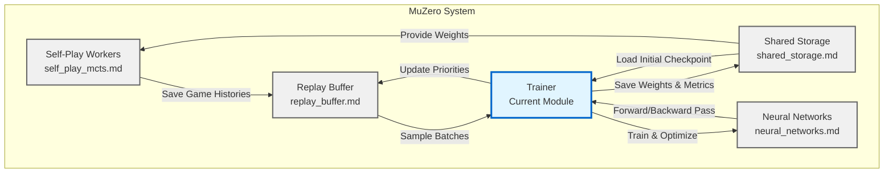

### Component Architecture

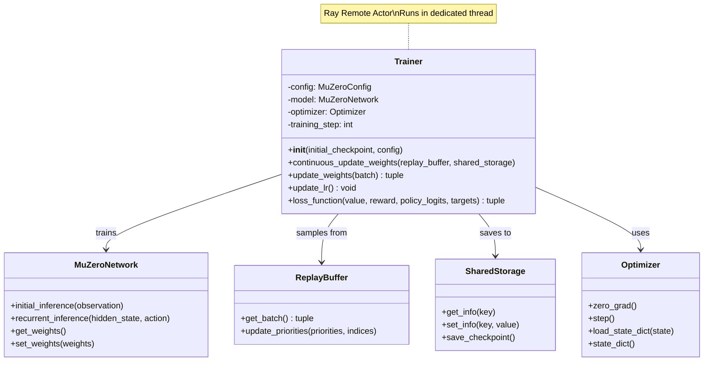

---

## Core Components

### Trainer Class

The `Trainer` class is implemented as a Ray remote actor (`@ray.remote`) that runs in a dedicated thread, enabling parallel execution with self-play workers.

#### Initialization

```python
def __init__(self, initial_checkpoint, config):
    """
    Initialize the trainer with a checkpoint and configuration.
    
    Args:
        initial_checkpoint: Dict containing:
            - weights: Initial neural network weights
            - optimizer_state: Previous optimizer state (or None)
            - training_step: Current training step count
        config: MuZeroConfig object with training hyperparameters
    """
```

**Initialization Process:**

1. **Random Seed Setup**: Fixes NumPy and PyTorch random seeds for reproducibility
2. **Network Initialization**: Creates MuZeroNetwork and loads initial weights
3. **Device Configuration**: Moves model to GPU if configured and available
4. **Training Mode**: Sets model to training mode (enables dropout, batch norm training)
5. **Optimizer Setup**: Initializes SGD or Adam optimizer with configured hyperparameters
6. **State Restoration**: Loads previous optimizer state if resuming training

**Supported Optimizers:**
- **SGD**: Stochastic Gradient Descent with momentum and weight decay
- **Adam**: Adaptive moment estimation with weight decay

---

## Training Process

### Continuous Training Loop

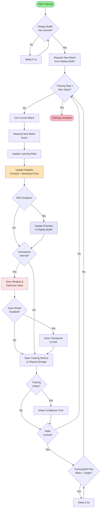

### Weight Update Process

The `update_weights` method performs a single training step with the following stages:

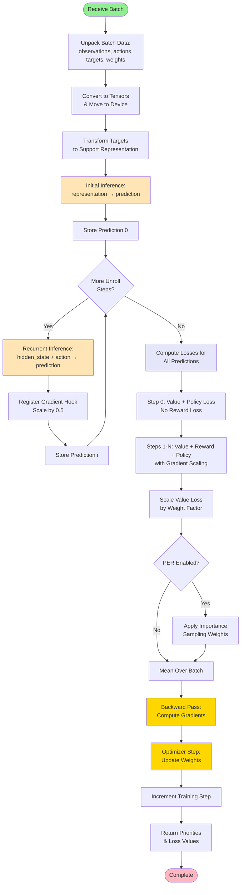

#### Detailed Steps

**1. Data Preparation**
```python
# Unpack batch components
observation_batch, action_batch, target_value, target_reward, 
target_policy, weight_batch, gradient_scale_batch = batch

# Convert to tensors and move to device
observation_batch = torch.tensor(observation_batch).float().to(device)
action_batch = torch.tensor(action_batch).long().to(device).unsqueeze(-1)
# ... (other conversions)

# Transform scalar targets to support representation
target_value = models.scalar_to_support(target_value, support_size)
target_reward = models.scalar_to_support(target_reward, support_size)
```

**2. Generate Predictions via Unrolling**
```python
# Initial inference from observation
value, reward, policy_logits, hidden_state = model.initial_inference(observation_batch)
predictions = [(value, reward, policy_logits)]

# Recurrent inference for K unroll steps
for i in range(1, num_unroll_steps + 1):
    value, reward, policy_logits, hidden_state = model.recurrent_inference(
        hidden_state, action_batch[:, i]
    )
    # Scale dynamics gradient (paper appendix)
    hidden_state.register_hook(lambda grad: grad * 0.5)
    predictions.append((value, reward, policy_logits))
```

**3. Compute Multi-Step Losses**

The loss function uses cross-entropy for all three heads:

```python
# Cross-entropy loss (better convergence than MSE)
value_loss = (-target_value * LogSoftmax(value)).sum(1)
reward_loss = (-target_reward * LogSoftmax(reward)).sum(1)
policy_loss = (-target_policy * LogSoftmax(policy_logits)).sum(1)
```

**Special handling for first step:**
- Reward loss is ignored (no previous action to predict reward from)
- Only value and policy losses are computed

**Gradient scaling for unroll steps:**
```python
# Scale by number of valid unroll steps
current_loss.register_hook(lambda grad: grad / gradient_scale_batch[:, i])
```

**4. Priority Computation (PER)**

For each prediction step, compute TD-error based priorities:
```python
pred_value_scalar = support_to_scalar(value).detach().cpu().numpy()
priorities[:, i] = abs(pred_value_scalar - target_value_scalar[:, i]) ** PER_alpha
```

**5. Final Loss Aggregation**
```python
# Combine losses with value loss scaling
loss = value_loss * value_loss_weight + reward_loss + policy_loss

# Apply importance sampling weights (PER)
if PER:
    loss *= weight_batch

# Mean over batch
loss = loss.mean()
```

**6. Optimization**
```python
optimizer.zero_grad()
loss.backward()
optimizer.step()
training_step += 1
```

---

## Loss Functions

### Multi-Head Loss Architecture

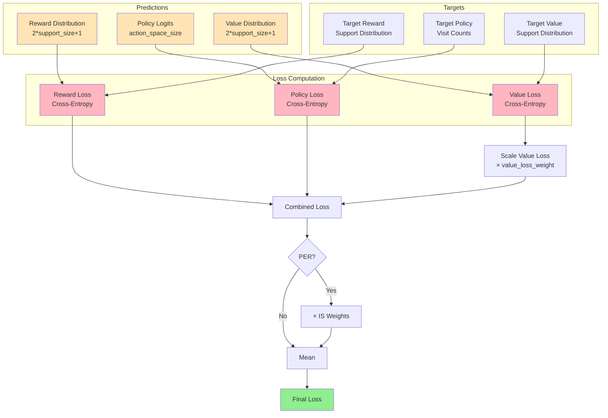

### Loss Function Details

#### Value Loss
- **Purpose**: Train the value network to predict expected returns
- **Type**: Cross-entropy between predicted and target value distributions
- **Scaling**: Multiplied by `value_loss_weight` (typically 0.25 per paper)
- **Target**: Discounted sum of future rewards + bootstrap value from MCTS

#### Reward Loss
- **Purpose**: Train the dynamics model to predict immediate rewards
- **Type**: Cross-entropy between predicted and target reward distributions
- **Special Case**: Ignored for the first step (no previous action)
- **Target**: Actual reward received after taking action

#### Policy Loss
- **Purpose**: Train the policy network to match MCTS visit distributions
- **Type**: Cross-entropy between predicted policy and MCTS visit counts
- **Target**: Normalized visit counts from MCTS search

#### Support Representation

MuZero uses a categorical representation for value and reward:

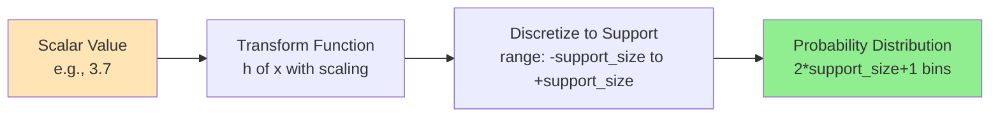

**Benefits:**
- More stable training than regression
- Better representation of value uncertainty
- Improved gradient flow

---

## Learning Rate Scheduling

### Exponential Decay Strategy

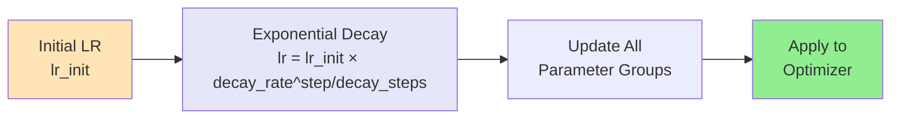

**Formula:**
```python
lr = lr_init * lr_decay_rate ** (training_step / lr_decay_steps)
```

**Typical Configuration:**
- `lr_init`: 0.001 - 0.02
- `lr_decay_rate`: 0.1 - 0.9
- `lr_decay_steps`: 10,000 - 350,000

**Update Frequency:** Every training step before weight update

---

## Gradient Management

### Gradient Scaling Strategies

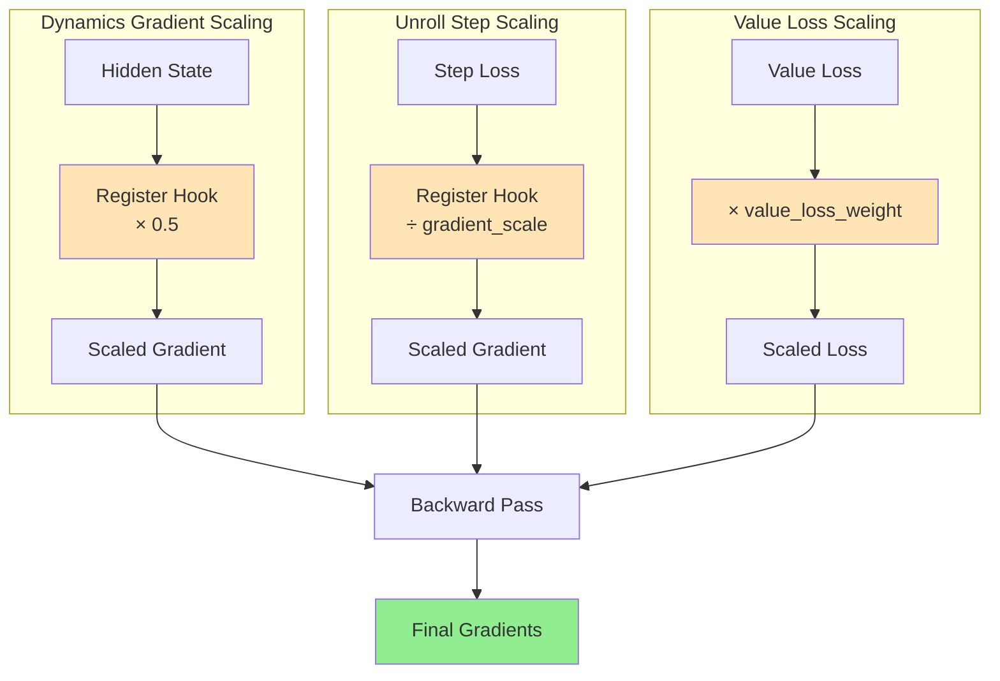

#### 1. Dynamics Function Gradient Scaling

**Purpose:** Prevent the dynamics function from dominating the gradient flow

**Implementation:**
```python
hidden_state.register_hook(lambda grad: grad * 0.5)
```

**Rationale:** The dynamics function is applied recursively, so its gradients can become disproportionately large

#### 2. Unroll Step Gradient Scaling

**Purpose:** Normalize gradients based on the number of valid unroll steps

**Implementation:**
```python
loss.register_hook(lambda grad: grad / gradient_scale_batch[:, i])
```

**Gradient Scale Calculation:**
```python
gradient_scale = min(num_unroll_steps, len(game_history) - current_position)
```

**Rationale:** Games of different lengths contribute different numbers of unroll steps; this normalizes their contribution

#### 3. Value Loss Weighting

**Purpose:** Balance the relative importance of value, reward, and policy losses

**Implementation:**
```python
loss = value_loss * value_loss_weight + reward_loss + policy_loss
```

**Typical Value:** 0.25 (as recommended in the MuZero paper appendix)

---

## Prioritized Experience Replay (PER)

### Priority Computation and Update Flow

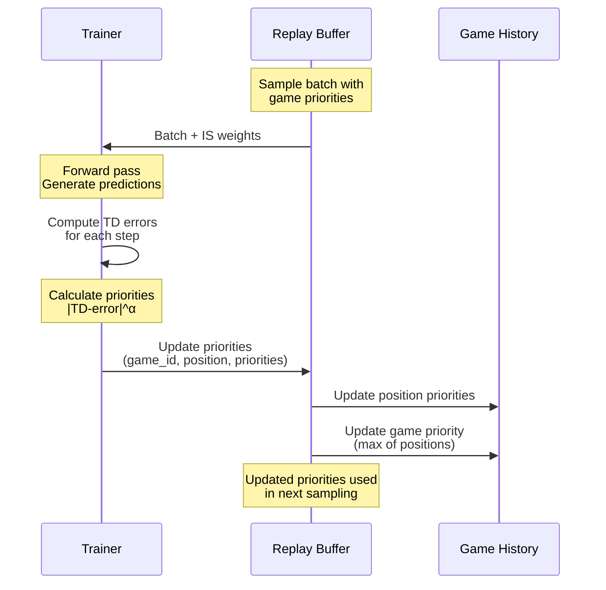

### Priority Calculation

**TD-Error Based Priorities:**
```python
# For each unroll step
pred_value = support_to_scalar(value_prediction)
target_value = target_value_scalar[:, i]
td_error = abs(pred_value - target_value)
priority = td_error ** PER_alpha
```

**Parameters:**
- `PER_alpha`: Controls priority exponent (typically 0.6 - 1.0)
- Higher alpha = more aggressive prioritization

### Importance Sampling Correction

**Purpose:** Correct bias introduced by non-uniform sampling

**Weight Calculation:**
```python
# In replay buffer during sampling
weight = 1 / (total_samples * game_prob * position_prob)

# Normalize by max weight
weight_batch = weight_batch / max(weight_batch)
```

**Application:**
```python
# In loss computation
loss *= weight_batch
```

---

## Training Ratio Control

### Self-Play vs Training Balance

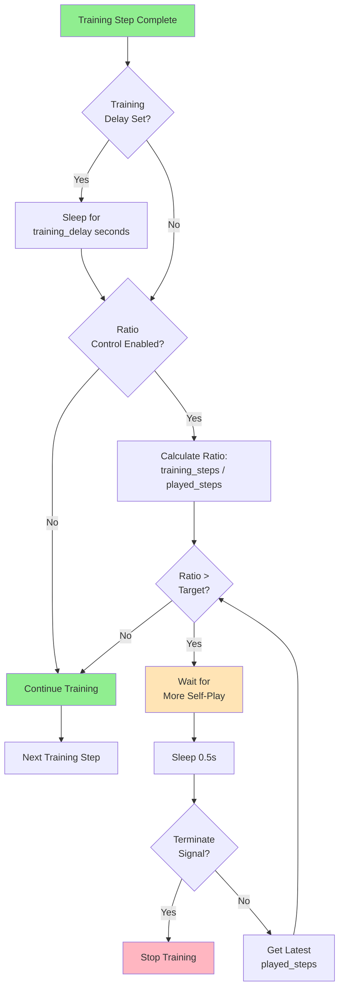

### Configuration Options

**1. Training Delay**
```python
if config.training_delay:
    time.sleep(config.training_delay)
```
- Fixed delay after each training step
- Simple but inflexible approach

**2. Ratio Control**
```python
ratio = training_steps / max(1, num_played_steps)
if ratio > config.ratio:
    # Wait for more self-play data
    time.sleep(0.5)
```
- Dynamic balancing based on actual progress
- Prevents training from outpacing data collection
- Typical ratio: 0.1 - 1.0

**Benefits:**
- Prevents overfitting to limited data
- Ensures fresh experiences are available
- Balances computational resources

---

## Checkpoint Management

### Save Strategy

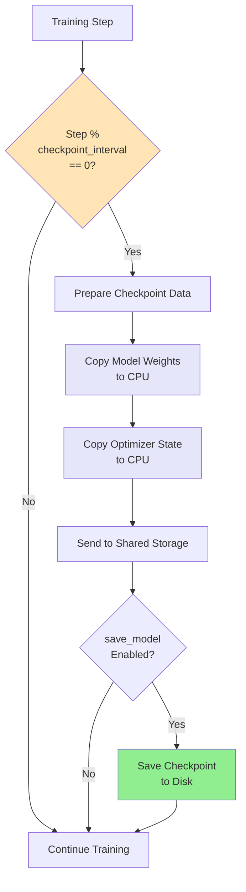

### Checkpoint Contents

**Saved to Shared Storage (Every Interval):**
```python
{
    "weights": model.get_weights(),           # Neural network parameters
    "optimizer_state": optimizer.state_dict() # Optimizer state (momentum, etc.)
}
```

**Saved to Disk (If Enabled):**
- Complete checkpoint including weights and optimizer state
- Allows resuming training from any checkpoint
- Stored at `config.results_path / "model.checkpoint"`

**Checkpoint Interval:**
- Configurable via `config.checkpoint_interval`
- Typical values: 10 - 1000 steps
- Trade-off between overhead and recovery granularity

---

## Training Metrics

### Metrics Tracked and Reported

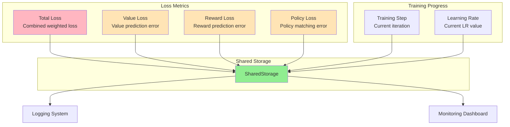

### Metrics Saved Each Step

```python
shared_storage.set_info.remote({
    "training_step": self.training_step,
    "lr": self.optimizer.param_groups[0]["lr"],
    "total_loss": total_loss,
    "value_loss": value_loss,
    "reward_loss": reward_loss,
    "policy_loss": policy_loss,
})
```

**Metric Descriptions:**

| Metric | Description | Typical Range |
|--------|-------------|---------------|
| `training_step` | Current training iteration | 0 - training_steps |
| `lr` | Current learning rate | 0.0001 - 0.02 |
| `total_loss` | Combined weighted loss | 0.1 - 10.0 |
| `value_loss` | Value prediction loss | 0.05 - 5.0 |
| `reward_loss` | Reward prediction loss | 0.01 - 2.0 |
| `policy_loss` | Policy matching loss | 0.05 - 5.0 |

**Usage:**
- Monitoring training progress
- Detecting training instabilities
- Hyperparameter tuning
- Debugging convergence issues

---

## Data Flow

### Complete Training Data Pipeline

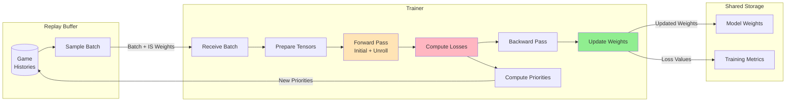

### Batch Data Structure

**Input Batch:**
```python
(
    observation_batch,      # [batch, channels, height, width]
    action_batch,          # [batch, num_unroll_steps+1]
    target_value,          # [batch, num_unroll_steps+1]
    target_reward,         # [batch, num_unroll_steps+1]
    target_policy,         # [batch, num_unroll_steps+1, action_space]
    weight_batch,          # [batch] (if PER enabled)
    gradient_scale_batch   # [batch, num_unroll_steps+1]
)
```

**Output:**
```python
(
    priorities,            # [batch, num_unroll_steps+1]
    total_loss,           # scalar
    value_loss,           # scalar
    reward_loss,          # scalar
    policy_loss           # scalar
)
```

---

## Configuration Parameters

### Key Training Hyperparameters

```python
class MuZeroConfig:
    # Optimizer settings
    optimizer: str = "Adam"              # "SGD" or "Adam"
    lr_init: float = 0.005              # Initial learning rate
    lr_decay_rate: float = 0.1          # LR decay rate
    lr_decay_steps: int = 350000        # Steps for one decay cycle
    momentum: float = 0.9               # SGD momentum (if using SGD)
    weight_decay: float = 1e-4          # L2 regularization
    
    # Training loop
    training_steps: int = 1000000       # Total training steps
    checkpoint_interval: int = 100      # Steps between checkpoints
    save_model: bool = True             # Save checkpoints to disk
    train_on_gpu: bool = True           # Use GPU for training
    
    # Batch configuration
    batch_size: int = 128               # Samples per training step
    num_unroll_steps: int = 5           # Steps to unroll dynamics
    td_steps: int = 10                  # Steps for TD target
    
    # Loss weights
    value_loss_weight: float = 0.25     # Scale factor for value loss
    
    # PER settings
    PER: bool = True                    # Enable prioritized replay
    PER_alpha: float = 0.6              # Priority exponent
    
    # Training ratio control
    ratio: float = None                 # Training/self-play ratio (None=disabled)
    training_delay: float = 0           # Fixed delay per step (seconds)
    
    # Support size for value/reward
    support_size: int = 300             # Categorical support range
    
    # Random seed
    seed: int = 0                       # Random seed for reproducibility
```

### Parameter Tuning Guidelines

**Learning Rate:**
- Start with `lr_init = 0.005` for most games
- Increase for simple games, decrease for complex ones
- Monitor loss curves for instability

**Batch Size:**
- Larger batches = more stable gradients but slower iteration
- Typical range: 64 - 512
- Limited by GPU memory

**Unroll Steps:**
- More steps = better credit assignment but more computation
- Typical range: 5 - 10
- Should be ≤ typical game length

**Value Loss Weight:**
- Paper recommends 0.25
- Increase if value predictions are poor
- Decrease if value dominates training

**PER Alpha:**
- Higher = more aggressive prioritization
- 0.0 = uniform sampling
- 0.6 - 1.0 typical range

---

## Integration with Other Modules

### Module Dependencies

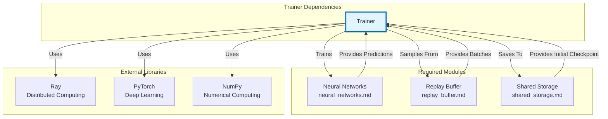

### Communication Patterns

**With Replay Buffer:**
```python
# Asynchronous batch retrieval
next_batch = replay_buffer.get_batch.remote()
index_batch, batch = ray.get(next_batch)

# Priority updates
replay_buffer.update_priorities.remote(priorities, index_batch)
```

**With Shared Storage:**
```python
# Read operations
num_games = ray.get(shared_storage.get_info.remote("num_played_games"))
terminate = ray.get(shared_storage.get_info.remote("terminate"))

# Write operations
shared_storage.set_info.remote({
    "weights": model.get_weights(),
    "training_step": training_step,
    "total_loss": total_loss
})
shared_storage.save_checkpoint.remote()
```

**With Neural Networks:**
```python
# Model operations
model = models.MuZeroNetwork(config)
model.set_weights(checkpoint["weights"])
model.to(device)
model.train()

# Inference
value, reward, policy, hidden = model.initial_inference(observation)
value, reward, policy, hidden = model.recurrent_inference(hidden, action)
```

---

## Performance Considerations

### Optimization Strategies

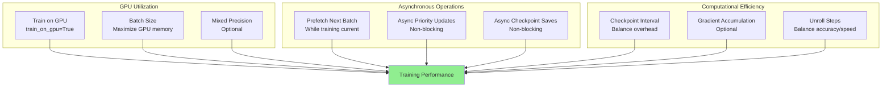

### Performance Tips

**1. GPU Utilization**
- Always train on GPU if available (`train_on_gpu=True`)
- Maximize batch size within GPU memory limits
- Monitor GPU utilization (should be >80%)

**2. Asynchronous Batch Retrieval**
```python
# Prefetch next batch while training current
next_batch = replay_buffer.get_batch.remote()
# ... train on current batch ...
index_batch, batch = ray.get(next_batch)  # Minimal wait
```

**3. Checkpoint Frequency**
- More frequent = more overhead but better recovery
- Less frequent = less overhead but more lost progress
- Typical: every 100-1000 steps

**4. Training Ratio**
- Set `ratio` to prevent training from outpacing self-play
- Typical: 0.1 - 1.0 (training steps per self-play step)
- Monitor `training_step / num_played_steps`

**5. Batch Size Scaling**
- Larger batches improve GPU utilization
- May need to adjust learning rate (linear scaling rule)
- Limited by GPU memory

### Typical Performance Metrics

| Configuration | Training Speed | GPU Utilization |
|---------------|----------------|-----------------|
| Small Network (FC) | 100-200 steps/sec | 60-80% |
| Medium Network (ResNet) | 20-50 steps/sec | 80-95% |
| Large Network (ResNet) | 5-15 steps/sec | 90-99% |

*Note: Speeds depend on hardware, batch size, and unroll steps*

---

## Error Handling and Edge Cases

### Common Issues and Solutions

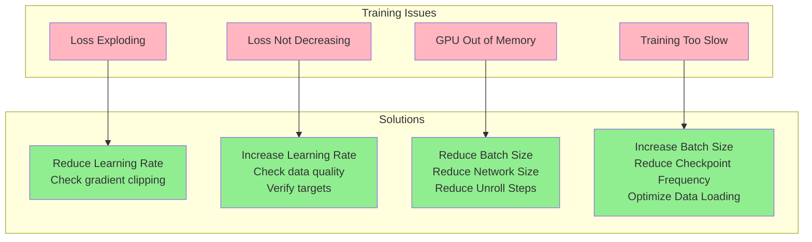

### Edge Case Handling

**1. Empty Replay Buffer**
```python
# Wait for games to be played
while ray.get(shared_storage.get_info.remote("num_played_games")) < 1:
    time.sleep(0.1)
```

**2. Termination Signal**
```python
# Check for early termination
while training_step < max_steps and not ray.get(
    shared_storage.get_info.remote("terminate")
):
    # Training loop
```

**3. Device Mismatch**
```python
# Warn if not training on GPU
if "cuda" not in str(next(self.model.parameters()).device):
    print("You are not training on GPU.\n")
```

**4. Optimizer State Loading**
```python
# Handle missing optimizer state
if initial_checkpoint["optimizer_state"] is not None:
    print("Loading optimizer...\n")
    self.optimizer.load_state_dict(initial_checkpoint["optimizer_state"])
```

**5. Gradient Numerical Stability**
```python
# Use cross-entropy instead of MSE for better stability
value_loss = (-target_value * torch.nn.LogSoftmax(dim=1)(value)).sum(1)
```

---

## Best Practices

### Training Configuration

✅ **DO:**
- Start with default hyperparameters from paper
- Use GPU training for significant speedup
- Enable PER for sample efficiency
- Monitor all loss components separately
- Save checkpoints regularly
- Use exponential learning rate decay
- Balance training/self-play ratio

❌ **DON'T:**
- Train on CPU for large networks
- Use very large learning rates
- Ignore loss divergence warnings
- Skip checkpoint saving
- Set batch size too small (<32)
- Disable PER without good reason

### Debugging Training

**Monitor These Metrics:**
1. **Total Loss**: Should decrease over time
2. **Value Loss**: Should stabilize at reasonable level
3. **Reward Loss**: Should be small (rewards are sparse)
4. **Policy Loss**: Should decrease as policy improves
5. **Learning Rate**: Should decay smoothly
6. **Training/Self-Play Ratio**: Should stay near target

**Warning Signs:**
- Loss suddenly increases → reduce learning rate
- Loss plateaus early → increase learning rate or check data
- GPU utilization low → increase batch size
- Training much faster than self-play → adjust ratio

### Code Example: Custom Training Loop

```python
import ray
from knowledge.trainer import Trainer
from knowledge.shared_storage import SharedStorage
from knowledge.replay_buffer import ReplayBuffer

# Initialize Ray
ray.init()

# Create initial checkpoint
initial_checkpoint = {
    "weights": None,  # Will be initialized by network
    "optimizer_state": None,
    "training_step": 0,
    "num_played_games": 0,
    "num_played_steps": 0
}

# Create actors
shared_storage = SharedStorage.remote(initial_checkpoint, config)
replay_buffer = ReplayBuffer.remote(initial_checkpoint, {}, config)
trainer = Trainer.remote(initial_checkpoint, config)

# Start training
trainer.continuous_update_weights.remote(replay_buffer, shared_storage)

# Monitor progress
while True:
    info = ray.get(shared_storage.get_info.remote([
        "training_step", "total_loss", "value_loss"
    ]))
    print(f"Step: {info['training_step']}, "
          f"Loss: {info['total_loss']:.4f}, "
          f"Value: {info['value_loss']:.4f}")
    time.sleep(10)
```

---

## Related Modules

- **[Neural Networks](neural_networks.md)**: Network architectures trained by this module
- **[Replay Buffer](replay_buffer.md)**: Source of training batches and priority updates
- **[Shared Storage](shared_storage.md)**: Storage for model weights and training metrics
- **[Self-Play MCTS](self_play_mcts.md)**: Generates training data through game play
- **[Main Orchestrator](main_orchestrator.md)**: Coordinates trainer with other components

---

## References

### MuZero Paper
- **Title**: Mastering Atari, Go, Chess and Shogi by Planning with a Learned Model
- **Authors**: Julian Schrittwieser et al.
- **Link**: https://arxiv.org/abs/1911.08265
- **Key Sections**: 
  - Appendix B: Training
  - Appendix D: Reanalyze
  - Appendix F: Hyperparameters

### Related Papers
- **Prioritized Experience Replay**: https://arxiv.org/abs/1511.05952
- **Distributed Prioritized Experience Replay**: https://arxiv.org/abs/1803.00933

### Implementation Details
- PyTorch Documentation: https://pytorch.org/docs/
- Ray Documentation: https://docs.ray.io/

---

## Summary

The **Trainer** module is the optimization engine of MuZero, implementing sophisticated training algorithms that enable the system to learn effective value, policy, and dynamics models from self-play experience. Key features include:

- **Continuous Training**: Runs concurrently with self-play in a dedicated thread
- **Multi-Step Unrolling**: Trains dynamics model through recurrent inference
- **Multi-Head Losses**: Simultaneously optimizes value, reward, and policy predictions
- **Prioritized Replay**: Focuses learning on high-error transitions
- **Gradient Management**: Careful scaling for stable training
- **Flexible Configuration**: Extensive hyperparameters for tuning

The module's design balances training efficiency, sample efficiency, and numerical stability, making it a critical component in MuZero's ability to master complex domains through self-play reinforcement learning.
